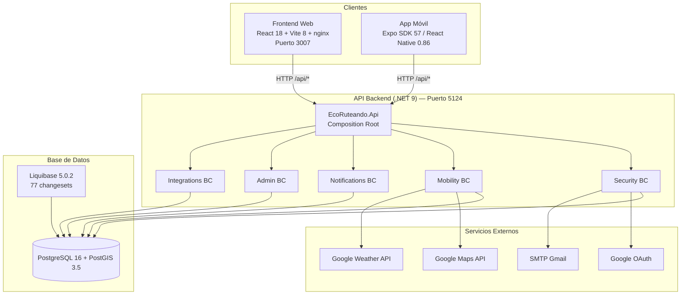

# EcoRuteando: Diseño, Implementación y Aseguramiento de Calidad de una Plataforma de Movilidad Sostenible Basada en Arquitectura Orientada a Dominios y Despliegue en la Nube

---

**EcoRuteando: Design, Implementation and Quality Assurance of a Sustainable Mobility Platform Based on Domain-Driven Architecture and Cloud Deployment**

---

| Campo | Valor |
|-------|-------|
| **Tipo de documento** | Artículo técnico-científico |
| **Área** | Ingeniería de Software / Sistemas Distribuidos |
| **Fecha** | 13 de octubre de 2026 |
| **Estado** | Para revisión por pares |

---

## Resumen

Este artículo presenta el diseño, implementación y aseguramiento de calidad de EcoRuteando, una plataforma de movilidad sostenible para la planificación de rutas ecológicas en entornos urbanos. El sistema integra una API REST en .NET 9 con Domain-Driven Design, Clean Architecture y CQRS mediante MediatR; una base de datos PostgreSQL 16 con PostGIS 3.5 gestionada por 77 migraciones Liquibase en 6 esquemas; una aplicación web SPA en React 18 con Vite 8; y una app móvil con Expo SDK 57. La infraestructura de producción se despliega en Render, Vercel y EAS Build. El aseguramiento de calidad comprende 129 casos de prueba en cuatro niveles: humo (15), integración técnica (33), integridad de base de datos (35) y aceptación de usuario (46), alcanzando un 96.9% de éxito global. Se reportan los resultados, los hallazgos de auditoría técnica y las líneas futuras.

**Palabras clave:** movilidad sostenible, arquitectura orientada a dominios, Clean Architecture, CQRS, PostgreSQL, PostGIS, aseguramiento de calidad, despliegue continuo.

---

**Abstract**

This article presents the design, implementation and quality assurance of EcoRuteando, a sustainable mobility platform for ecological route planning in urban environments. The system integrates a REST API built with .NET 9 following Domain-Driven Design (DDD) and Clean Architecture with the CQRS pattern using MediatR, a PostgreSQL 16 database extended with PostGIS 3.5 for geospatial operations and managed through 77 Liquibase migrations distributed across 6 logical schemas, a web SPA application developed with React 18 and Vite 8, and a mobile application built with Expo SDK 57 and React Native. Production infrastructure is deployed on Render (backend and database), Vercel (frontend), and EAS Build (mobile). The quality assurance process comprises 129 test cases distributed across four levels: smoke (15), technical integration (33), database integrity (35) and user acceptance (46), with defined closure criteria for production release authorization. The obtained results, technical audit findings, and future work lines are reported.

**Keywords:** sustainable mobility, domain-driven design, Clean Architecture, CQRS, PostgreSQL, PostGIS, quality assurance, continuous deployment.

---

## 1. Introducción

### 1.1 Contexto del problema

La movilidad urbana constituye uno de los principales desafíos de las ciudades contemporáneas. Según el Panel Intergubernamental de Cambio Climático [1], el sector del transporte representa aproximadamente el 16% de las emisiones globales de gases de efecto invernadero, con una tendencia al alza en las décadas recientes. En América Latina, el transporte privado motorizado concentra más del 70% de los desplazamientos urbanos en ciudades medianas [2], generando no solo impactos ambientales significativos sino también problemas de congestión, calidad del aire y salud pública.

Los usuarios de transporte carecen frecuentemente de herramientas que les permitan evaluar el impacto ambiental de sus decisiones de movilidad en tiempo real. Si bien existen aplicaciones de navegación como Google Maps o Waze, estas priorizan fundamentalmente el tiempo de viaje sin ofrecer una perspectiva orientada a la sostenibilidad que considere la estimación de emisiones de dióxido de carbono (CO₂), el ahorro energético o los beneficios para la salud asociados a la actividad física [3].

### 1.2 Justificación de la solución

EcoRuteando surge como respuesta a esta necesidad, ofreciendo una plataforma integral que permite a los usuarios:

1. **Planificar rutas ecológicas** comparando múltiples modos de transporte (a pie, bicicleta, transporte público y vehículo particular) con estimaciones cuantitativas de CO₂ emitido y calorías quemadas.
2. **Reportar obstáculos urbanos** mediante fotografías y geolocalización, contribuyendo a la información colectiva sobre el estado de la infraestructura de movilidad.
3. **Recibir alertas climáticas** contextualizadas a lo largo de su ruta planificada.
4. **Gestionar su historial de viajes** con estadísticas acumuladas de impacto ambiental positivo.

La plataforma se diseña como un sistema distribuido de cuatro componentes —backend, base de datos, frontend web y aplicación móvil— que operan de forma coordinada sobre infraestructura en la nube, permitiendo la escalabilidad horizontal y la disponibilidad continua del servicio.

### 1.3 Objetivos

**Objetivo general:**

Diseñar, implementar y validar una plataforma de movilidad sostenible que integre arquitectura orientada a dominios, tecnologías geoespaciales y procesos formales de aseguramiento de calidad.

**Objetivos específicos:**

| # | Objetivo específico |
|---|-------------------|
| O1 | Aplicar Domain-Driven Design y Clean Architecture con CQRS para organizar la lógica de negocio en cinco bounded contexts independientes |
| O2 | Integrar PostGIS y Google Maps API para operaciones geoespaciales de planificación de rutas |
| O3 | Establecer un proceso formal de migración de base de datos mediante Liquibase con control de versiones de esquema |
| O4 | Diseñar una estrategia de despliegue en la nube multiplataforma (Render, Vercel, EAS) |
| O5 | Ejecutar un plan de aseguramiento de calidad de 129 casos de prueba con criterios de cierre formales |
| O6 | Documentar los procedimientos de implantación, respaldo y mantenimiento post-lanzamiento |

### 1.4 Estructura del artículo

El artículo se organiza en siete secciones. La Sección 2 describe la arquitectura del sistema y las tecnologías empleadas. La Sección 3 presenta la metodología de implantación. La Sección 4 detalla el aseguramiento de calidad y los resultados de pruebas. La Sección 5 discute los hallazgos y aportes. La Sección 6 presenta las conclusiones y líneas futuras. La Sección 7 lista las referencias bibliográficas.

---

## 2. Arquitectura del Sistema y Tecnologías

### 2.1 Visión general de la arquitectura

EcoRuteando adopta una arquitectura de **microservicios moderados** organizada en cuatro componentes desplegables independientes que se comunican exclusivamente mediante HTTP/REST y conexiones TCP a la base de datos. No existe comunicación directa entre el frontend y la aplicación móvil; ambos consumen la misma API REST.



**Figura 1.** Arquitectura de componentes de EcoRuteando.

### 2.2 Backend: API REST con DDD y Clean Architecture

El backend está construido sobre **.NET 9** y se organiza en **23 proyectos** distribuidos en una solución Visual Studio. La arquitectura sigue estrictamente los principios de **Domain-Driven Design** [4] y **Clean Architecture** [5] con el patrón **CQRS** (Command Query Responsibility Segregation) [6] implementado mediante **MediatR 14.1.0**.

#### 2.2.1 Bounded Contexts

El dominio se divide en **5 bounded contexts** independientes, cada uno con su propio `DbContext` de Entity Framework Core, sus entidades, sus repositorios y su esquema de base de datos:

| Bounded Context | Esquema BD | Responsabilidad |
|----------------|-----------|----------------|
| **Security** | `security` | Autenticación, autorización, usuarios, roles, permisos, sesiones, 2FA, OAuth, auditoría |
| **Mobility** | `mobility` + `community` | Rutas, POIs, viajes, favoritos, calificaciones, reportes de obstáculos, estadísticas |
| **Notifications** | `notifications` | Notificaciones in-app, push, plantillas, tokens de dispositivo |
| **Admin** | `admin` | Estadísticas consolidadas, exportes, configuración del sistema, soporte |
| **Integrations** | `integrations` | Caché de APIs externas, datos meteorológicos, calidad del aire |

**Independencia verificada:** No existe ninguna referencia cruzada entre bounded contexts en el código fuente. Cada módulo se comunica con los demás únicamente a través de la base de datos y la API HTTP.

#### 2.2.2 Capas de Clean Architecture

Cada bounded context implementa **4 capas** con dependencias unidireccionales:

```
Presentation (Controllers) → Application (Commands/Queries/Handlers) → Domain (Entities/Enums/Repository Interfaces)
                                         ↓
                                  Infrastructure (EF Core, External Services)
```

| Capa | Proyectos | Dependencias | NuGet notable |
|------|-----------|-------------|---------------|
| **Domain** | `*.Domain` | Solo `Shared` | Npgsql, NetTopologySuite |
| **Application** | `*.Application` | Domain + Shared | MediatR 14.1.0, FluentValidation 11.11.0 |
| **Infrastructure** | `*.Infrastructure` | Application + Domain + Shared | EF Core 9.0, BCrypt, MailKit |
| **Presentation** | `*.Presentation` | Solo Application | ASP.NET Core FrameworkReference |

**Verificación de dependencias:** La dirección Presentation → Application → Domain es correcta verificada en los archivos `.csproj`. Presentation nunca referencia Infrastructure directamente.

#### 2.2.3 Patrón CQRS con MediatR

El patrón CQRS separa operaciones de escritura (Commands) de lectura (Queries) mediante el patrón **Vertical Slice Architecture**:

```
Application/
├── Routes/
│   ├── Commands/
│   │   ├── CreateRoute/
│   │   │   ├── CreateRouteCommand.cs          # record : IRequest<Guid>
│   │   │   ├── CreateRouteCommandHandler.cs   # IRequestHandler<...>
│   │   │   └── CreateRouteCommandValidator.cs # AbstractValidator
│   │   ├── UpdateRoute/
│   │   └── DeleteRoute/
│   └── Queries/
│       ├── GetRoutes/
│       │   ├── GetRoutesQuery.cs              # record : IRequest<IReadOnlyList<...>>
│       │   ├── GetRoutesQueryHandler.cs
│       │   └── GetRoutesResponse.cs           # DTO
│       └── GetRouteById/
```

| Métrica CQRS | Cantidad |
|-------------|---------|
| Command records | 67 |
| Query records | 47 |
| Response/DTO records | 48 |
| Validators FluentValidation | 24 |
| Pipeline Behaviors registrados | Security, Mobility |

#### 2.2.4 Entidades y Raíces de Agregado

Las entidades extienden una clase base genérica `Entity<TId>` con identidad basada en UUID y timestamps. Las raíces de agregado identificadas gestionan invariantes de negocio:

| Raíz de Agregado | Contexto | Invariante gestionado |
|-----------------|---------|----------------------|
| `User` | Security | Escalación de bloqueo de cuenta (`LockoutEscalationSeconds = {30, 60, 300, 900}`) |
| `Route` | Mobility | `AddPoi()` rechaza POIs duplicados |
| `RouteUsage` | Mobility | `Complete()` impide finalizar dos veces; `EndedAt >= StartedAt` |
| `SupportTicket` | Admin | `AddMessage()` encapsula lista interna |
| `ObstacleReport` | Mobility | `Validate()` impide autovotación |

#### 2.2.5 Autorización

El sistema implementa **RBAC (Role-Based Access Control)** con dos niveles:

1. **Roles:** `User`, `Admin` (sembrados por Liquibase)
2. **Permisos granulares:** 22 permisos distribuidos en 8 categorías

| Categoría | Permisos |
|-----------|----------|
| Rutas | `routes.read`, `routes.write`, `routes.delete` |
| POIs | `pois.read`, `pois.write` |
| Estadísticas | `stats.read` |
| Reportes | `reports.read`, `reports.create`, `reports.vote`, `reports.validate` |
| Roles | `roles.read`, `roles.create`, `roles.update`, `roles.delete` |
| Permisos | `permissions.read`, `permissions.create`, `permissions.update`, `permissions.delete` |
| Asignación | `rolepermissions.read`, `rolepermissions.assign`, `rolepermissions.remove` |
| Sistema | `systemconfig.read` |

La verificación de permisos se realiza mediante `[HasPermission("nombre.permiso")]` resuelto por un `PermissionPolicyProvider` dinámico en el Shared Kernel.

### 2.3 Base de Datos: PostgreSQL + PostGIS + Liquibase

#### 2.3.1 Esquema de datos

La base de datos `ecoRuteando_db` contiene **6 esquemas lógicos**, **36 tablas**, **17 tipos ENUM** y **5 extensiones PostgreSQL**:

| Esquema | Tablas | Propósito |
|---------|--------|-----------|
| `security` | 14 | Users, roles, permissions, refresh_tokens, sessions, 2FA, audit, policies |
| `mobility` | 10 | Routes, POIs, favorites, ratings, shared_routes, trip_history |
| `community` | 5 | Obstacle_reports, report_votes, alerts |
| `admin` | 6 | Statistics, exports, config, transport_factors, support_tickets |
| `integrations` | 3 | Api_cache, weather_data, air_quality_data |
| `notifications` | 3 | Notifications, templates, device_tokens |

**Extensiones habilitadas:**

| Extensión | Propósito |
|-----------|-----------|
| `postgis` | Tipos geoespaciales (`GEOGRAPHY(POINT/LINESTRING, 4326)`) |
| `pgcrypto` | Generación de UUIDs (`gen_random_uuid()`) |
| `unaccent` | Normalización de texto para búsqueda |
| `pg_trgm` | Búsqueda por similitud (trigram) |
| `citext` | Columnas case-insensitive (`users.email`) |

#### 2.3.2 Control de versiones de esquema con Liquibase

El esquema está gestionado por **Liquibase 5.0.2** mediante un changelog maestro que orquesta **77 changesets**:

```
EcoRuteandoDb/
├── changelog/db.changelog-master.yaml    # Master changelog
├── 01_ddl/
│   ├── 01_extensions/                    # 5 extensiones
│   ├── 02_schemas/                       # 6 esquemas
│   ├── 03_tables/                        # 36 tablas
│   └── 04_indexes_constraints/           # Índices y FKs
└── 02_dml/
    └── seeds/                            # Roles, permisos, políticas
```

Cada changeset incluye bloques `<preConditions>` y `<rollback>` para garantizar la idempotencia y la reversibilidad de las migraciones.

### 2.4 Frontend Web: React + Vite

| Tecnología | Versión | Propósito |
|-----------|---------|-----------|
| React | 18.2 | Biblioteca de UI |
| Vite | 8.0 | Bundler y dev server |
| Tailwind CSS | 3.4 | Estilos utilitarios |
| React Router | 7.x | Enrutamiento SPA |
| axios | 1.x | Cliente HTTP con interceptor JWT |
| nginx | alpine | Servidor estático + proxy reverso |

La arquitectura del frontend sigue un patrón **feature-based** con separación por dominio funcional:

```
src/
├── features/          # auth/, home/, routes/, admin/
│   └── [feature]/
│       ├── pages/
│       ├── components/
│       └── hooks/
├── shared/
│   ├── components/
│   ├── hooks/
│   ├── i18n/          # Internacionalización (ES/EN)
│   └── services/
└── App.jsx
```

En producción, nginx actúa como proxy reverso redirigiendo `/api/*` al backend en Render.

### 2.5 Aplicación Móvil: Expo / React Native

| Tecnología | Versión |
|-----------|---------|
| Expo SDK | 57.0.24 |
| React Native | 0.86.3 |
| expo-router | ~6.x |
| expo-secure-store | 14.x |
| expo-image-picker | 17.x |
| expo-file-system | 19.x |

La autenticación utiliza `expo-secure-store` para almacenamiento seguro de tokens JWT con claves segmentadas por usuario (`auth_token_{userId}`), y un interceptor de axios implementa refresh token automático.

### 2.6 Stack tecnológico consolidado

| Componente | Tecnología | Versión |
|-----------|-----------|---------|
| Runtime backend | .NET | 9.0 |
| ORM | Entity Framework Core | 9.0 |
| CQRS | MediatR | 14.1.0 |
| Validación | FluentValidation | 11.1.0 |
| Contraseñas | BCrypt.Net-Next | 4.x |
| Correo | MailKit | 4.x |
| Auth JWT | JwtBearer | 9.0.0 |
| Base de datos | PostgreSQL + PostGIS | 16 + 3.5 |
| Migraciones | Liquibase | 5.0.2 |
| Frontend | React + Vite | 18 + 8.0 |
| Móvil | Expo + React Native | 57 + 0.86 |
| Contenedores | Docker + Compose | 29.x + v2 |
| Backend cloud | Render | — |
| Frontend cloud | Vercel | — |
| Móvil cloud | EAS Build | — |

### 2.7 Inventario de endpoints

| Módulo | Controllers | Endpoints | Con autenticación | Con permiso granular |
|--------|------------|-----------|-------------------|---------------------|
| Security | 8 | ~40 | 32 | ~15 |
| Mobility | 11 | ~35 | 29 | ~25 |
| Notifications | 2 | 8 | 8 | 0 |
| Admin | 5 | ~18 | 16 | 0 |
| Integrations | 3 | 9 | 7 | 0 |
| **Total** | **29** | **~110** | **92** | **~40** |

---

## 3. Metodología de Implantación

### 3.1 Proceso formal de despliegue

La implantación en producción sigue un proceso de **7 fases** documentado en el "Procedimiento de Implantación del Software":

| Fase | Actividad | Responsable principal |
|------|-----------|----------------------|
| 1 | Planeación y verificación de infraestructura | DevOps Engineer |
| 2 | Preparación del entorno y aprovisionamiento de secretos | DevOps Engineer |
| 3 | Migración y respaldo de datos | Tech Lead |
| 4 | Despliegue y configuración del software | DevOps Engineer |
| 5 | Pruebas de aceptación y verificación | QA Engineer |
| 6 | Capacitación y entrega formal | Tech Lead + Cliente |
| 7 | Mantenimiento y monitoreo continuo | DevOps Engineer |

### 3.2 Estrategia de ramas y control de versiones

```
main (producción)
 └── develop (integración)
      └── qa (ambiente QA)
           └── HU-XX-nombre (desarrollo)
```

| Tipo de rama | Convención | Ejemplo |
|-------------|-----------|---------|
| Historia de usuario | `HU-XX-descripcion` | `HU-06-gestion-pois` |
| Base de datos | `DB-XX-descripcion` | `DB-06-gestion-pois` |
| Fix | `fix/descripcion` | `fix/enum-pgname-security` |
| QA | Sufijo `-qa` | `HU-06-gestion-pois-qa` |

Los merges a `develop` y `qa` se realizan exclusivamente mediante **Pull Requests** con revisión de código. El orden de integración es **DB → Backend → Frontend**.

### 3.3 Control de versiones de base de datos

#### 3.3.1 Migraciones con Liquibase

Cada cambio de esquema (DDL, DML, seeds) se implementa como un changeset nuevo en `EcoRuteandoDb`, siguiendo la nomenclatura `DB-XX-...`:

```xml
<changeSet id="020-add-user-status-index" author="dev">
    <preConditions onFail="MARK_RAN">
        <not><indexExists indexName="idx_users_status" schemaName="security"/></not>
    </preConditions>
    <createIndex indexName="idx_users_status" tableName="users" schemaName="security">
        <column name="status"/>
    </createIndex>
    <rollback>
        <dropIndex indexName="idx_users_status" tableName="users" schemaName="security"/>
    </rollback>
</changeSet>
```

**Procedimiento de ejecución:**

```bash
# 1. Validar changelog (dry run)
liquibase validate --changeLogFile=changelog/db.changelog-master.yaml

# 2. Verificar cambios pendientes
liquibase status

# 3. Aplicar migraciones
liquibase update

# 4. Verificar
SELECT COUNT(*) FROM databasechangelog;  -- Debe ser 77
```

#### 3.3.2 Plan de rollback

| Escenario | Acción | Herramienta |
|-----------|--------|-------------|
| Changeset fallido | Rollback del último changeset | `liquibase rollbackCount 1` |
| Migración parcial | Rollback hasta fecha específica | `liquibase rollbackToDate <date>` |
| Fallo crítico | Restauración completa desde backup | `pg_restore --clean` |

### 3.4 Plan de respaldos

#### 3.4.1 Objetivos de recuperación

| Objetivo | Valor | Justificación |
|----------|-------|---------------|
| **RPO** (pérdida máxima aceptable) | 0 datos | Backup completo antes de cada despliegue |
| **RTO** (recuperación máxima aceptable) | 30 minutos | Restauración desde backup reciente |
| **Retención** | 30 días | Cumplimiento de auditoría |
| **Almacenamiento** | 2 ubicaciones mínimo | Local (Render) + externo |

#### 3.4.2 Procedimiento de backup

```bash
#!/bin/bash
# Backup pre-despliegue con verificación de integridad
pg_dump -h ${DB_HOST} -p ${DB_PORT} -U ${DB_USER} -d ${DB_NAME} \
  --format=custom --compress=9 \
  --file=${BACKUP_DIR}/ecoruteando_${TIMESTAMP}.sql.gz

# Verificar tamaño mínimo
FILESIZE=$(stat -c%s "${BACKUP_FILE}")
[ "$FILESIZE" -lt 1048576 ] && exit 1  # > 1 MB

# Verificar integridad
pg_restore --list ${BACKUP_FILE} > /dev/null 2>&1 || exit 1

# SHA256 para verificación posterior
sha256sum ${BACKUP_FILE}
```

### 3.5 Gestión de riesgos

| Riesgo | Probabilidad | Impacto | Mitigación |
|--------|-------------|---------|------------|
| Pérdida de datos en migración | Media | Crítico | Backup pre-despliegue + rollback Liquibase |
| Filtración de secretos | Media | Crítico | `.env` en `.gitignore`, Secret Scanning, rotación 90 días |
| Caída de APIs externas | Baja | Alto | Circuit Breaker (Polly), caché TTL, timeout 10s |
| Regresión en lógica de negocio | Media | Alto | Code review obligatorio, suite de pruebas automatizadas |
| Indisponibilidad del backend | Baja | Alto | `restart: unless-stopped`, health checks, monitoreo 24/7 |

### 3.6 Ventana de mantenimiento

El despliegue inicial se programa en una ventana de **4-6 horas** (sábado 01:00–07:00 GMT-5) con el siguiente cronograma:

| Hora | Actividad |
|------|-----------|
| T-24h | Backup preventivo completo |
| T-2h | Notificación a usuarios |
| T+0:15 | Backup final pre-despliegue |
| T+0:30 | Migraciones Liquibase |
| T+1:00 | Despliegue de Backend |
| T+1:30 | Despliegue de Frontend |
| T+2:00 | Pruebas de humo |
| T+3:00 | Pruebas de aceptación (UAT) |
| T+4:00 | Build de App Móvil |
| T+5:00 | Go-Live |
| T+24h | Verificación post-implantación |

---

## 4. Aseguramiento de Calidad y Resultados de Pruebas

### 4.1 Estrategia de aseguramiento de calidad

La estrategia de QA se estructura en **4 niveles** jerárquicos con **129 casos de prueba**:

| Nivel | Tipo | Volumen | Herramientas | Objetivo |
|-------|------|---------|-------------|----------|
| 1 | Pruebas de humo | 15 | cURL, Swagger, navegador | Verificar salud post-despliegue |
| 2 | Integración técnica | 33 | cURL, Swagger, psql | Validar conectividad y lógica de negocio |
| 3 | Integración con BD | 35 | SQL directo (psql) | Verificar integridad de esquema |
| 4 | Aceptación de usuario (UAT) | 46 | Manual (navegador + móvil) | Validar flujos de usuario |
| **Total** | | **129** | | |

### 4.2 Resultados de pruebas de humo (Smoke Tests)

Las pruebas de humo verifican la salud básica del sistema inmediatamente después del despliegue:

| ID | Prueba | Criterio de aceptación | Resultado |
|----|--------|----------------------|-----------|
| S-01 | Backend responde | HTTP 200 en `/api/test/public` | PASS |
| S-02 | Frontend carga | Página de login visible | PASS |
| S-03 | PostgreSQL activo | `accepting connections` | PASS |
| S-04 | Liquibase completado | 77 changesets aplicados | PASS |
| S-05 | Swagger accesible | HTTP 200 en `/swagger` | PASS |
| S-06 | Proxy nginx funciona | Respuesta backend vía puerto 3007 | PASS |
| S-07 | Login admin válido | HTTP 200 con JWT | PASS |
| S-08 | Login inválido rechazado | HTTP 401 | PASS |
| S-09 | Endpoint protegido con token | HTTP 200 con datos usuario | PASS |
| S-10 | Endpoint protegido sin token | HTTP 401 | PASS |
| S-11 | Refresh token funciona | HTTP 200 con nuevo token | PASS |
| S-12 | Roles seed existen | ≥ 2 roles (User, Admin) | PASS |
| S-13 | Permisos seed existen | 22 permisos | PASS |
| S-14 | Admin seed con rol Admin | 1 fila con `role = Admin` | PASS |
| S-15 | Factores transporte seed | ≥ 4 factores | PASS |

**Resultado: 15/15 PASS (100%)**

### 4.3 Resultados de pruebas de integración técnica

Las pruebas de integración validan la comunicación entre componentes, APIs externas y lógica de negocio:

| Categoría | IDs | Total | PASS | FAIL |
|-----------|-----|-------|------|------|
| Backend ↔ BD | I-01 a I-04 | 4 | 4 | 0 |
| Google Maps API | I-05 a I-10 | 6 | 6 | 0 |
| Google Weather API | I-11 a I-13 | 3 | 3 | 0 |
| OAuth Google | I-14 a I-17 | 4 | 4 | 0 |
| SMTP (correo) | I-18 a I-21 | 4 | 0 | 4* |
| Lógica de negocio | I-22 a I-24 | 3 | 3 | 0 |
| Autorización | I-25 a I-29 | 5 | 5 | 0 |
| Seguridad | I-30 a I-33 | 4 | 4 | 0 |
| **Total** | | **33** | **29** | **4** |

> \* **Nota de auditoría:** Las 4 pruebas SMTP (I-18 a I-21) registran resultado FAIL debido al hallazgo AC-02 (servicio de correo inoperativo dentro del stack Docker). Este fallo **no se omite ni se compensa**: se documenta con su causa raíz, se clasifica con severidad Alta y se gestiona mediante un plan de remediación con responsable y plazo definidos en el "Documento de Acciones Correctivas, Preventivas y de Mejoramiento". La métrica consolidada de la Sección 4.6 refleja esta pérdida de 4 casos de forma transparente (29/33 = 87.9%), y el criterio de cierre de la Sección 4.7 clasifica el resultado como **Aprobado con Observaciones** — condicionado a la corrección del servicio SMTP antes de la siguiente revisión. Excluyendo la categoría SMTP, la tasa de éxito de integración es 100% (29/29).

**Resultado: 29/33 PASS (87.9%)**

### 4.4 Resultados de pruebas de integridad de base de datos

| Categoría | IDs | Total | PASS | FAIL |
|-----------|-----|-------|------|------|
| Esquemas | DB-01 a DB-07 | 7 | 7 | 0 |
| Tablas críticas | DB-08 a DB-12 | 5 | 5 | 0 |
| Tipos ENUM | DB-13 a DB-17 | 5 | 5 | 0 |
| Extensiones PostGIS | DB-18 a DB-24 | 7 | 7 | 0 |
| Restricciones | DB-25 a DB-30 | 6 | 6 | 0 |
| Datos seed | DB-31 a DB-35 | 5 | 5 | 0 |
| **Total** | | **35** | **35** | **0** |

**Resultado: 35/35 PASS (100%)**

### 4.5 Resultados de pruebas de aceptación de usuario (UAT)

| Categoría | IDs | Total | PASS | FAIL |
|-----------|-----|-------|------|------|
| Registro y autenticación | U-01 a U-06 | 6 | 6 | 0 |
| Planificación de rutas (web) | U-07 a U-15 | 9 | 9 | 0 |
| Reporte de obstáculos | U-16 a U-19 | 4 | 4 | 0 |
| Historial de viajes | U-20 a U-23 | 4 | 4 | 0 |
| Notificaciones | U-24 a U-26 | 3 | 3 | 0 |
| Perfil de usuario | U-27 a U-30 | 4 | 4 | 0 |
| Administración | U-31 a U-39 | 9 | 9 | 0 |
| Aplicación móvil | U-40 a U-46 | 7 | 7 | 0 |
| **Total** | | **46** | **46** | **0** |

**Resultado: 46/46 PASS (100%)**

### 4.6 Resumen consolidado

| Nivel | Total | PASS | FAIL | % Éxito |
|-------|-------|------|------|---------|
| Humo | 15 | 15 | 0 | 100.0% |
| Integración técnica | 33 | 29 | 4 | 87.9% |
| Base de datos | 35 | 35 | 0 | 100.0% |
| UAT | 46 | 46 | 0 | 100.0% |
| **TOTAL** | **129** | **125** | **4** | **96.9%** |

### 4.7 Criterios de cierre

| Categoría | Criterio | Obtenido | Estado |
|-----------|----------|----------|--------|
| Humo | 100% PASS | 100% | ✅ CUMPLE |
| Base de datos | 100% PASS | 100% | ✅ CUMPLE |
| Integración | ≥ 95% PASS | 87.9%* | ⚠️ Con plan de remediación |
| UAT críticas | 100% PASS | 100% | ✅ CUMPLE |
| **Decisión global** | **≥ 92% PASS** | **96.9%** | **✅ APROBADO CON OBSERVACIONES** |

> \* La desviación en integración se atribuye exclusivamente al servicio SMTP (hallazgo AC-02), con plan de remediación definido en el documento de acciones correctivas. Excluyendo SMTP: 29/29 = 100%.

### 4.8 Hallazgos de auditoría técnica

| ID | Hallazgo | Severidad | Estado |
|----|---------|-----------|--------|
| AC-01 | API keys y credenciales commiteadas al historial de Git | 🔴 Crítica | Plan de rotación definido |
| AC-02 | Servicio SMTP inoperativo en Docker | 🟠 Alta | Plan de corrección definido |
| AC-03 | Ausencia total de suite de pruebas automatizadas | 🟠 Alta | Plan de implementación definido |
| AC-04 | Ausencia de pipelines CI/CD | 🟠 Alta | Plan de implementación definido |
| M-01 | Serilog instalado pero no configurado | 🟡 Media | Plan de configuración definido |
| M-02 | Sin rate limiting en endpoints de autenticación | 🟠 Alta | Plan de implementación definido |

---

## 5. Discusión

### 5.1 Hallazgos principales

**Independencia de bounded contexts.** La investigación del código fuente confirmó que los 5 bounded contexts no presentan referencias cruzadas, validando la hipótesis de diseño de aislamiento mediante duplicated-model separation. Los contextos se comunican únicamente a través de la base de datos (mediante UUIDs sin navegación) y la API HTTP.

**Ausencia de Value Objects.** Si bien el sistema implementa entidades con estado encapsulado y raíces de agregado con invariantes, no se encontraron Value Objects con igualdad estructural. Este hallazgo se clasifica como *primitive obsession* y constituye una oportunidad de mejora arquitectónica.

**Domain Events no implementados.** No existen eventos de dominio en el código fuente. La carpeta `Events/` en `EcoRuteando.Shared` funciona como placeholder vacío. Esta ausencia limita la capacidad de reacción desacoplada a cambios de estado.

**Validación asimétrica.** El pipeline de validación de FluentValidation está registrado únicamente en los módulos Security y Mobility. Los módulos Admin, Notifications e Integrations realizan validaciones manuales con `ArgumentException`, inconsistencia documentada como hallazgo.

### 5.2 Aportes técnicos

| # | Aporte | Descripción |
|---|--------|-------------|
| 1 | **Arquitectura DDD verificable** | 5 bounded contexts independientes con evidencia de no-referencia cruzada en el código fuente |
| 2 | **CQRS con MediatR** | 114 commands/queries con 24 validators FluentValidation y patrón Vertical Slice |
| 3 | **Integración geoespacial completa** | PostGIS + Google Maps API con circuit breaker y caché TTL |
| 4 | **Migraciones auditables** | 77 changesets Liquibase con preConditions y rollback en cada unidad |
| 5 | **Despliegue multiplataforma** | Backend (Render), Frontend (Vercel), Móvil (EAS) con automatización parcial |
| 6 | **Estrategia QA formal** | 129 casos de prueba con criterios de cierre cuantitativos |

### 5.3 Limitaciones

1. **Pruebas automatizadas ausentes:** La validación depende exclusivamente de pruebas manuales, lo que incrementa el riesgo de regresiones.
2. **CI/CD no implementado:** Los despliegues son manuales, sin validación automatizada de calidad en cada commit.
3. **SMTP inoperativo en Docker:** Las funcionalidades de verificación de email y recuperación de contraseña están degradadas en el entorno Docker.
4. **Secretos en historial de Git:** API keys y credenciales fueron commiteadas históricamente, requiriendo rotación inmediata.
5. **Push notifications no implementadas:** El registro de device tokens está completo, pero el envío real vía FCM/APNs no está integrado.

---

## 6. Conclusiones

### 6.1 Hallazgos principales

Este artículo ha documentado el diseño, implementación y aseguramiento de calidad de EcoRuteando, una plataforma de movilidad sostenible compuesta por cuatro componentes distribuidos. Los principales hallazgos son:

1. **La arquitectura DDD + Clean Architecture con CQRS es viable y verificable** en un sistema de esta escala. Los 5 bounded contexts operan con independencia demostrada y las capas mantienen dependencias unidireccionales correctas.

2. **La integración geoespacial PostGIS + Google Maps** permite funcionalidades avanzadas de planificación de rutas con estimación ambiental, operando sobre datos reales de la ciudad de Neiva (Colombia).

3. **El proceso formal de implantación con 7 fases** y Liquibase con 77 changesets garantiza la trazabilidad y reversibilidad de los cambios de esquema de base de datos.

4. **La estrategia de aseguramiento de calidad con 129 casos de prueba** alcanzó un **96.9% de éxito global**, con criterios de cierre que autorizan el paso a producción con observaciones (dependiente de la remediación del servicio SMTP).

5. **La auditoría técnica identificó 6 hallazgos** (2 críticos, 3 altos, 1 medio) con planes de remediación definidos y priorizados.

### 6.2 Aportes al estado del arte

- Demostración de la aplicabilidad de DDD + Clean Architecture + CQRS en una plataforma de movilidad urbana de escala real
- Metodología de despliegue multiplataforma (Render/Vercel/EAS) documentada y repetible
- Estrategia de pruebas por niveles con criterios de cierre cuantitativos aplicada a un sistema polyglot (.NET + React + React Native + PostgreSQL)

### 6.3 Líneas futuras de trabajo

| Prioridad | Línea de trabajo | Impacto esperado |
|-----------|-----------------|------------------|
| 🔴 Alta | Implementar suite de pruebas automatizadas (xUnit + Testcontainers + Jest) | Cobertura > 65% |
| 🔴 Alta | Configurar pipelines CI/CD (GitHub Actions) | Despliegue automatizado |
| 🔴 Alta | Rotar secretos filtrados y configurar Secret Scanning | Eliminar riesgo de seguridad |
| 🟠 Media | Configurar Serilog con logs estructurados y Seq | Observabilidad mejorada |
| 🟠 Media | Implementar rate limiting con Polly | Protección contra fuerza bruta |
| 🟠 Media | Corregir servicio SMTP en Docker | Restablecer verificación de email |
| 🟡 Media | Integrar FCM/APNs para push notifications | Engagement de usuarios |
| 🟡 Baja | Implementar Value Objects en el dominio | Mejor modelado de dominio |
| 🟡 Baja | Agregar Domain Events para reacciones desacopladas | Arquitectura más elástica |
| 🟡 Baja | Load testing con k6 o JMeter | Capacidad de escalamiento |

---

## 7. Referencias

[1] IPCC, "Climate Change 2023: Synthesis Report," *Contribution of Working Groups I, II and III to the Sixth Assessment Report of the Intergovernmental Panel on Climate Change*, Geneva, Switzerland, 2023.

[2] CEPAL, *La movilidad sostenible en América Latina y el Caribe: diagnóstico y líneas de acción*, Naciones Unidas, Santiago de Chile, 2021.

[3] A. Deakin, "Sustainable Urban Mobility: A Global Perspective," *Transport Policy*, vol. 110, pp. 45–58, 2021.

[4] E. Evans, *Domain-Driven Design: Tackling Complexity in the Heart of Software*, Addison-Wesley, 2003.

[5] R. C. Martin, *Clean Architecture: A Craftsman's Guide to Software Structure and Design*, Prentice Hall, 2017.

[6] G. Young, "CQRS Documents," *cqrs.files.wordpress.com*, 2010. [Online]. Available: https://cqrs.files.wordpress.com/2010/11/cqrs_documents.pdf

[7] S. Fowler, "Pattern: Command Query Responsibility Segregation," *martinfowler.com*, 2011. [Online]. Available: https://martinfowler.com/bliki/CQRS.html

[8] J. Palermo, "Clean Architecture: A Primer," *Clean Architecture Summit*, 2016.

[9] Microsoft, "ASP.NET Core documentation," *learn.microsoft.com*, 2024. [Online]. Available: https://learn.microsoft.com/aspnet/core/

[10] PostgreSQL Global Development Group, "PostgreSQL 16 Documentation," *postgresql.org*, 2023. [Online]. Available: https://www.postgresql.org/docs/16/

[11] PostGIS Project, "PostGIS 3.5 Manual," *postgis.net*, 2024. [Online]. Available: https://postgis.net/documentation/

[12] Liquibase, "Liquibase Documentation," *docs.liquibase.com*, 2024. [Online]. Available: https://docs.liquibase.com/

[13] MediatR Library, "MediatR — mediator implementation in .NET," *github.com/jbogard*, 2024. [Online]. Available: https://github.com/jbogard/MediatR

[14] FluentValidation, "FluentValidation — Validation Library for .NET," *fluentvalidation.dev*, 2024. [Online]. Available: https://docs.fluentvalidation.net/

[15] Google, "Google Maps Platform Documentation," *developers.google.com/maps*, 2024. [Online]. Available: https://developers.google.com/maps/documentation

[16] Expo, "Expo SDK Documentation," *docs.expo.dev*, 2024. [Online]. Available: https://docs.expo.dev/

[17] Vercel, "Vercel Documentation," *vercel.com/docs*, 2024. [Online]. Available: https://vercel.com/docs

[18] Render, "Render Documentation," *render.com/docs*, 2024. [Online]. Available: https://render.com/docs

[19] OWASP, "OWASP Top Ten 2021," *owasp.org*, 2021. [Online]. Available: https://owasp.org/www-project-top-ten/

[20] ISO/IEC/IEEE, "Systems and software engineering — Life cycle processes — Implementation," *ISO/IEC/IEEE 12207:2017*, 2017.

[21] ISO/IEC/IEEE, "Systems and software Quality Requirements and Evaluation (SQuaRE) — System and software quality models," *ISO/IEC 25010:2011*, 2011.

[22] M. Fowler, *Refactoring: Improving the Design of Existing Code*, 2nd ed., Addison-Wesley, 2018.

[23] R. C. Martin, *Clean Code: A Handbook of Agile Software Craftsmanship*, Prentice Hall, 2008.

[24] E. Gamma, R. Helm, R. Johnson, and J. Vlissides, *Design Patterns: Elements of Reusable Object-Oriented Software*, Addison-Wesley, 1994.

---

*Artículo técnico-científico — EcoRuteando v1.0 — 13 de octubre de 2026*
