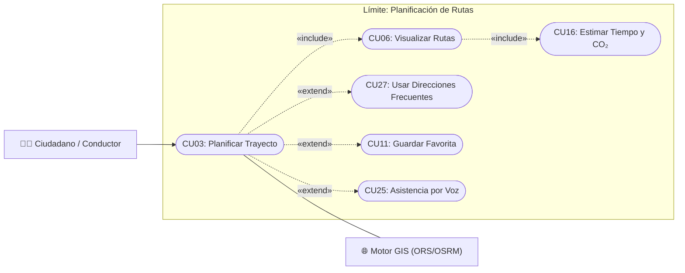

# Caso de Uso N° 3 — Gestión de rutas

> Requisito asociado: **RF3** · SRS EcoRuteando, sección 4.2

**Descripción:** Permite al usuario autenticado crear, modificar o eliminar rutas personalizadas dentro de la aplicación.

| Campo | Descripción |
|---|---|
| **Nombre** | Gestión de rutas |
| **Prioridad** | Alta |
| **Precondición** | El usuario debe haber iniciado sesión. |

---

### Diagrama de Caso de Uso UML

---

## Secuencia normal

| Paso | Acción | Sistema |
|:---:|---|---|
| 1 | El usuario accede al módulo de rutas. | El sistema muestra las rutas registradas del usuario. |
| 2 | El usuario selecciona una acción (agregar, modificar o eliminar). | El sistema muestra el formulario correspondiente con validaciones. |
| 3 | El usuario completa la información requerida y confirma. | El sistema valida los datos y guarda/actualiza/elimina en la base de datos. |
| 4 | — | El sistema confirma la acción realizada con mensaje de éxito. |

## Postcondición

Las rutas quedan actualizadas en la base de datos según la acción realizada y visibles en el listado.

## Excepciones (flujo alterno)

| Paso | Condición | Respuesta del sistema |
|:---:|---|---|
| E1 | No existen rutas registradas. | Muestra “Sin información disponible” con CTA para crear la primera ruta. |
| E2 | Datos inválidos o incompletos (nombre vacío, coordenadas inválidas). | Muestra error de validación por campo y bloquea el guardado. |
| E3 | Ruta duplicada (mismo origen/destino/nombre). | Muestra “Ya existe una ruta con esos datos” y sugiere editar la existente. |
| E4 | Sesión expirada o permisos insuficientes al intentar modificar/eliminar. | Redirige a login con “Sesión expirada” y revierte cambios no guardados. |
| E5 | Timeout de BD o error de concurrencia al guardar. | Muestra “No fue posible guardar. Intente más tarde” y registra el fallo. |

| Campo | Descripción |
|---|---|
| **Actores** | Usuario |
| **Comentarios** | Verificar que no existan rutas duplicadas (RF3.1). Trazabilidad: RF3 → CU03. |

