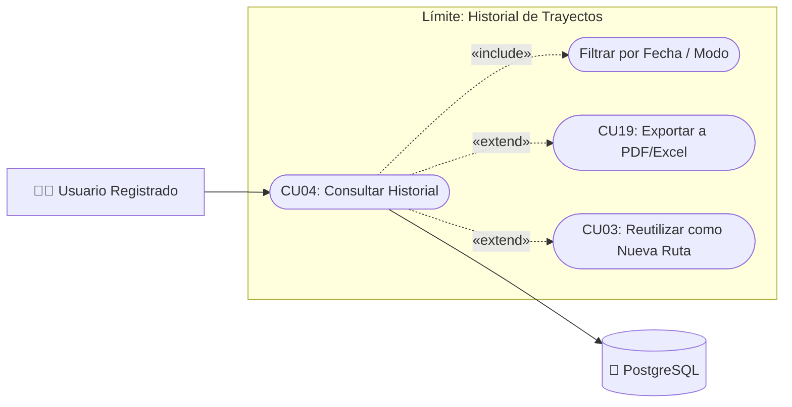

# Caso de Uso N° 4 — Historial de trayectos

> Requisito asociado: **RF4** · SRS EcoRuteando, sección 4.2

**Descripción:** Permite al usuario consultar el historial de todos los recorridos realizados, con fecha, distancia y estado de finalización.

| Campo | Descripción |
|---|---|
| **Nombre** | Historial de trayectos |
| **Prioridad** | Media |
| **Precondición** | El usuario debe haber iniciado sesión y tener al menos un trayecto registrado (opcional: puede estar vacío). |

---

### Diagrama de Caso de Uso UML

---

## Secuencia normal

| Paso | Acción | Sistema |
|:---:|---|---|
| 1 | El usuario accede a la sección “Historial de trayectos”. | El sistema valida la sesión activa y consulta los trayectos del usuario (tabla `uso_rutas`). |
| 2 | — | El sistema recupera los trayectos con fecha, hora, distancia, duración y CO₂ ahorrado. |
| 3 | — | El sistema muestra la lista ordenada cronológicamente con paginación. |
| 4 | El usuario selecciona un trayecto de la lista. | El sistema muestra el detalle completo: mapa del recorrido, métricas y estado (finalizado/en curso). |

## Postcondición

El usuario visualiza correctamente su historial de trayectos con la información asociada a cada recorrido.

## Excepciones (flujo alterno)

| Paso | Condición | Respuesta del sistema |
|:---:|---|---|
| E1 | No existen trayectos registrados. | Muestra mensaje “Sin información disponible — aún no has realizado trayectos” con CTA a planificar ruta. |
| E2 | Sesión expirada o token JWT inválido. | Redirige a inicio de sesión y muestra “Sesión expirada, inicie sesión nuevamente”. |
| E3 | Timeout de base de datos o error de consulta. | Muestra “Error al cargar el historial. Intente más tarde” y registra el fallo. |
| E4 | Registro duplicado por concurrencia. | El sistema deduplica por `id_uso` y notifica “Trayecto ya registrado”. |

| Campo | Descripción |
|---|---|
| **Actores** | Usuario |
| **Comentarios** | Verificar que no se repitan registros de trayectos (control por `id_uso` + `id_ruta`). Trazabilidad: RF4 / RF12 → CU04. |

