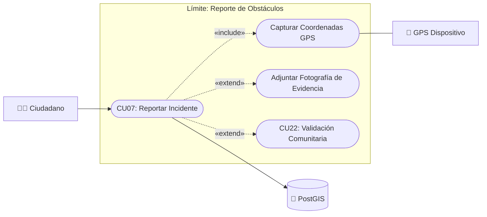

# Caso de Uso N° 7 — Reporte ciudadano de obstáculos

> Requisito asociado: **RF7** · SRS EcoRuteando, sección 4.2

**Descripción:** Permite al usuario reportar obstáculos o problemas en rutas vehiculares y peatonales (alcance reducido: solo vehículo y a pie).

| Campo | Descripción |
|---|---|
| **Nombre** | Reporte ciudadano de obstáculos |
| **Prioridad** | Media |
| **Precondición** | El usuario debe tener sesión activa. |

---

### Diagrama de Caso de Uso UML

---

## Secuencia normal

| Paso | Acción | Sistema |
|:---:|---|---|
| 1 | El usuario selecciona “Reportar obstáculo”. | El sistema muestra el formulario de reporte. |
| 2 | El usuario ingresa tipo de obstáculo, ubicación y descripción. | El sistema valida los datos ingresados y la ubicación GPS. |
| 3 | — | El sistema guarda el reporte y notifica al administrador. |

## Postcondición

El reporte queda almacenado y en espera de validación.

## Excepciones (flujo alterno)

| Paso | Condición | Respuesta del sistema |
|:---:|---|---|
| E1 | Información incompleta o formato inválido. | Muestra error por campo “Complete todos los campos obligatorios”. |
| E2 | Ubicación GPS fuera de Neiva o inválida. | Muestra “Ubicación no válida, seleccione un punto dentro de la zona cubierta”. |
| E3 | Sesión expirada durante el envío. | Redirige a login y guarda borrador local si es posible. |
| E4 | Fallo de conexión con servidor/BD (timeout). | Muestra “No se pudo guardar el reporte. Intente más tarde” y registra el error. |
| E5 | Reporte duplicado en misma ubicación/tipo reciente. | Advierte “Ya existe un reporte similar cercano” y evita duplicados. |

| Campo | Descripción |
|---|---|
| **Actores** | Usuario, Administrador |
| **Comentarios** | Validar ubicación mediante GPS. Trazabilidad: RF7 → CU07. |

