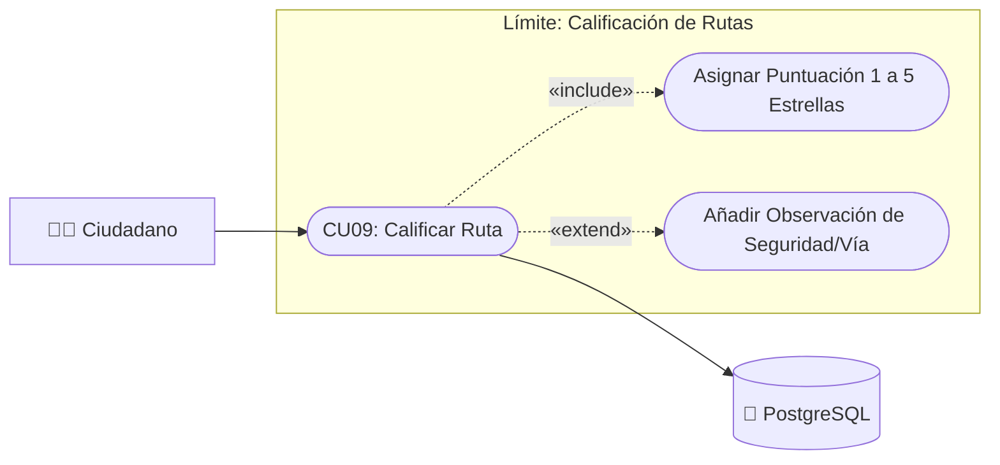

# Caso de Uso N° 9 — Calificar rutas

> Requisito asociado: **RF9** · SRS EcoRuteando, sección 4.2

**Descripción:** Permite al usuario calificar las rutas de vehículo y a pie utilizadas según su experiencia.

| Campo | Descripción |
|---|---|
| **Nombre** | Calificar rutas |
| **Prioridad** | Media |
| **Precondición** | El usuario debe haber finalizado una ruta (vehículo o a pie). |

---

### Diagrama de Caso de Uso UML

---

## Secuencia normal

| Paso | Acción | Sistema |
|:---:|---|---|
| 1 | El usuario accede al historial de rutas. | El sistema muestra las rutas completadas (vehículo/a pie). |
| 2 | El usuario selecciona una ruta. | El sistema habilita la opción de calificación (1-5 estrellas). |
| 3 | El usuario ingresa la puntuación y comentario. | El sistema valida y guarda la calificación. |

## Postcondición

La calificación se almacena en la base de datos y afecta el promedio de la ruta.

## Excepciones (flujo alterno)

| Paso | Condición | Respuesta del sistema |
|:---:|---|---|
| E1 | Ruta no completada o en curso. | Bloquea la calificación con “Solo puedes calificar rutas finalizadas”. |
| E2 | Campos incompletos (sin puntuación). | Muestra “Debe completar todos los campos”. |
| E3 | Usuario ya calificó esa ruta. | Muestra “Ya has calificado esta ruta” y permite editar. |
| E4 | Sesión expirada o permisos insuficientes. | Redirige a login. |
| E5 | Error de BD al persistir. | Muestra “No fue posible guardar la calificación”. |

| Campo | Descripción |
|---|---|
| **Actores** | Usuario |
| **Comentarios** | Calificación 1-5 estrellas. Trazabilidad: RF9 → CU09. |

