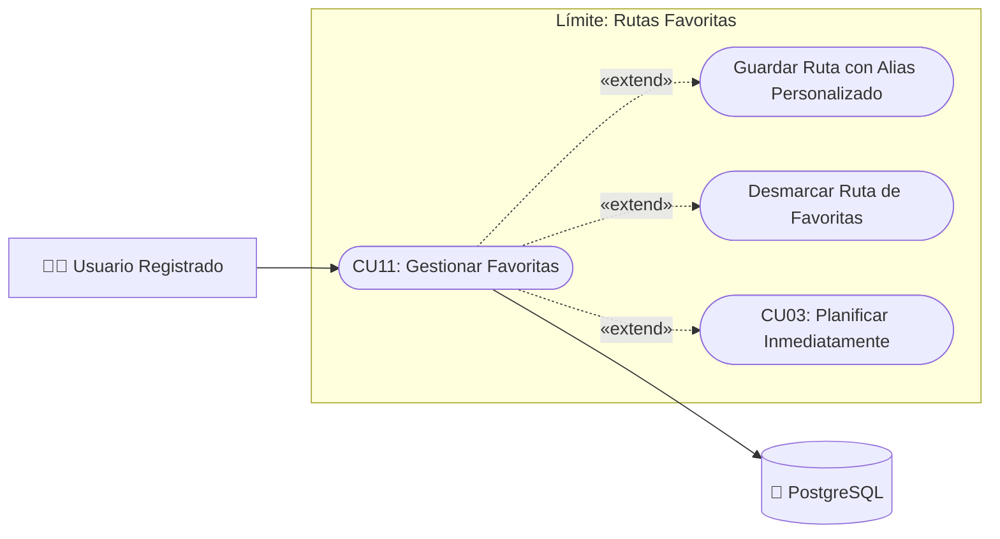

# Caso de Uso N° 11 — Gestión de rutas favoritas

> Requisito asociado: **RF14** · SRS EcoRuteando, sección 4.2

**Descripción:** Permite al usuario marcar rutas como favoritas para acceder rápidamente a ellas y reutilizarlas en futuros trayectos dentro de la aplicación.

| Campo | Descripción |
|---|---|
| **Nombre** | Gestión de rutas favoritas |
| **Prioridad** | Media |
| **Precondición** | El usuario debe tener sesión activa en la aplicación. |

---

### Diagrama de Caso de Uso UML

---

## Secuencia normal

| Paso | Acción | Sistema |
|:---:|---|---|
| 1 | El usuario accede al detalle de una ruta | El sistema muestra la opción “Agregar a favoritos”. |
| 2 | El usuario selecciona “Agregar a favoritos” | El sistema valida la sesión activa y guarda la ruta en su lista de favoritos. |
| 3 | — | El sistema confirma con el mensaje “Ruta agregada a favoritos”. |
| 4 | El usuario accede a la sección “Mis rutas favoritas” | El sistema consulta la base de datos y muestra la lista de rutas favoritas. |
| 5 | El usuario selecciona una ruta favorita | El sistema carga el detalle de la ruta en el mapa interactivo. |

## Postcondición

La ruta queda almacenada en la lista de favoritos del usuario y disponible para consultas posteriores.

## Excepciones (flujo alterno)

| Paso | Acción |
|:---:|---|
| 1 | Si el usuario no tiene sesión activa, el sistema solicita iniciar sesión antes de guardar la ruta. |
| 2 | Si no existen rutas favoritas guardadas, el sistema muestra el mensaje “sin información disponible”. |

| Campo | Descripción |
|---|---|
| **Actores** | Usuario |
| **Comentarios** | Una misma ruta no debe duplicarse en la lista de favoritos. Asociado a RF14 (RF14.1 Marcar favorita, RF14.2 Ver favoritas). |
