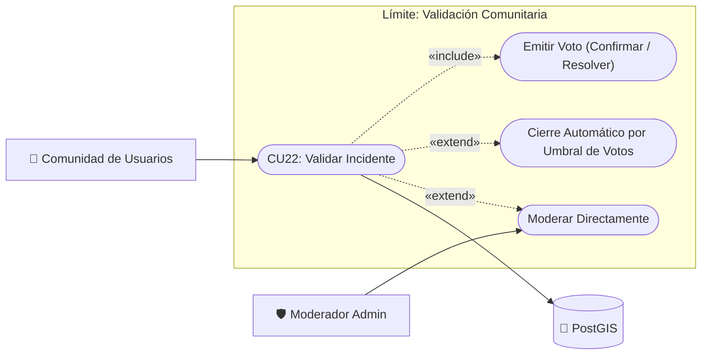

# Caso de Uso N° 22 — Validación comunitaria de reportes

> Requisito asociado: **RF7** · SRS EcoRuteando, sección 4.2 (extiende CU07 / HU-16)

**Descripción:** Permite a la comunidad confirmar o rechazar reportes de obstáculos cercanos ("¿Sigue ocurriendo?") y asigna a cada reporte un **nivel de confianza** (0–100) que determina su visibilidad en el mapa. El sistema no pretende saber con certeza si un reporte es cierto: lo estima con señales ponderadas (usuarios independientes, antigüedad, evidencia, rechazos).

| Campo | Descripción |
|---|---|
| **Nombre** | Validación comunitaria de reportes |
| **Prioridad** | Media |
| **Precondición** | Sesión activa con permiso `reports.vote` (para votar) o `reports.read` (para consultar). Al menos un reporte creado vía CU07. |

---

### Diagrama de Caso de Uso UML

---

## Secuencia normal

| Paso | Acción | Sistema |
|:---:|---|---|
| 1 | El usuario crea un reporte (CU07) | El sistema calcula el score inicial (base por creación + evidencia fotográfica) y lo persiste en `confidence_score`. |
| 2 | Otros usuarios abren el mapa | El sistema lista los reportes cercanos con score efectivo ≥ 40, activos y no expirados, incluyendo conteo de confirmaciones/rechazos y etiqueta de estado derivada. |
| 3 | El usuario toca un marcador de reporte | El sistema muestra el detalle: tipo, antigüedad, votos, confianza y la pregunta **“¿Sigue ocurriendo?”**. |
| 4 | El usuario responde 👍 Sí o 👎 No | El sistema registra el voto (1 por usuario por reporte, a ≤ 500 m del incidente) y recalcula el score. |
| 5 | — | Si los rechazos superan a las confirmaciones → el reporte pasa a **DISPUTED** (`under_review`) y pierde visibilidad. |
| 6 | — | Si ≥ 2 usuarios independientes confirman y el score es ≥ 70 → el reporte se etiqueta **CONFIRMED**. |
| 7 | Con el tiempo | El score decae al leer (−1 punto / 10 min); al vencer `expires_at` el reporte queda **EXPIRED** y sale del mapa. Una confirmación posterior puede reactivarlo. |

## Postcondición

Los reportes visibles en el mapa reflejan un nivel de confianza razonable basado en evidencia comunitaria; los reportes débiles o disputados quedan ocultos o en cola de revisión administrativa (CU07).

## Excepciones (flujo alterno)

| Paso | Condición | Respuesta del sistema |
|:---:|---|---|
| E1 | El usuario vota su propio reporte. | Se registra el voto pero no aporta puntos de confirmación. |
| E2 | El usuario está a > 500 m del reporte. | Rechaza con “Debes estar cerca del reporte para votar”. |
| E3 | El usuario ya había votado el mismo reporte. | Actualiza su voto anterior (la clave primaria lo garantiza); no puede duplicarlo. |
| E4 | El reporte está expirado y el usuario confirma. | Reactiva el reporte (nuevo `expires_at`, estado activo). |
| E5 | Reporte con estado `validated` o `rejected` por administrador. | La validación/rechazo administrativo prevalece; la comunidad solo lo vota si sigue activo. |
| E6 | Sesión expirada o sin permiso. | 401 / 403 estándar de la API. |

| Campo | Descripción |
|---|---|
| **Actores** | Usuario ciudadano, Administrador (cola de revisión) |
| **Comentarios** | Trazabilidad: RF7 → CU07 → CU22. Score = puntos ponderados recalculados al crear/votar y decaído en lectura. Estados derivados: ACTIVE (≥40), CONFIRMED (≥2 confirmaciones y ≥70), DISPUTED (rechazos > confirmaciones), EXPIRED (`expires_at` vencido). |
