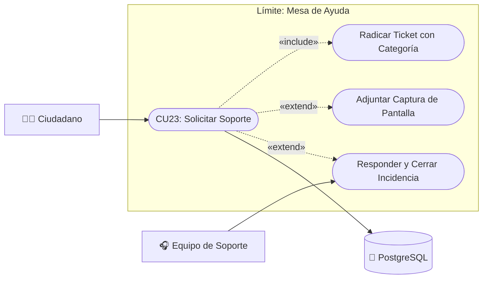

# Caso de Uso N° 23 — Soporte técnico y mesa de ayuda

> Requisito asociado: **RF30** · SRS EcoRuteando (Centro de ayuda y solicitudes de soporte)

**Descripción:** Permite a los usuarios consultar respuestas a preguntas frecuentes (FAQ) y, en caso de requerir asistencia técnica o reportar una inconsistencia del sistema, radicar un ticket de soporte con seguimiento de estado (Pendiente, En proceso, Resuelta).

| Campo | Descripción |
|---|---|
| **Nombre** | Soporte técnico y mesa de ayuda |
| **Prioridad** | Media |
| **Precondición** | Para consultar FAQ no se requiere sesión activa. Para enviar tickets se requiere autenticación en la plataforma. |

---

### Diagrama de Caso de Uso UML

---

## Secuencia normal

| Paso | Acción | Sistema |
|:---:|---|---|
| 1 | El usuario accede al Centro de Ayuda desde su perfil. | El sistema despliega las preguntas frecuentes agrupadas por categorías (rutas, perfil, privacidad). |
| 2 | Si la duda no se resuelve, el usuario abre el formulario de soporte. | El sistema presenta los campos: Asunto, Tipo de problema y Descripción. |
| 3 | El usuario completa los datos y presiona «Enviar solicitud». | El sistema valida la información, genera un ticket de soporte con identificador único y estado inicial **Pendiente**. |
| 4 | — | El sistema asocia el ticket a la cuenta del usuario y confirma la recepción exitosa en pantalla. |
| 5 | El administrador consulta la bandeja de tickets recibidos. | El sistema lista los casos permitiendo actualizar el estado a **En proceso** o **Resuelta**. |

## Postcondición

La solicitud queda registrada en la base de datos y disponible para gestión y resolución por el equipo de soporte.

## Excepciones (flujo alterno)

| Paso | Condición | Respuesta del sistema |
|:---:|---|---|
| E1 | Campos obligatorios vacíos o descripción insuficiente. | El sistema solicita completar los campos mínimos requeridos. |
| E2 | Error en la comunicación con el servidor. | Se muestra mensaje informativo invitando a reintentar el envío. |

| Campo | Descripción |
|---|---|
| **Actores** | Ciudadano / Usuario registrado, Administrador del sistema |
| **Comentarios** | Alineado con RF30.1 y RF30.2 del SRS de EcoRuteando. |
