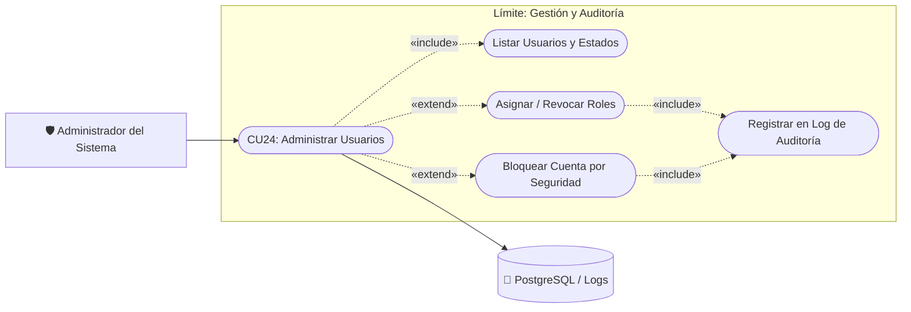

# Caso de Uso N° 24 — Gestión administrativa de usuarios y auditoría

> Requisitos asociados: **RF21, RF24** · SRS EcoRuteando (Gestión de usuarios y trazabilidad inmutable)

**Descripción:** Permite a los administradores del sistema supervisar los usuarios registrados, activar o suspender cuentas, gestionar roles de acceso y consultar el registro inmutable de auditoría para trazabilidad de eventos críticos.

| Campo | Descripción |
|---|---|
| **Nombre** | Gestión administrativa de usuarios y auditoría |
| **Prioridad** | Alta |
| **Precondición** | Sesión activa con rol de Administrador y verificación 2FA completada. |

---

### Diagrama de Caso de Uso UML

---

## Secuencia normal

| Paso | Acción | Sistema |
|:---:|---|---|
| 1 | El administrador ingresa al panel de control (`/admin`). | El sistema valida credenciales y permisos de administrador. |
| 2 | El administrador selecciona la sección «Gestión de Usuarios». | El sistema lista los usuarios con filtros por estado (activo, suspendido) y rol. |
| 3 | El administrador cambia el estado o rol de una cuenta. | El sistema aplica el cambio en base de datos y emite confirmación. |
| 4 | El administrador consulta la sección «Auditoría del Sistema». | El sistema lista los registros de auditoría (AuditLogs) con fecha, IP, usuario y acción. |
| 5 | El administrador aplica filtros por fecha o tipo de evento. | El sistema actualiza la vista con los registros coincidentes. |

## Postcondición

Las acciones administrativas quedan registradas de forma inmutable en la tabla de auditoría para fines de control y seguridad.

## Excepciones (flujo alterno)

| Paso | Condición | Respuesta del sistema |
|:---:|---|---|
| E1 | Intento de acceso sin rol administrativo. | El sistema deniega el acceso con código HTTP 403 Forbidden. |
| E2 | Intentos de modificación de superadministrador protegidos. | Se bloquea la acción para preservar la gobernanza del sistema. |

| Campo | Descripción |
|---|---|
| **Actores** | Administrador del sistema |
| **Comentarios** | Alineado con RF21 y RF24 del SRS. |
