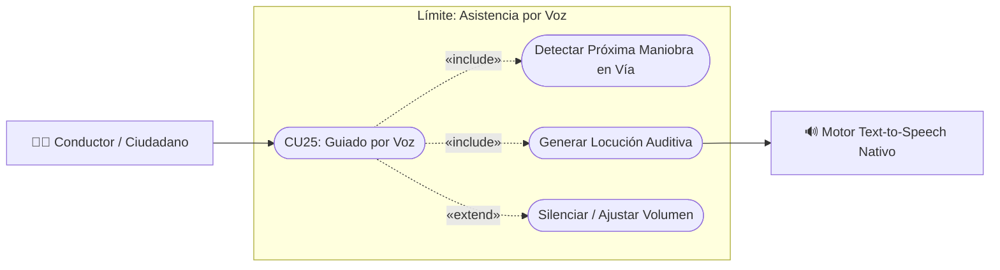

# Caso de Uso N° 25 — Asistencia auditiva de navegación paso a paso

> Requisito asociado: **RF28** · SRS EcoRuteando (Locución de maniobras y motor TTS)

**Descripción:** Proporciona locución por voz anticipada de las instrucciones de maniobra durante el desplazamiento de una ruta activa (a pie o en vehículo), permitiendo al usuario recibir guía sonora manos libres.

| Campo | Descripción |
|---|---|
| **Nombre** | Asistencia auditiva de navegación paso a paso |
| **Prioridad** | Media |
| **Precondición** | Ruta calculada e iniciada con acceso concedido a la geolocalización GPS. |

---

### Diagrama de Caso de Uso UML

---

## Secuencia normal

| Paso | Acción | Sistema |
|:---:|---|---|
| 1 | El usuario presiona «Iniciar Navegación» en la ruta seleccionada. | El sistema activa el seguimiento GPS continuo y carga los pasos de maniobra. |
| 2 | El usuario se despliega hacia el siguiente giro. | Conforme la distancia al punto de giro es inferior a 40 metros, el motor de síntesis Text-to-Speech (TTS) emite la instrucción sonora correspondiente. |
| 3 | El usuario visualiza el banner de navegación con la maniobra actual. | El sistema sincroniza el icono direccional con la locución emitida. |
| 4 | El usuario presiona el icono de altavoz para silenciar. | El sistema silencia las instrucciones sonoras manteniendo la guía visual. |
| 5 | El usuario alcanza el punto de destino. | El sistema emite la locución «Has llegado a tu destino» y finaliza el trayecto. |

## Postcondición

El usuario completa el recorrido con apoyo auditivo sin necesidad de mirar constantemente la pantalla.

## Excepciones (flujo alterno)

| Paso | Condición | Respuesta del sistema |
|:---:|---|---|
| E1 | Dispositivo sin motor de voz habilitado o silenciado por hardware. | El sistema continúa la navegación visual sin interrumpir la ruta. |
| E2 | Pérdida momentánea de señal GPS. | El sistema mantiene la última indicación conocida y notifica la reconexión. |

| Campo | Descripción |
|---|---|
| **Actores** | Ciudadano / Conductor / Peatón |
| **Comentarios** | Implementado mediante motor Text-to-Speech (TTS / expo-speech en móvil). |
