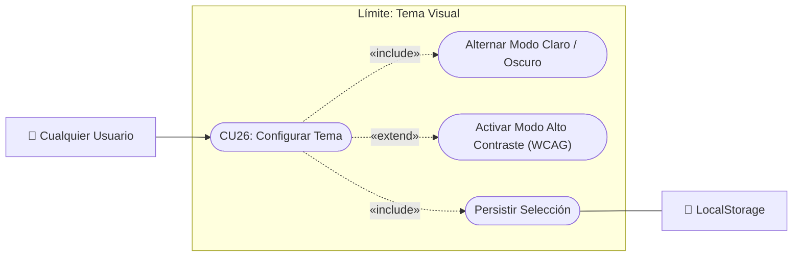

# Caso de Uso N° 26 — Personalización de tema visual

> Requisito asociado: **RF33** · SRS EcoRuteando (Tema claro y modo oscuro)

**Descripción:** Permite al usuario alternar entre el tema claro y el tema oscuro para mejorar la legibilidad y el confort visual según las condiciones de iluminación del entorno.

| Campo | Descripción |
|---|---|
| **Nombre** | Personalización de tema visual |
| **Prioridad** | Baja |
| **Precondición** | Acceso a la interfaz web o móvil del sistema. |

---

### Diagrama de Caso de Uso UML

---

## Secuencia normal

| Paso | Acción | Sistema |
|:---:|---|---|
| 1 | El usuario presiona el selector de tema (icono sol/luna) en la barra de navegación o perfil. | El sistema cambia dinámicamente las clases CSS y tokens de color de la interfaz. |
| 2 | — | El mapa interactivo y los componentes de datos adaptan su paleta de colores para mantener alto contraste. |
| 3 | — | El sistema guarda la preferencia seleccionada en el almacenamiento local (`localStorage` / almacenamiento seguro). |
| 4 | El usuario recarga la página o reingresa a la aplicación en una sesión posterior. | El sistema recupera la preferencia guardada y aplica el tema elegido inmediatamente. |

## Postcondición

La interfaz visual se presenta en el modo de contraste deseado y la preferencia persiste entre sesiones.

| Campo | Descripción |
|---|---|
| **Actores** | Todos los usuarios (Visitantes y Registrados) |
| **Comentarios** | Alineado con RF33 del SRS. |
