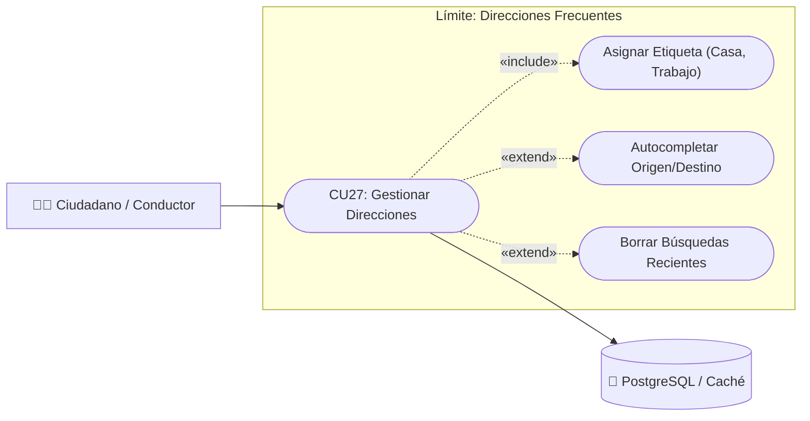

# CU27: Gestión y Reutilización de Direcciones Frecuentes

| Campo | Descripción |
| :---

| :--- |
| **Identificador** | CU27 |
| **Nombre** | Gestión y Reutilización de Direcciones Frecuentes |
| **Módulo** | Rutas y Movilidad Ecológica |
| **Requisito Asociado** | RF13 (Historial de direcciones y autocompletado de ubicaciones) |
| **Actor Principal** | Ciudadano / Conductor (Autenticado) |
| **Tipo de Caso de Uso** | Concreto / Extensión |
| **Prioridad** | Media |

---

---

### Diagrama de Caso de Uso UML

---

### Descripción General
Permite a los usuarios autenticados almacenar, etiquetar (ej. "Casa", "Trabajo", "Universidad") y reutilizar de manera inmediata direcciones utilizadas frecuentemente en la aplicación móvil o web, agilizando la definición de origen o destino en la planificación de trayectos sin tener que ingresar manualmente el texto o buscarlo en el mapa cada vez.

---

### Precondiciones
1. El usuario debe haber iniciado sesión con una cuenta activa en el sistema.
2. El dispositivo debe tener conectividad a red para sincronizar las direcciones con el perfil del usuario (o persistencia local en caché si está sin conexión).

---

### Flujo Normal de Eventos

| Paso | Acción del Usuario | Respuesta del Sistema |
| :---: | :--- | :--- |
| **1** | El usuario accede al formulario de búsqueda de rutas o a la sección "Mis Direcciones" en su perfil. | El sistema despliega el listado de direcciones recientes y favoritas organizadas con sus etiquetas personalizadas. |
| **2** | El usuario selecciona una dirección guardada para definirla como origen o destino. | El sistema autocompleta instantáneamente el campo correspondiente con las coordenadas geográficas y el nombre del punto. |
| **3** | *(Opcional)* Desde el mapa o tras completar un trayecto, el usuario pulsa "Guardar dirección en frecuentes". | El sistema solicita asignar una etiqueta personalizada (ej. "Gimnasio") o icono identificador. |
| **4** | El usuario confirma el guardado de la ubicación. | El sistema valida las coordenadas y almacena el registro asociado al ID del usuario en la base de datos, mostrando confirmación visual. |

---

### Flujos Alternativos y Excepciones

#### A1. Edición de etiqueta o eliminación de dirección guardada
- **Paso 1:** El usuario desliza la dirección hacia la izquierda o presiona el botón de opciones (tres puntos).
- **Paso 2:** El usuario selecciona "Editar etiqueta" o "Eliminar de frecuentes".
- **Paso 3:** El sistema actualiza el registro o lo elimina de la base de datos previa confirmación, refrescando el listado de autocompletado.

#### A2. Limpieza de historial de búsquedas recientes
- **Paso 1:** El usuario selecciona "Borrar historial reciente".
- **Paso 2:** El sistema limpia la caché local de direcciones buscadas recientemente preservando las direcciones fijas marcadas como favoritas ("Casa", "Trabajo").

#### E1. Falla de conexión al sincronizar direcciones
- **Paso 1:** Si no hay cobertura de datos, el sistema consulta las direcciones almacenadas en el caché local (*AsyncStorage* / *SQLite* local).
- **Paso 2:** Muestra las direcciones en modo sin conexión y sincroniza los cambios pendientes una vez reestablecido el canal.

---

### Postcondiciones
- **Éxito:** La dirección queda disponible de forma instantánea en el menú de autocompletado y en el selector de rutas.
- **Cancelación:** La lista de direcciones permanece intacta sin modificaciones en la base de datos.
