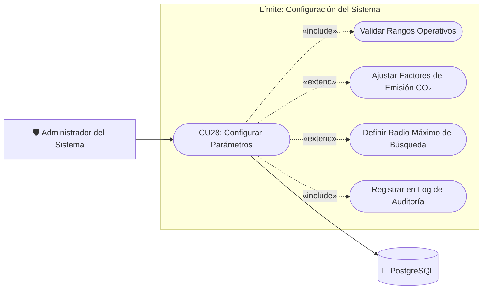

# CU28: Configuración de Parámetros Generales del Sistema

| Campo | Descripción |
| :---

| :--- |
| **Identificador** | CU28 |
| **Nombre** | Configuración de Parámetros Generales del Sistema |
| **Módulo** | Administración del Sistema |
| **Requisito Asociado** | RF23 (Configuración del sistema y variables operativas) |
| **Actor Principal** | Administrador del Sistema |
| **Tipo de Caso de Uso** | Concreto |
| **Prioridad** | Alta |

---

---

### Diagrama de Caso de Uso UML

---

### Descripción General
Permite a los administradores autorizados acceder al módulo de configuración de la plataforma web administrativa para ajustar y parametrizar las variables operativas globales del sistema EcoRuteando (tales como radio máximo de búsqueda en metros, factores de cálculo de emisión de CO₂ en g/km según tipo de combustible, umbral de votos para validación automática de incidentes y políticas de expiración de reportes ciudadanos).

---

### Precondiciones
1. El usuario debe haber iniciado sesión exitosamente con credenciales de **Administrador**.
2. El sistema debe haber verificado el rol mediante token JWT con permisos de escritura administrativa (`Role: Administrator`).

---

### Flujo Normal de Eventos

| Paso | Acción del Administrador | Respuesta del Sistema |
| :---: | :--- | :--- |
| **1** | El administrador navega al menú **Configuración del Sistema** en el panel de control web. | El sistema carga y muestra el formulario de parámetros clasificados por categorías: Movilidad, Factores Ambientales, Comunidad y Políticas de Caché. |
| **2** | El administrador modifica uno o varios parámetros operativos (ej. ajusta el factor de emisión promedio de gasolina de 142 g CO₂/km a 138 g CO₂/km, o define el radio de búsqueda de incidentes en 5,000 metros). | El sistema valida sintácticamente los campos en tiempo real (rangos permitidos, formato numérico positivo). |
| **3** | El administrador pulsa el botón **Guardar Cambios**. | El sistema solicita confirmación mediante un modal de seguridad con resumen de los valores anteriores vs. los nuevos valores. |
| **4** | El administrador confirma la operación. | El sistema persiste los nuevos valores en la base de datos PostgreSQL, refresca la caché de configuración en memoria del backend y genera un registro de auditoría (RF24) con el ID del administrador, fecha y valores modificados. |
| **5** | El sistema muestra un mensaje de éxito: *"Configuración actualizada correctamente"*. | Los nuevos parámetros quedan operativos de inmediato para todas las peticiones móviles y web subsecuentes. |

---

### Flujos Alternativos y Excepciones

#### A1. Restauración a valores predeterminados de fábrica
- **Paso 1:** El administrador selecciona la opción **Restablecer valores por defecto**.
- **Paso 2:** El sistema despliega una advertencia indicando que todos los parámetros operativos volverán a su línea base inicial recomendada.
- **Paso 3:** Tras la confirmación, el sistema sobreescribe las variables con los valores estándar y audita el evento.

#### E1. Valor fuera de rango permitido
- **Paso 1:** El administrador ingresa un valor incompatible (ej. radio de búsqueda negativo o factor de CO₂ excesivo superior al umbral físico).
- **Paso 2:** El sistema bloquea el guardado, resalta el campo con alerta visual de error y muestra un mensaje indicando los límites mínimos y máximos admisibles.

#### E2. Permisos insuficientes o sesión expirada
- **Paso 1:** Si el token de sesión caduca mientras se editaba la configuración, el sistema rechaza la petición HTTP PUT con código `401 Unauthorized`.
- **Paso 2:** Redirige al administrador a la pantalla de reautenticación sin perder los cambios en el formulario local.

---

### Postcondiciones
- **Éxito:** Los nuevos parámetros operativos rigen de forma global para los cálculos del sistema y se registra el evento en la bitácora de auditoría.
- **Cancelación:** Las variables operativas mantienen sus valores previos sin alteración.
