# Diagramas de Casos de Uso del Sistema - EcoRuteando

Este documento recopila la especificación visual y modelación formal mediante **Diagramas de Casos de Uso UML 2.5** para el proyecto **EcoRuteando**.

La arquitectura visual está estructurada en dos niveles:
1. **Nivel Macro (Visión General y Subsistemas)**: Diagrama General de Límites del Sistema y 5 Diagramas de Paquetes/Subsistemas.
2. **Nivel Micro (Desglose Exhaustivo)**: **28 Diagramas Individuales** (CU01 al CU28), detallando actores directos, límites de funcionalidad, relaciones `«include»`, variaciones `«extend»` y servicios tecnológicos integrados (PostGIS, Motor TTS, API GIS, SMTP, etc.).

---

## 1. Diagrama General de Arquitectura de Casos de Uso

Muestra la interacción global entre los 3 actores primarios, los 2 servicios tecnológicos externos y los 5 subsistemas funcionales dentro de la frontera del sistema.

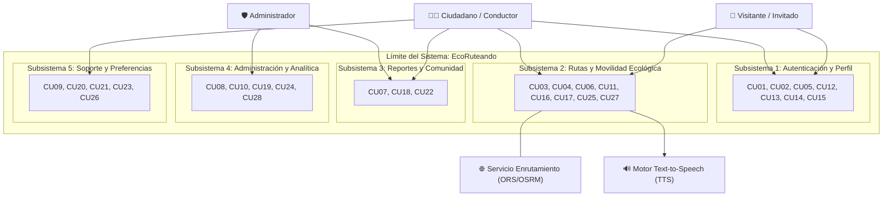

---

## 2. Diagramas de Subsistemas / Paquetes Funcionales

### 2.1. Subsistema 1: Autenticación y Gestión de Cuentas
Cubre: `CU01`, `CU02`, `CU05`, `CU12`, `CU13`, `CU14`, `CU15`.

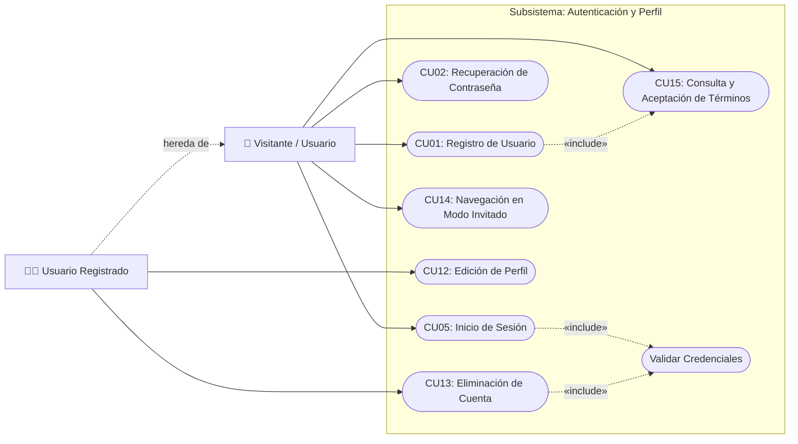

---

### 2.2. Subsistema 2: Rutas y Movilidad Ecológica
Cubre: `CU03`, `CU04`, `CU06`, `CU11`, `CU16`, `CU17`, `CU25`, `CU27`.

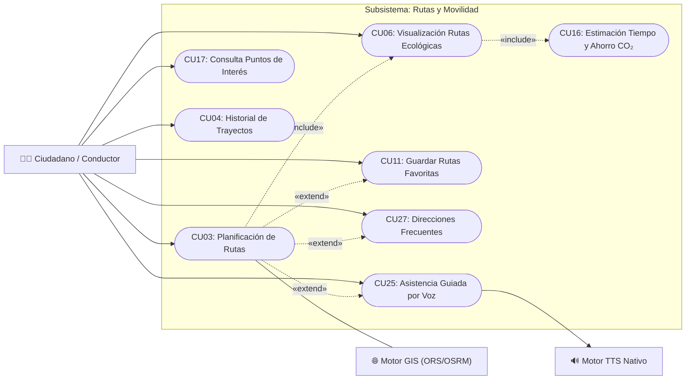

---

### 2.3. Subsistema 3: Reportes Colaborativos e Incidentes
Cubre: `CU07`, `CU18`, `CU22`.

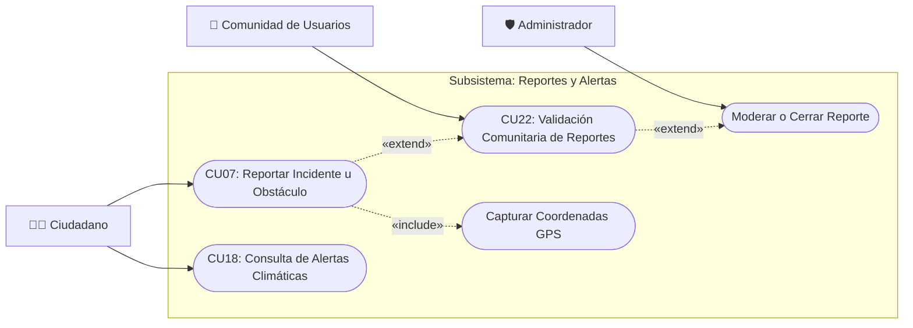

---

### 2.4. Subsistema 4: Administración, Auditoría y Analítica
Cubre: `CU08`, `CU10`, `CU19`, `CU24`, `CU28`.

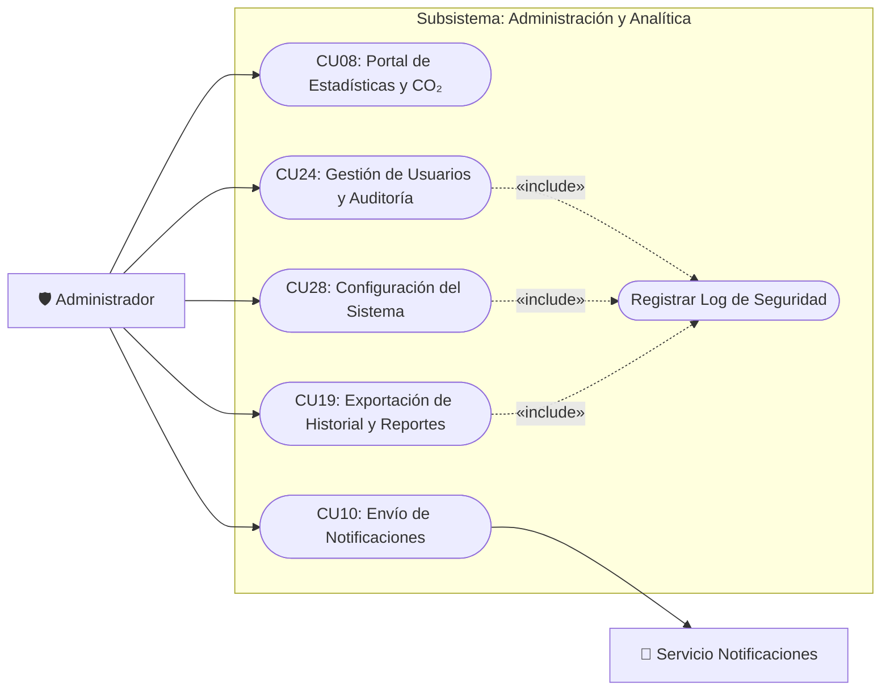

---

### 2.5. Subsistema 5: Soporte, Social y Preferencias
Cubre: `CU09`, `CU20`, `CU21`, `CU23`, `CU26`.

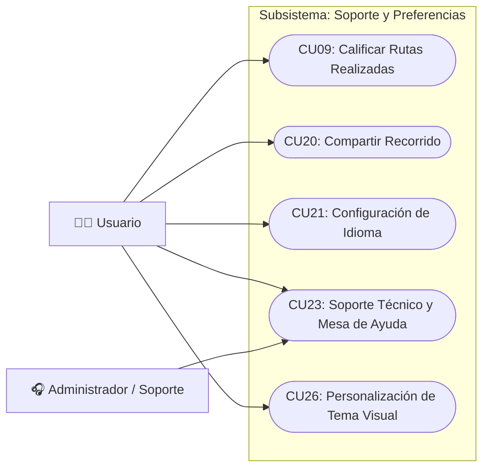

---

## 3. Catálogo Detallado: Los 28 Diagramas Individuales Desglosados

A continuación se detalla la modelación técnica independiente para cada uno de los 28 Casos de Uso del sistema:

### 3.1. CU01: Registro de Usuario
- **Subsistema:** Autenticación y Perfil
- **Requisitos Funcionales Asociados:** `RF01, RF04`
- **Descripción Técnica:** Flujo de registro con validación de contraseña, hashing Argon2id y aceptación obligatoria de términos.

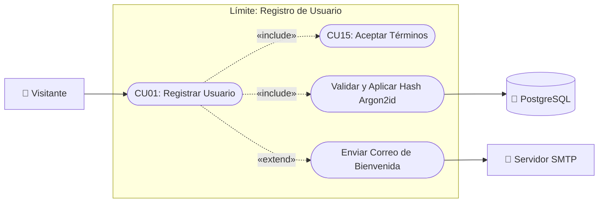

---

### 3.2. CU02: Recuperación de Contraseña
- **Subsistema:** Autenticación y Perfil
- **Requisitos Funcionales Asociados:** `RF03`
- **Descripción Técnica:** Generación de token temporal firmado y envío seguro por correo para restablecimiento de clave.

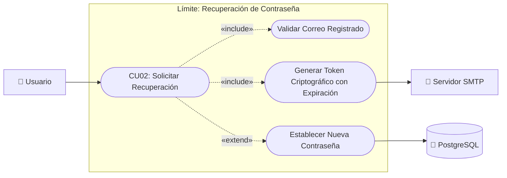

---

### 3.3. CU03: Planificación de Rutas
- **Subsistema:** Rutas y Movilidad
- **Requisitos Funcionales Asociados:** `RF09, RF26, RF27`
- **Descripción Técnica:** Definición interactiva de trayecto con cálculo multimodal ecológico y asistencia por voz.

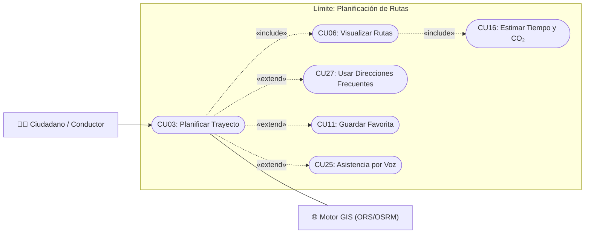

---

### 3.4. CU04: Historial de Trayectos
- **Subsistema:** Rutas y Movilidad
- **Requisitos Funcionales Asociados:** `RF12`
- **Descripción Técnica:** Consulta paginada de rutas recorridas con filtros por fecha y opciones de exportación.

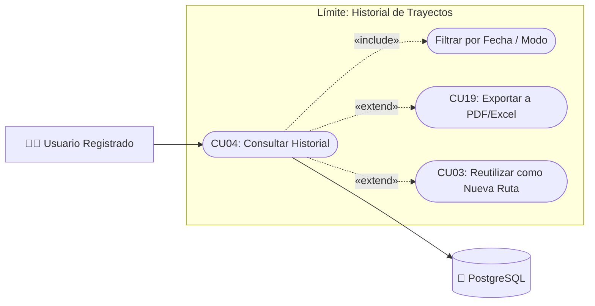

---

### 3.5. CU05: Inicio de Sesión
- **Subsistema:** Autenticación y Perfil
- **Requisitos Funcionales Asociados:** `RF02, RF04`
- **Descripción Técnica:** Autenticación segura con verificación de contraseña cifrada y expedición de token JWT.

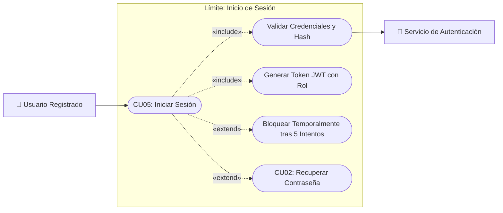

---

### 3.6. CU06: Visualización de Rutas Ecológicas
- **Subsistema:** Rutas y Movilidad
- **Requisitos Funcionales Asociados:** `RF10`
- **Descripción Técnica:** Renderizado cartográfico vectorial de la ruta óptima con métrica de CO₂ evitado.

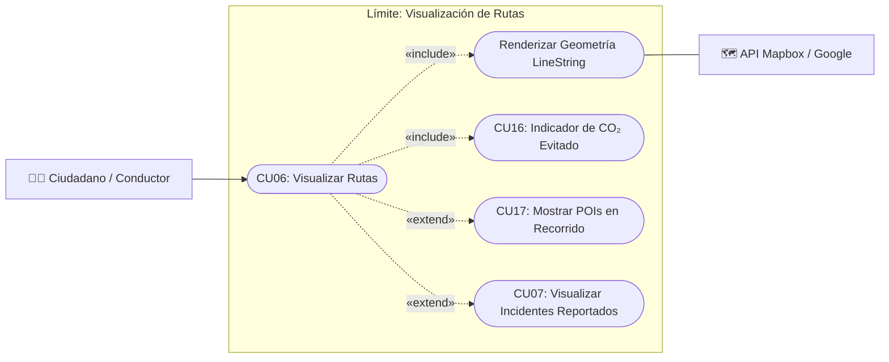

---

### 3.7. CU07: Reporte Ciudadano de Obstáculos
- **Subsistema:** Reportes y Comunidad
- **Requisitos Funcionales Asociados:** `RF17`
- **Descripción Técnica:** Georreferenciación de incidentes viales mediante GPS y evidencia fotográfica opcional.

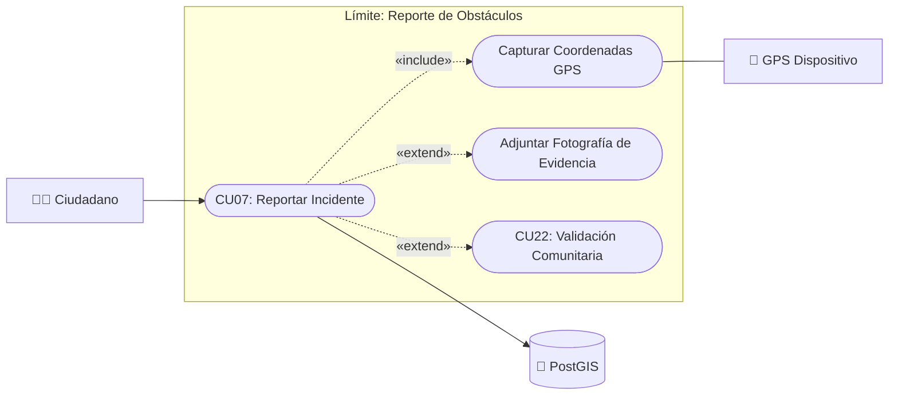

---

### 3.8. CU08: Portal de Estadísticas y Analítica
- **Subsistema:** Administración y Analítica
- **Requisitos Funcionales Asociados:** `RF20`
- **Descripción Técnica:** Métricas consolidadas de impacto ambiental, balance de CO₂ y movilidad por zonas.

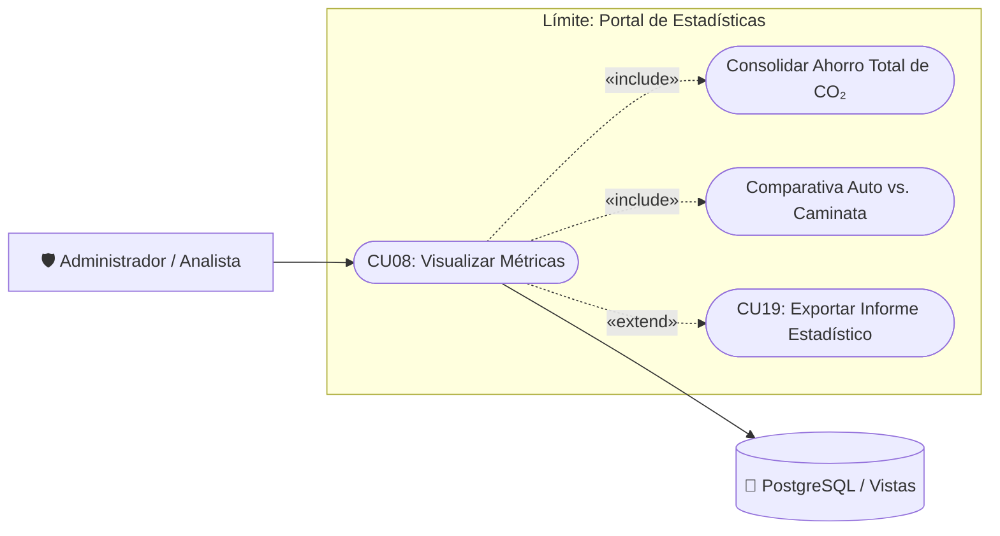

---

### 3.9. CU09: Calificar y Retroalimentar Rutas
- **Subsistema:** Soporte y Preferencias
- **Requisitos Funcionales Asociados:** `RF16`
- **Descripción Técnica:** Evaluación de calidad de trazado y estado de la vía al completar un trayecto.

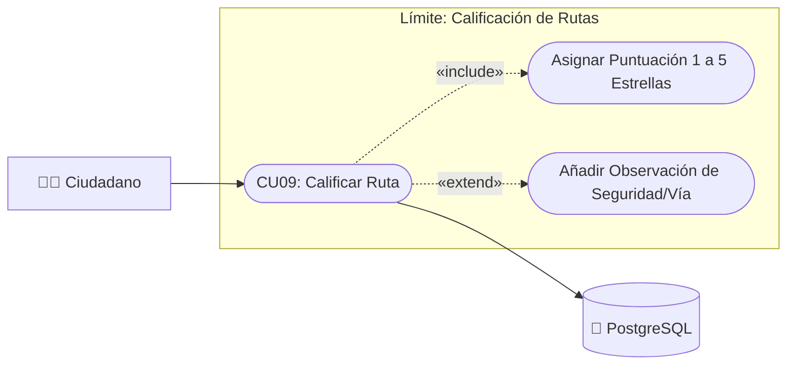

---

### 3.10. CU10: Envío de Notificaciones del Sistema
- **Subsistema:** Administración y Analítica
- **Requisitos Funcionales Asociados:** `RF25`
- **Descripción Técnica:** Despacho institucional de alertas y comunicados push segmentados por perfil.

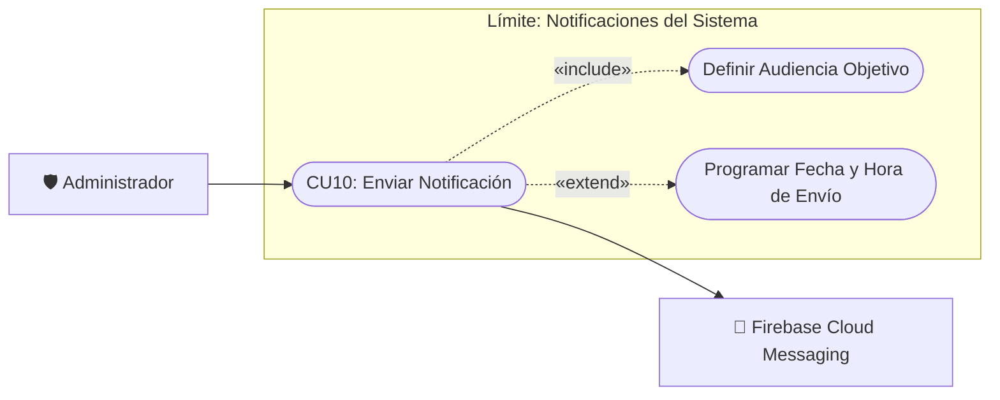

---

### 3.11. CU11: Gestión de Rutas Favoritas
- **Subsistema:** Rutas y Movilidad
- **Requisitos Funcionales Asociados:** `RF14`
- **Descripción Técnica:** Marcado y acceso rápido a recorridos frecuentes con alias personalizados.

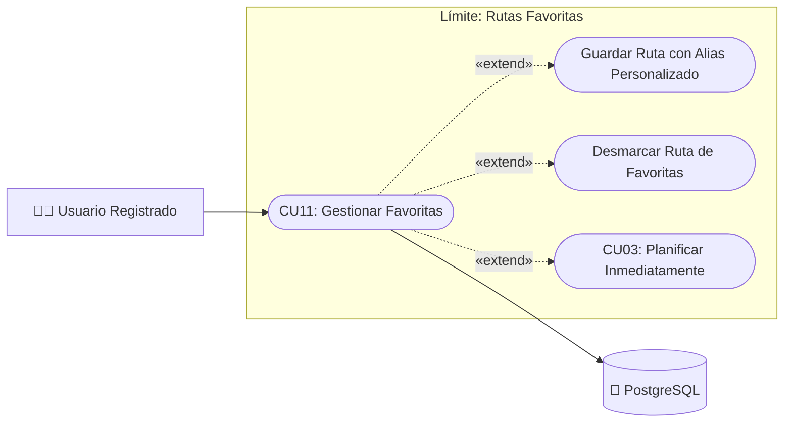

---

### 3.12. CU12: Edición del Perfil de Usuario
- **Subsistema:** Autenticación y Perfil
- **Requisitos Funcionales Asociados:** `RF05`
- **Descripción Técnica:** Modificación de nombres, correo de contacto, contraseña y preferencias del usuario.

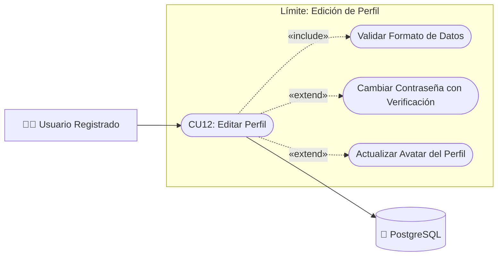

---

### 3.13. CU13: Eliminación de Cuenta
- **Subsistema:** Autenticación y Perfil
- **Requisitos Funcionales Asociados:** `RF06, RF21`
- **Descripción Técnica:** Baja voluntaria con reautenticación estricta y anonimización de datos para estadísticas.

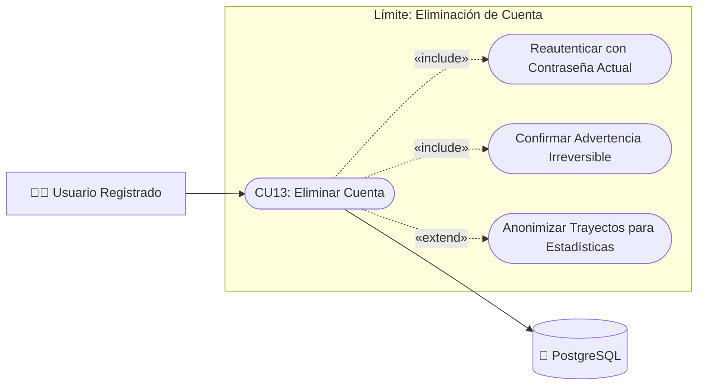

---

### 3.14. CU14: Modo Invitado
- **Subsistema:** Autenticación y Perfil
- **Requisitos Funcionales Asociados:** `RF07`
- **Descripción Técnica:** Acceso libre sin registro previo con sesión efímera en memoria local del dispositivo.

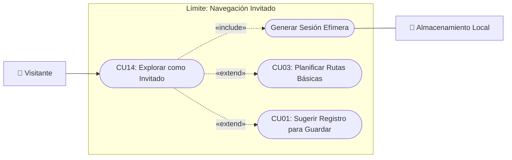

---

### 3.15. CU15: Consulta y Aceptación de Términos
- **Subsistema:** Autenticación y Perfil
- **Requisitos Funcionales Asociados:** `RF08`
- **Descripción Técnica:** Lectura y firma digital del consentimiento informado de tratamiento de datos personales.

```mermaid
flowchart LR
    Ciudadano["👤 Visitante / Ciudadano"]
    DB[("💾 PostgreSQL")]

    subgraph ModuloLegal ["Límite: Términos y Condiciones"]
        CU15(["CU15: Gestionar Términos"])
        VerDoc(["Visualizar Versión Vigente"])
        Aceptar(["Registrar Consentimiento Informado"])
        Timestamp(["Auditar Versión y Marca Temporal"])
    end

    Ciudadano --> CU15
    CU15 -.->|"«include»"| VerDoc
    CU15 -.->|"«extend»"| Aceptar
    Aceptar -.->|"«include»"| Timestamp

    Timestamp --> DB
```

---

### 3.16. CU16: Estimación de Tiempo y CO₂
- **Subsistema:** Rutas y Movilidad
- **Requisitos Funcionales Asociados:** `RF11`
- **Descripción Técnica:** Cálculo matemático de duración de recorrido y gramos de dióxido de carbono evitados.

```mermaid
flowchart LR
    Ciudadano["🧑‍💼 Ciudadano / Sistema"]
    MotorCalculo["⚙️ Motor Algorítmico Ambiental"]

    subgraph ModuloRutas ["Límite: Estimación de CO₂"]
        CU16(["CU16: Calcular Métricas de Ruta"])
        Distancia(["Calcular Distancia y Pendiente"])
        Emision(["Aplicar Factor de Combustible (g/km)"])
        Comparativa(["Comparar con Caminata a Pie"])
    end

    Ciudadano --> CU16
    CU16 -.->|"«include»"| Distancia
    CU16 -.->|"«include»"| Emision
    CU16 -.->|"«extend»"| Comparativa

    CU16 --- MotorCalculo
```

---

### 3.17. CU17: Puntos de Interés (POIs)
- **Subsistema:** Rutas y Movilidad
- **Requisitos Funcionales Asociados:** `RF15`
- **Descripción Técnica:** Búsqueda espacial de talleres, zonas verdes y parqueaderos para agregarlos como paradas.

```mermaid
flowchart LR
    Ciudadano["🧑‍💼 Ciudadano / Conductor"]
    DB[("💾 PostGIS")]

    subgraph ModuloRutas ["Límite: Consulta de POIs"]
        CU17(["CU17: Consultar POIs"])
        FiltroCat(["Filtrar por Categoría (Taller, Zonas Verdes)"])
        Radio(["Filtrar por Radio de Proximidad"])
        AddParada(["Agregar POI como Parada en Ruta"])
    end

    Ciudadano --> CU17
    CU17 -.->|"«include»"| FiltroCat
    CU17 -.->|"«include»"| Radio
    CU17 -.->|"«extend»"| AddParada

    CU17 --> DB
```

---

### 3.18. CU18: Alertas Climáticas
- **Subsistema:** Reportes y Comunidad
- **Requisitos Funcionales Asociados:** `RF19`
- **Descripción Técnica:** Integración con API meteorológica para avisar anticipadamente precipitaciones en el trayecto.

```mermaid
flowchart LR
    Ciudadano["🧑‍💼 Ciudadano"]
    WeatherAPI["⛅ API Meteorológica"]

    subgraph ModuloReportes ["Límite: Alertas Climáticas"]
        CU18(["CU18: Consultar Clima"])
        Pronostico(["Obtener Estado del Tiempo Actual"])
        AlertaLluvia(["Generar Alerta de Lluvia en Ruta"])
    end

    Ciudadano --> CU18
    CU18 -.->|"«include»"| Pronostico
    CU18 -.->|"«extend»"| AlertaLluvia

    CU18 --- WeatherAPI
```

---

### 3.19. CU19: Exportación de Historial y Reportes
- **Subsistema:** Administración y Analítica
- **Requisitos Funcionales Asociados:** `RF22, RF29`
- **Descripción Técnica:** Generación de documentos PDF tabulares y hojas de cálculo Excel (.xlsx) estructuradas.

```mermaid
flowchart LR
    Usuario["🧑‍💼 Usuario / Administrador"]
    PDFEngine["📄 Motor de Generación PDF/Excel"]

    subgraph ModuloReportes ["Límite: Exportación de Datos"]
        CU19(["CU19: Exportar Información"])
        RangoFechas(["Seleccionar Rango Temporal"])
        PDF(["Generar Documento PDF"])
        Excel(["Generar Hoja de Cálculo Excel (.xlsx)"])
    end

    Usuario --> CU19
    CU19 -.->|"«include»"| RangoFechas
    CU19 -.->|"«extend»"| PDF
    CU19 -.->|"«extend»"| Excel

    CU19 --- PDFEngine
```

---

### 3.20. CU20: Compartir Recorridos
- **Subsistema:** Soporte y Preferencias
- **Requisitos Funcionales Asociados:** `RF32`
- **Descripción Técnica:** Difusión de trayectos mediante URL de token temporal seguro excluyendo datos personales.

```mermaid
flowchart LR
    Usuario["🧑‍💼 Usuario"]
    OSShare["📲 Sistema Operativo / Redes"]

    subgraph ModuloSocial ["Límite: Compartir Trayecto"]
        CU20(["CU20: Compartir Recorrido"])
        LinkOfuscado(["Generar Enlace Cifrado sin Datos Privados"])
        Redes(["Compartir en Redes Sociales"])
        Portapapeles(["Copiar Enlace al Portapapeles"])
    end

    Usuario --> CU20
    CU20 -.->|"«include»"| LinkOfuscado
    CU20 -.->|"«extend»"| Redes
    CU20 -.->|"«extend»"| Portapapeles

    LinkOfuscado --- OSShare
```

---

### 3.21. CU21: Configuración de Idioma
- **Subsistema:** Soporte y Preferencias
- **Requisitos Funcionales Asociados:** `RF34`
- **Descripción Técnica:** Conmutación en caliente entre español e inglés con persistencia en el almacenamiento local.

```mermaid
flowchart LR
    Usuario["👤 Cualquier Usuario"]
    Storage["📱 Preferencias del Dispositivo"]

    subgraph ModuloPreferencias ["Límite: Selector de Idioma"]
        CU21(["CU21: Cambiar Idioma"])
        Seleccionar(["Elegir Idioma (Español / Inglés)"])
        ActualizarUI(["Recargar Textos Traducibles"])
        Persistir(["Guardar Preferencia Localmente"])
    end

    Usuario --> CU21
    CU21 -.->|"«include»"| Seleccionar
    CU21 -.->|"«include»"| ActualizarUI
    CU21 -.->|"«include»"| Persistir

    Persistir --- Storage
```

---

### 3.22. CU22: Validación Comunitaria de Reportes
- **Subsistema:** Reportes y Comunidad
- **Requisitos Funcionales Asociados:** `RF18`
- **Descripción Técnica:** Votación colaborativa de incidentes con descarte automático al superar el umbral fijado.

```mermaid
flowchart LR
    Comunidad["👥 Comunidad de Usuarios"]
    Admin["🛡️ Moderador Admin"]
    DB[("💾 PostGIS")]

    subgraph ModuloReportes ["Límite: Validación Comunitaria"]
        CU22(["CU22: Validar Incidente"])
        Voto(["Emitir Voto (Confirmar / Resolver)"])
        AutoCierre(["Cierre Automático por Umbral de Votos"])
        Moderar(["Moderar Directamente"])
    end

    Comunidad --> CU22
    Admin --> Moderar

    CU22 -.->|"«include»"| Voto
    CU22 -.->|"«extend»"| AutoCierre
    CU22 -.->|"«extend»"| Moderar

    CU22 --> DB
```

---

### 3.23. CU23: Soporte Técnico y Mesa de Ayuda
- **Subsistema:** Soporte y Preferencias
- **Requisitos Funcionales Asociados:** `RF30`
- **Descripción Técnica:** Canal de radicación de tickets de soporte con categorización y respuesta del equipo.

```mermaid
flowchart LR
    Ciudadano["🧑‍💼 Ciudadano"]
    AdminSoporte["🎧 Equipo de Soporte"]
    DB[("💾 PostgreSQL")]

    subgraph ModuloSoporte ["Límite: Mesa de Ayuda"]
        CU23(["CU23: Solicitar Soporte"])
        Radicar(["Radicar Ticket con Categoría"])
        Adjunto(["Adjuntar Captura de Pantalla"])
        Responder(["Responder y Cerrar Incidencia"])
    end

    Ciudadano --> CU23
    AdminSoporte --> Responder

    CU23 -.->|"«include»"| Radicar
    CU23 -.->|"«extend»"| Adjunto
    CU23 -.->|"«extend»"| Responder

    CU23 --> DB
```

---

### 3.24. CU24: Gestión Administrativa y Auditoría
- **Subsistema:** Administración y Analítica
- **Requisitos Funcionales Asociados:** `RF21, RF24`
- **Descripción Técnica:** Control de usuarios, asignación de privilegios y bitácora de auditoría inmutable de eventos.

```mermaid
flowchart LR
    Admin["🛡️ Administrador del Sistema"]
    DB[("💾 PostgreSQL / Logs")]

    subgraph ModuloAdmin ["Límite: Gestión y Auditoría"]
        CU24(["CU24: Administrar Usuarios"])
        Listar(["Listar Usuarios y Estados"])
        CambiarRol(["Asignar / Revocar Roles"])
        Bloquear(["Bloquear Cuenta por Seguridad"])
        LogAudit(["Registrar en Log de Auditoría"])
    end

    Admin --> CU24
    CU24 -.->|"«include»"| Listar
    CU24 -.->|"«extend»"| CambiarRol
    CU24 -.->|"«extend»"| Bloquear
    CambiarRol -.->|"«include»"| LogAudit
    Bloquear -.->|"«include»"| LogAudit

    CU24 --> DB
```

---

### 3.25. CU25: Asistencia de Navegación por Voz (TTS)
- **Subsistema:** Rutas y Movilidad
- **Requisitos Funcionales Asociados:** `RF28`
- **Descripción Técnica:** Locución auditiva paso a paso de maniobras usando el motor Text-to-Speech nativo del SO.

```mermaid
flowchart LR
    Conductor["🧑‍💼 Conductor / Ciudadano"]
    TTS["🔊 Motor Text-to-Speech Nativo"]

    subgraph ModuloNavegacion ["Límite: Asistencia por Voz"]
        CU25(["CU25: Guiado por Voz"])
        Deteccion(["Detectar Próxima Maniobra en Vía"])
        Sintesis(["Generar Locución Auditiva"])
        Mute(["Silenciar / Ajustar Volumen"])
    end

    Conductor --> CU25
    CU25 -.->|"«include»"| Deteccion
    CU25 -.->|"«include»"| Sintesis
    CU25 -.->|"«extend»"| Mute

    Sintesis --> TTS
```

---

### 3.26. CU26: Personalización de Tema Visual
- **Subsistema:** Soporte y Preferencias
- **Requisitos Funcionales Asociados:** `RF33`
- **Descripción Técnica:** Alternancia dinámica de tema claro/oscuro y modo de alto contraste accesible WCAG 2.1.

```mermaid
flowchart LR
    Usuario["👤 Cualquier Usuario"]
    Storage["📱 LocalStorage"]

    subgraph ModuloPreferencias ["Límite: Tema Visual"]
        CU26(["CU26: Configurar Tema"])
        Alternar(["Alternar Modo Claro / Oscuro"])
        Contraste(["Activar Modo Alto Contraste (WCAG)"])
        Guardar(["Persistir Selección"])
    end

    Usuario --> CU26
    CU26 -.->|"«include»"| Alternar
    CU26 -.->|"«extend»"| Contraste
    CU26 -.->|"«include»"| Guardar

    Guardar --- Storage
```

---

### 3.27. CU27: Gestión de Direcciones Frecuentes
- **Subsistema:** Rutas y Movilidad
- **Requisitos Funcionales Asociados:** `RF13`
- **Descripción Técnica:** Almacenamiento, autocompletado en 1 toque y organización de destinos habituales.

```mermaid
flowchart LR
    Ciudadano["🧑‍💼 Ciudadano / Conductor"]
    DB[("💾 PostgreSQL / Caché")]

    subgraph ModuloRutas ["Límite: Direcciones Frecuentes"]
        CU27(["CU27: Gestionar Direcciones"])
        Etiquetar(["Asignar Etiqueta (Casa, Trabajo)"])
        Autocompletar(["Autocompletar Origen/Destino"])
        Limpiar(["Borrar Búsquedas Recientes"])
    end

    Ciudadano --> CU27
    CU27 -.->|"«include»"| Etiquetar
    CU27 -.->|"«extend»"| Autocompletar
    CU27 -.->|"«extend»"| Limpiar

    CU27 --> DB
```

---

### 3.28. CU28: Configuración del Sistema
- **Subsistema:** Administración y Analítica
- **Requisitos Funcionales Asociados:** `RF23`
- **Descripción Técnica:** Parametrización global de variables de cálculo, radios de búsqueda y políticas operativas.

```mermaid
flowchart LR
    Admin["🛡️ Administrador del Sistema"]
    DB[("💾 PostgreSQL")]

    subgraph ModuloAdmin ["Límite: Configuración del Sistema"]
        CU28(["CU28: Configurar Parámetros"])
        ValidaParam(["Validar Rangos Operativos"])
        FactorCO2(["Ajustar Factores de Emisión CO₂"])
        Radio(["Definir Radio Máximo de Búsqueda"])
        LogAudit(["Registrar en Log de Auditoría"])
    end

    Admin --> CU28
    CU28 -.->|"«include»"| ValidaParam
    CU28 -.->|"«extend»"| FactorCO2
    CU28 -.->|"«extend»"| Radio
    CU28 -.->|"«include»"| LogAudit

    CU28 --> DB
```

---

## 4. Matriz de Cobertura y Trazabilidad Integral

| Subsistema | Casos de Uso Cubiertos | Requisitos Funcionales Asociados | Actores Clave |
| :--- | :--- | :--- | :--- |
| **1. Autenticación y Perfil** | CU01, CU02, CU05, CU12, CU13, CU14, CU15 | RF01, RF02, RF03, RF04, RF07, RF08 | Visitante, Usuario Registrado |
| **2. Rutas y Movilidad** | CU03, CU04, CU06, CU11, CU16, CU17, CU25, CU27 | RF05, RF06, RF09, RF10, RF11, RF12, RF13, RF14, RF15, RF26, RF27, RF28 | Ciudadano / Conductor, API Rutas, Motor TTS |
| **3. Reportes y Comunidad** | CU07, CU18, CU22 | RF17, RF18, RF19 | Ciudadano, Comunidad, Moderador Admin |
| **4. Administración y Analítica** | CU08, CU10, CU19, CU24, CU28 | RF20, RF21, RF22, RF23, RF24, RF25, RF29 | Administrador del Sistema, Servidor Notificaciones |
| **5. Soporte y Preferencias** | CU09, CU20, CU21, CU23, CU26 | RF16, RF30, RF31, RF32, RF33, RF34 | Usuario, Administrador de Soporte |
