# Suite Maestra de Diagramas de Secuencia UML — EcoRuteando

Este documento recopila la modelación dinámica temporal completa mediante **12 Diagramas de Secuencia UML 2.5** para el proyecto **EcoRuteando**, cubriendo de extremo a extremo todas las interacciones críticas de la plataforma.

---

## Índice General de Diagramas de Secuencia

| ID | Flujo del Sistema | Casos de Uso Vinculados | Requisitos Funcionales |
| :---: | :--- | :--- | :--- |
| **DS01** | Registro de Usuario con Hash Argon2id y Envío OTP | CU01, CU15 | RF01, RF04, RF08 |
| **DS02** | Inicio de Sesión y Emisión de Token JWT | CU05 | RF02, RF04, RF24 |
| **DS03** | Recuperación de Contraseña Criptográfica | CU02 | RF03, RF04 |
| **DS04** | Planificación de Ruta en Auto y Cálculo de CO₂ | CU03, CU06, CU16, CU27 | RF09, RF10, RF11, RF13, RF26, RF27 |
| **DS05** | Desplazamiento Peatonal Cero Emisiones | CU03, CU06, CU16 | RF09, RF10, RF11 |
| **DS06** | Asistencia de Navegación por Voz (TTS) y GPS | CU25 | RF25, RF28 |
| **DS07** | Consulta Geoespacial de Puntos de Interés (POIs) | CU17 | RF15 |
| **DS08** | Registro de Reporte Ciudadano con Captura GPS | CU07, CU18 | RF17, RF18, RF25 |
| **DS09** | Validación Comunitaria por Votos y Auto-Cierre | CU22 | RF18, RF22 |
| **DS10** | Calificación y Retroalimentación de Trayectos | CU09, CU11 | RF14, RF16 |
| **DS11** | Exportación de Historial y Reportes (PDF/Excel) | CU08, CU19 | RF20, RF22, RF29 |
| **DS12** | Gestión Administrativa y Auditoría de Seguridad | CU24, CU28 | RF21, RF23, RF24 |

---

### DS01: Registro de Nuevo Usuario con Hash Argon2id y Envío de Correo OTP
- **Casos de Uso:** `CU01, CU15` | **Requisitos:** `RF01, RF04, RF08`
- **Descripción:** Modela el flujo de registro, validación de contraseña robusta, aplicación de hash con salt mediante Argon2id, almacenamiento seguro y despacho de código de verificación vía SMTP.

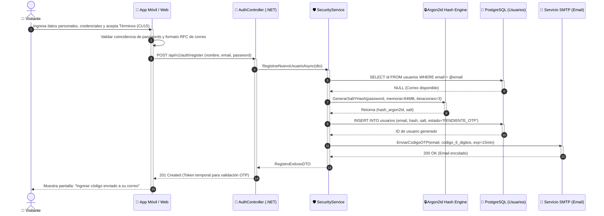

---

### DS02: Inicio de Sesión, Validación de Credenciales y Emisión de Token JWT
- **Casos de Uso:** `CU05` | **Requisitos:** `RF02, RF04, RF24`
- **Descripción:** Verificación criptográfica de credenciales, protección contra ataques de fuerza bruta mediante bloqueo temporal tras 5 intentos y expedición de token JWT con expiración controlada.

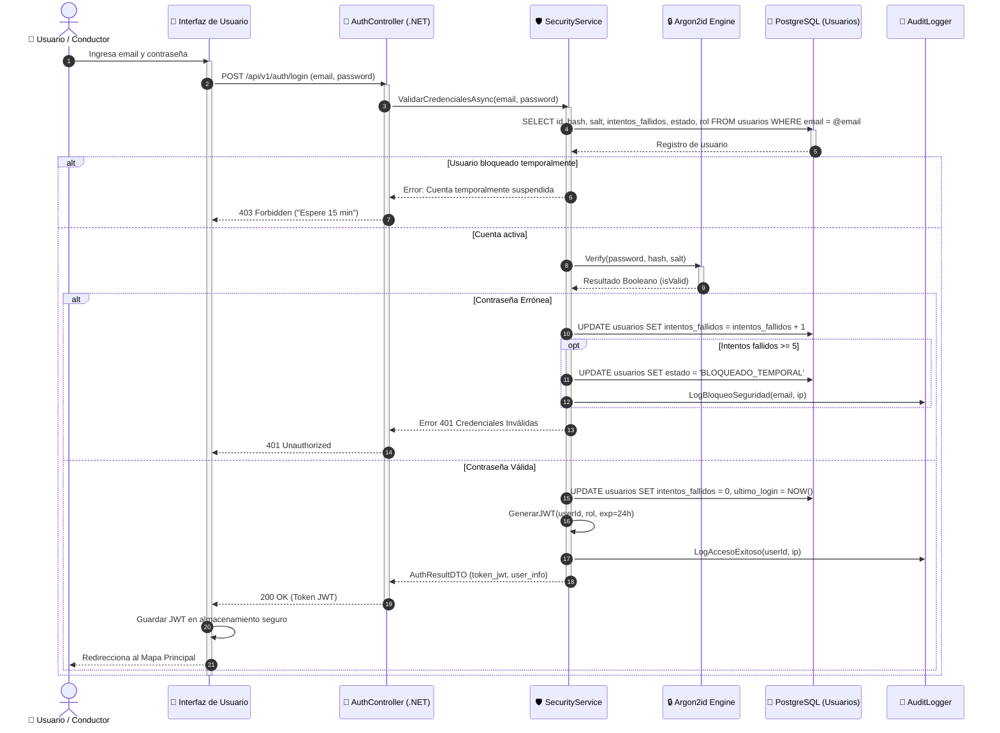

---

### DS03: Recuperación de Contraseña con Token Temporal Criptográfico
- **Casos de Uso:** `CU02` | **Requisitos:** `RF03, RF04`
- **Descripción:** Generación de token firmado de restablecimiento con expiración corta, envío por SMTP y actualización de contraseña previa verificación.

```mermaid
sequenceDiagram
    autonumber
    actor U as 👤 Usuario
    participant UI as 📱 App Móvil / Web
    participant AuthCtrl as 🚪 AuthController (.NET)
    participant TokenSvc as 🔑 TokenService
    participant DB as 💾 PostgreSQL (Tokens / Usuarios)
    participant SMTP as 📧 Servicio SMTP

    U->>UI: Solicita "Olvidé mi contraseña" e ingresa correo
    activate UI
    UI->>AuthCtrl: POST /api/v1/auth/forgot-password (email)
    activate AuthCtrl
    AuthCtrl->>TokenSvc: GenerarTokenRestablecimiento(email)
    activate TokenSvc
    TokenSvc->>DB: INSERT INTO reset_tokens (user_id, token_hash, exp=1h, usado=false)
    activate DB
    DB-->>TokenSvc: Token persistido
    deactivate DB
    TokenSvc->>SMTP: EnviarEmailRecuperacion(email, reset_link_con_token)
    activate SMTP
    SMTP-->>TokenSvc: Email despachado
    deactivate SMTP
    TokenSvc-->>AuthCtrl: Proceso completado
    deactivate TokenSvc
    AuthCtrl-->>UI: 200 OK ("Si el correo existe, recibirá instrucciones")
    deactivate AuthCtrl
    UI-->>U: Aviso visual informativo

    Note over U, UI: El usuario abre el enlace recibido en su correo
    U->>UI: Ingresa nueva contraseña y token
    UI->>AuthCtrl: POST /api/v1/auth/reset-password (token, new_password)
    activate AuthCtrl
    AuthCtrl->>DB: Validar token no expirado y no usado
    activate DB
    DB-->>AuthCtrl: Token válido
    AuthCtrl->>DB: UPDATE usuarios SET hash = nuevo_hash, salt = nuevo_salt; UPDATE reset_tokens SET usado=true
    deactivate DB
    AuthCtrl-->>UI: 200 OK ("Contraseña actualizada exitosamente")
    deactivate AuthCtrl
    UI-->>U: Notifica éxito y redirige a Iniciar Sesión
    deactivate UI
```

---

### DS04: Planificación de Ruta Óptima en Auto Particular, Cálculo de CO₂ y Respaldo PostGIS
- **Casos de Uso:** `CU03, CU06, CU16, CU27` | **Requisitos:** `RF09, RF10, RF11, RF13, RF26, RF27`
- **Descripción:** Cálculo de trayectos vehiculares eficientes, consulta a la API GIS, estimación de combustible y CO₂ evitado vs. promedio de la ciudad y persistencia en base de datos geoespacial.

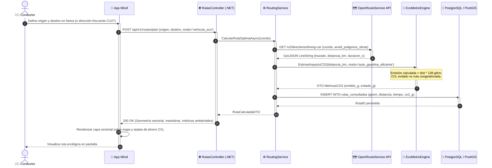

---

### DS05: Desplazamiento a Pie (Modo Peatonal Cero Emisiones) y Comparativa Ambiental
- **Casos de Uso:** `CU03, CU06, CU16` | **Requisitos:** `RF09, RF10, RF11`
- **Descripción:** Resolución de rutas a pie priorizando andenes y zonas seguras peatonales de Neiva, computando 0 gramos de CO₂ emitidos y calculando el 100% de emisiones evitadas.

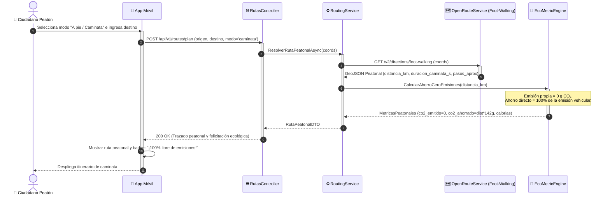

---

### DS06: Navegación Guiada por GPS con Asistencia Auditiva Text-to-Speech (TTS)
- **Casos de Uso:** `CU25` | **Requisitos:** `RF25, RF28`
- **Descripción:** Ciclo continuo de telemetría GPS, seguimiento de la posición en tiempo real, detección de proximidad a maniobras de giro y síntesis auditiva en cabina mediante el motor TTS nativo.

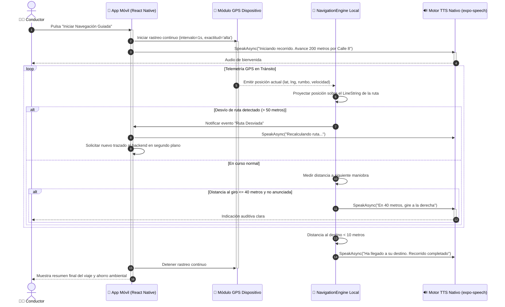

---

### DS07: Consulta Geoespacial de Puntos de Interés (POIs) e Inserción como Parada
- **Casos de Uso:** `CU17` | **Requisitos:** `RF15`
- **Descripción:** Filtrado espacial por categoría y radio de proximidad utilizando funciones ST_DWithin de PostGIS, permitiendo agregar talleres o parqueaderos como paradas intermedias en la ruta.

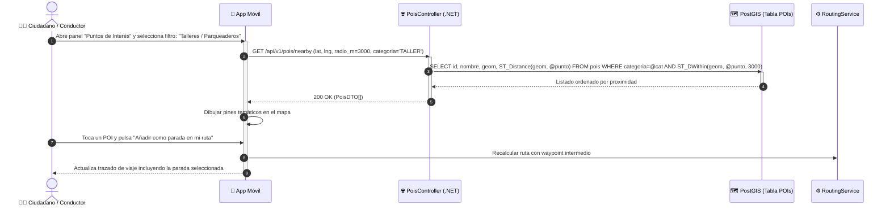

---

### DS08: Registro de Reporte Ciudadano con Captura Satelital GPS y Notificación Push
- **Casos de Uso:** `CU07, CU18` | **Requisitos:** `RF17, RF18, RF25`
- **Descripción:** Georreferenciación de obstáculos en vía, validación de polígono urbano, almacenamiento en PostGIS y difusión push inmediata a conductores que transiten a menos de 3 km.

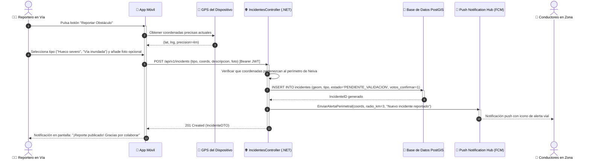

---

### DS09: Validación Comunitaria de Incidentes por Votación en Tiempo Real y Auto-Cierre
- **Casos de Uso:** `CU22` | **Requisitos:** `RF18, RF22`
- **Descripción:** Ciclo colaborativo de votación donde conductores cercanos confirman o descartan reportes, automatizando el archivo o retiro del marcador sin intervención humana.

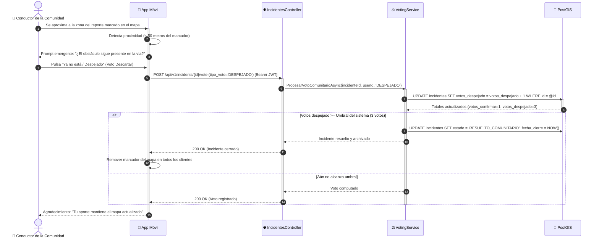

---

### DS10: Consulta, Calificación y Retroalimentación de Trayecto con Estrellas
- **Casos de Uso:** `CU09, CU11` | **Requisitos:** `RF14, RF16`
- **Descripción:** Al finalizar un recorrido, el usuario califica el estado de la vía de 1 a 5 estrellas, redacta observaciones de seguridad y opcionalmente guarda el trayecto como favorito con un alias.

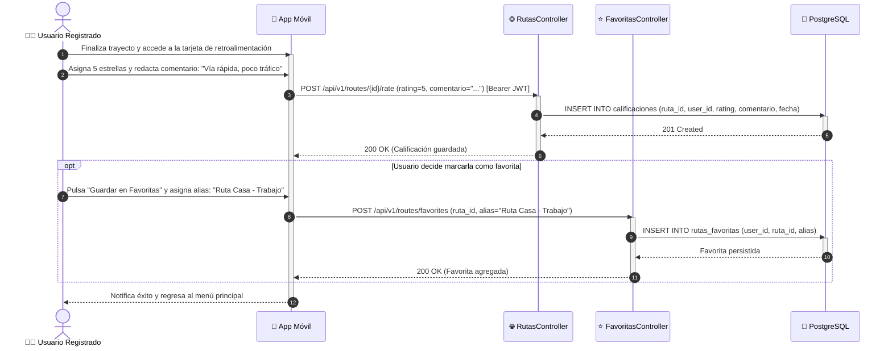

---

### DS11: Generación y Exportación de Historial y Reportes Estadísticos en PDF y Excel
- **Casos de Uso:** `CU08, CU19` | **Requisitos:** `RF20, RF22, RF29`
- **Descripción:** Procesamiento de consultas complejas de trayectos por rango temporal, agregación de métricas de CO₂ y compilación de archivos descargables en formatos PDF y Excel (.xlsx).

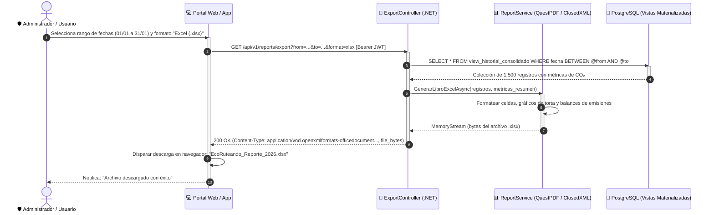

---

### DS12: Gestión Administrativa de Usuarios, Modificación de Roles y Log de Auditoría
- **Casos de Uso:** `CU24, CU28` | **Requisitos:** `RF21, RF23, RF24`
- **Descripción:** Supervisión administrativa de usuarios, revocación o asignación de privilegios de moderador/administrador y registro inmutable en bitácora de auditoría de seguridad.

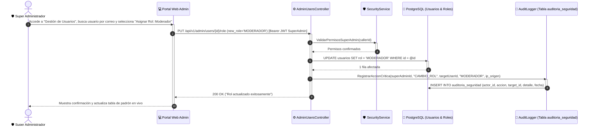

---
