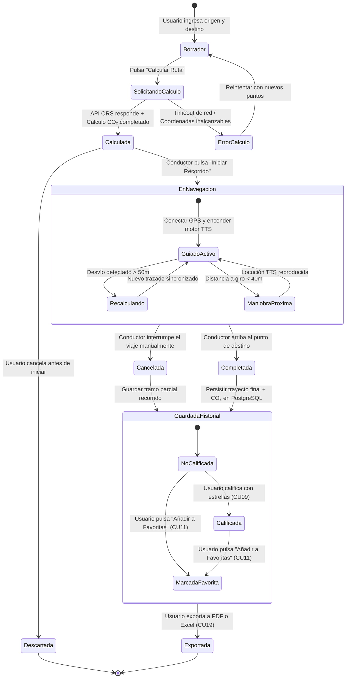
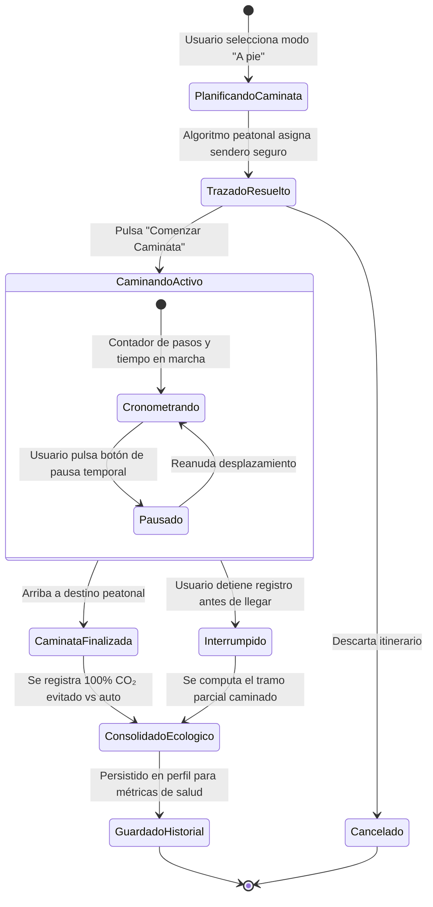
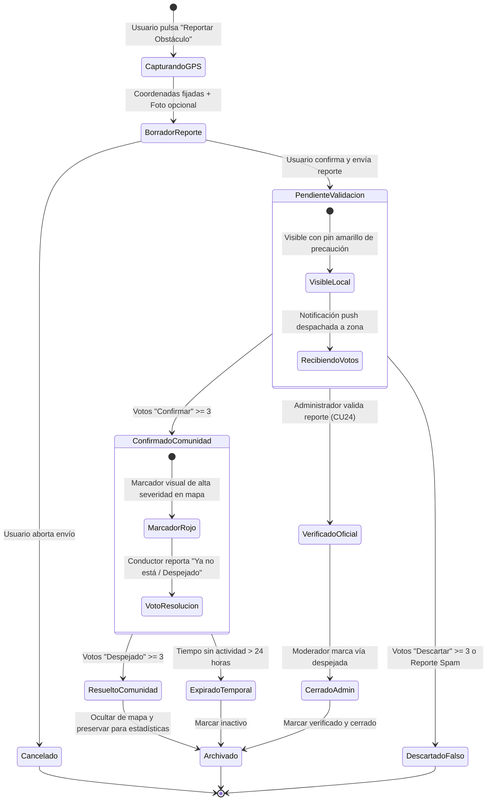
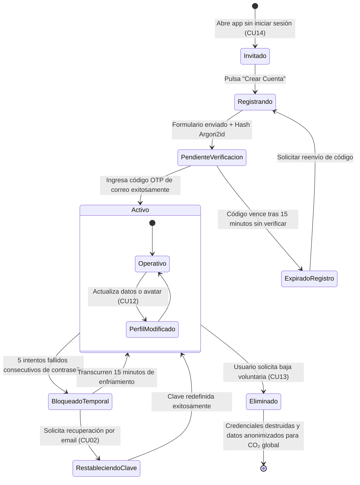
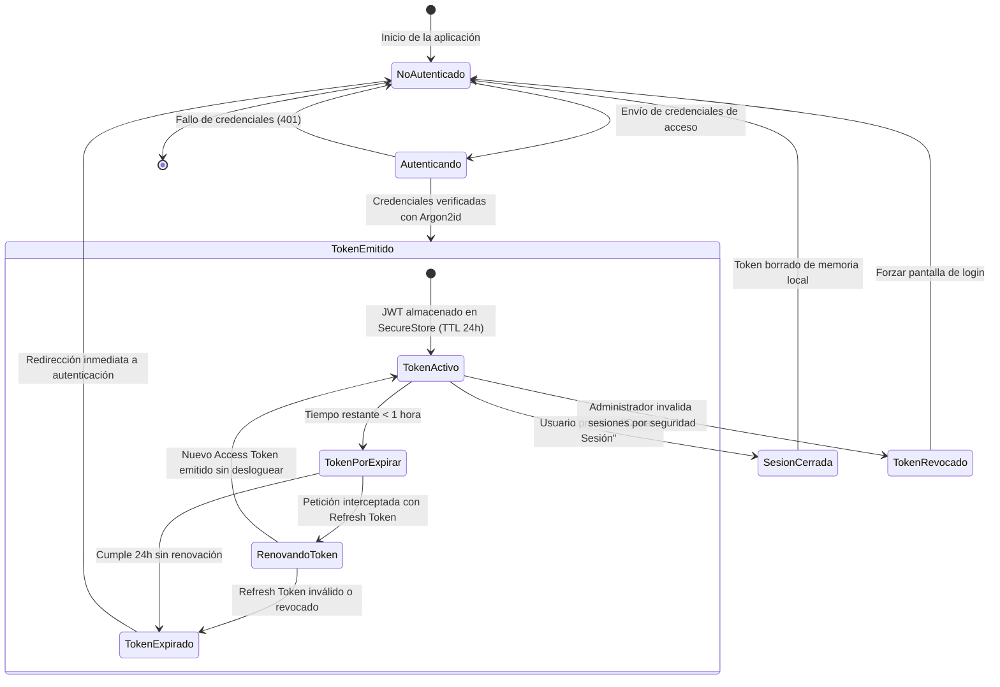
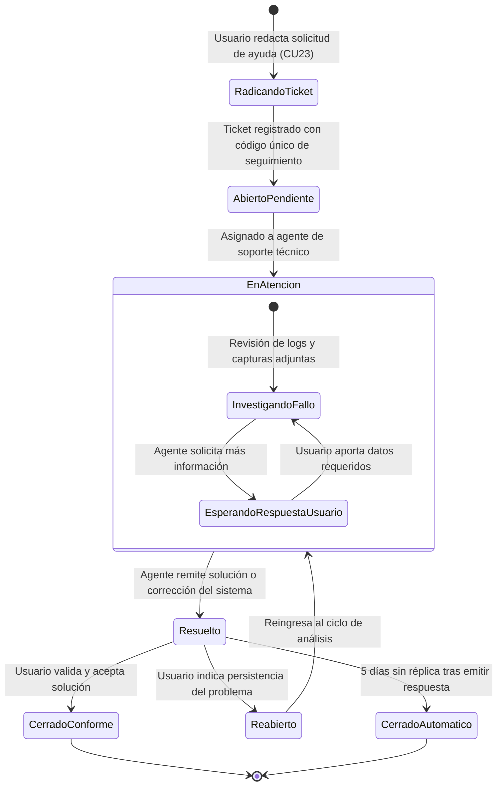
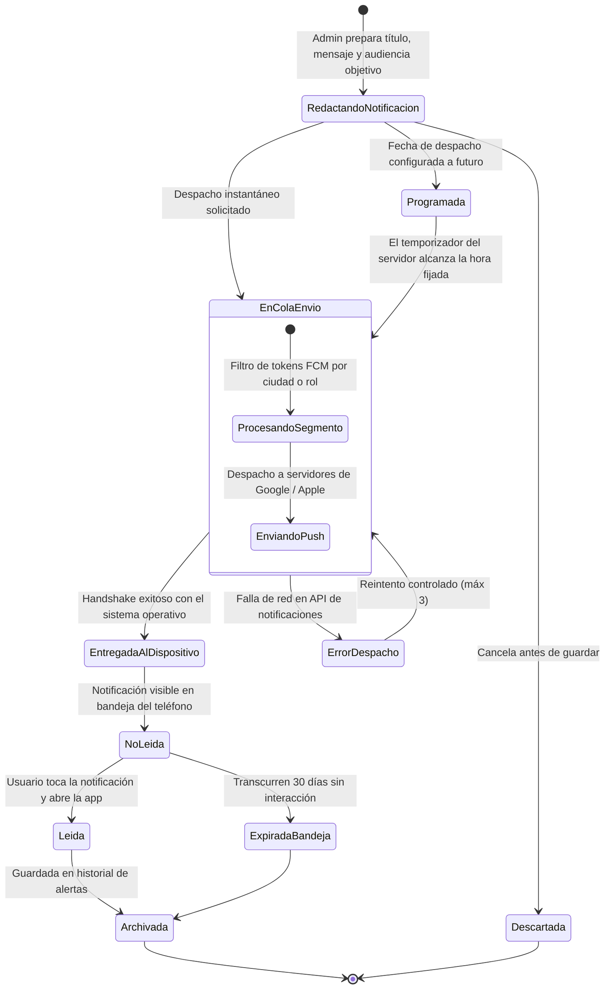
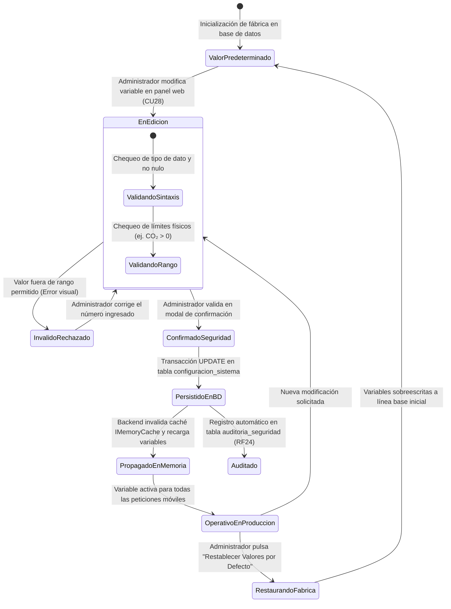

# Suite Maestra de Diagramas de Transición de Estados — EcoRuteando

Este documento recopila la modelación formal mediante **8 Diagramas de Transición de Estados UML 2.5 (Statecharts)** para las entidades y subsistemas del proyecto **EcoRuteando**.

---

## Índice General de Diagramas de Transición

| ID | Entidad o Subsistema Modelado | Requisitos Funcionales |
| :---: | :--- | :--- |
| **TE01** | Ciclo de Vida de una Ruta en Vehículo Particular | RF09, RF10, RF11, RF12, RF14, RF28 |
| **TE02** | Ciclo de Vida de un Trayecto Peatonal / Caminata a Pie | RF09, RF10, RF11, RF12 |
| **TE03** | Ciclo de Vida del Reporte Ciudadano de Obstáculo | RF17, RF18, RF24 |
| **TE04** | Ciclo de Vida de la Cuenta de Usuario | RF01, RF02, RF04, RF06, RF07 |
| **TE05** | Ciclo de Vida de la Sesión y Token JWT (TTL 24h) | RF02, RF04 |
| **TE06** | Ciclo de Vida de un Ticket de Soporte Técnico | RF30 |
| **TE07** | Ciclo de Vida de una Notificación del Sistema | RF25 |
| **TE08** | Ciclo de Vida de Parámetros Operativos del Sistema | RF23, RF24 |

---

### TE01: Ciclo de Vida de una Ruta / Trayecto en Vehículo Particular
- **Requisitos:** `RF09, RF10, RF11, RF12, RF14, RF28`
- **Descripción:** Estados formales por los que transita una ruta en automóvil eficiente: desde su formulación inicial hasta su ejecución asistida por voz y almacenamiento histórico para balances ambientales.

---

### TE02: Ciclo de Vida del Trayecto Peatonal / Caminata a Pie
- **Requisitos:** `RF09, RF10, RF11, RF12`
- **Descripción:** Ciclo de estados para desplazamientos a pie: cálculo de andenes peatonales, métrica de 0 g CO₂ emitidos, pausa de caminata y consolidación en el podio ecológico.

---

### TE03: Ciclo de Vida del Reporte Ciudadano de Obstáculo / Incidente
- **Requisitos:** `RF17, RF18, RF24`
- **Descripción:** Estados de los reportes viales: desde su creación georreferenciada con GPS, su confirmación por consenso de otros conductores y su retiro o archivado por expiración temporal.

---

### TE04: Ciclo de Vida de la Cuenta de Usuario
- **Requisitos:** `RF01, RF02, RF04, RF06, RF07`
- **Descripción:** Ciclo completo de identidad digital: modo invitado local, registro con verificación OTP, sesión activa con token JWT, congelamiento preventivo por ataques de fuerza bruta y baja definitiva.

---

### TE05: Ciclo de Vida de la Sesión y Token de Autenticación (JWT y Refresh Token)
- **Requisitos:** `RF02, RF04`
- **Descripción:** Estados temporales de tokens de acceso: emisión inicial con claims de rol, estado activo durante 24 horas, renovación en segundo plano con refresh token y expiración o revocación definitiva.

---

### TE06: Ciclo de Vida de un Ticket de Soporte Técnico y Mesa de Ayuda
- **Requisitos:** `RF30`
- **Descripción:** Gestión formal de incidencias técnicas: radicación ciudadana, asignación al equipo de soporte, fase de investigación, respuesta al usuario y cierre con encuesta de satisfacción.

---

### TE07: Ciclo de Vida de una Notificación del Sistema (Push / In-App)
- **Requisitos:** `RF25`
- **Descripción:** Ciclo de comunicaciones del sistema: redacción administrativa, programación horaria, encolado en Firebase Cloud Messaging, entrega al dispositivo móvil y lectura por el destinatario.

---

### TE08: Ciclo de Vida de Parámetros Operativos del Sistema
- **Requisitos:** `RF23, RF24`
- **Descripción:** Manejo de variables globales de entorno: factores de cálculo de CO₂, límites geográficos, valores por defecto de fábrica, validación de rangos numéricos y propagación en caliente en caché.

---
