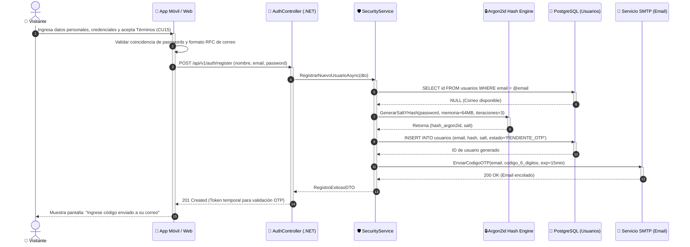

# DS01: Registro de Nuevo Usuario con Hash Argon2id y Envío de Correo OTP

| Campo | Especificación |
| :--- | :--- |
| **Identificador** | DS01 |
| **Nombre** | DS01: Registro de Nuevo Usuario con Hash Argon2id y Envío de Correo OTP |
| **Casos de Uso Vinculados** | CU01, CU15 |
| **Requisitos Funcionales** | RF01, RF04, RF08 |

---

### Descripción del Flujo
Modela el flujo de registro, validación de contraseña robusta, aplicación de hash con salt mediante Argon2id, almacenamiento seguro y despacho de código de verificación vía SMTP.

---

### Diagrama de Secuencia UML

