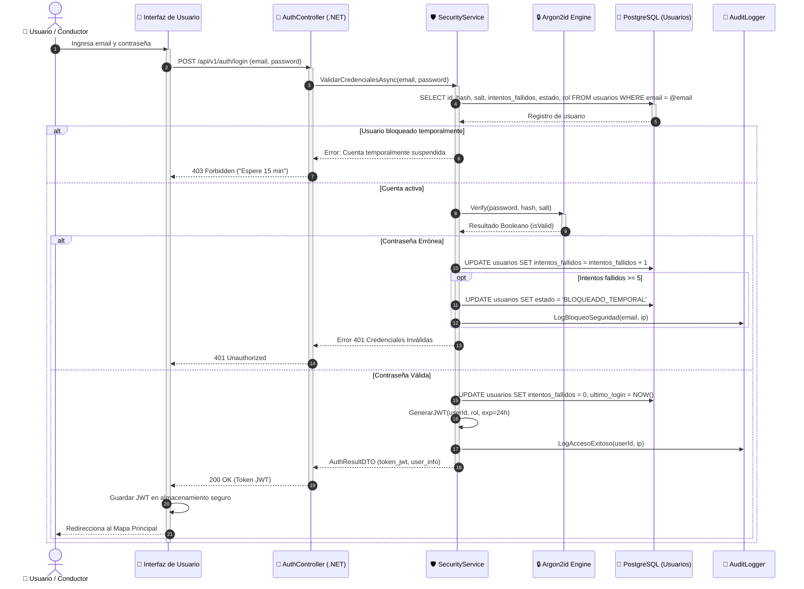

# DS02: Inicio de Sesión, Validación de Credenciales y Emisión de Token JWT

| Campo | Especificación |
| :--- | :--- |
| **Identificador** | DS02 |
| **Nombre** | DS02: Inicio de Sesión, Validación de Credenciales y Emisión de Token JWT |
| **Casos de Uso Vinculados** | CU05 |
| **Requisitos Funcionales** | RF02, RF04, RF24 |

---

### Descripción del Flujo
Verificación criptográfica de credenciales, protección contra ataques de fuerza bruta mediante bloqueo temporal tras 5 intentos y expedición de token JWT con expiración controlada.

---

### Diagrama de Secuencia UML

