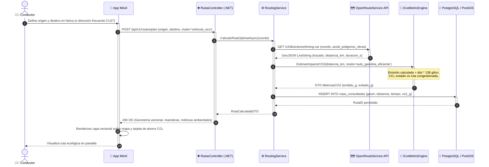

# DS04: Planificación de Ruta Óptima en Auto Particular, Cálculo de CO₂ y Respaldo PostGIS

| Campo | Especificación |
| :--- | :--- |
| **Identificador** | DS04 |
| **Nombre** | DS04: Planificación de Ruta Óptima en Auto Particular, Cálculo de CO₂ y Respaldo PostGIS |
| **Casos de Uso Vinculados** | CU03, CU06, CU16, CU27 |
| **Requisitos Funcionales** | RF09, RF10, RF11, RF13, RF26, RF27 |

---

### Descripción del Flujo
Cálculo de trayectos vehiculares eficientes, consulta a la API GIS, estimación de combustible y CO₂ evitado vs. promedio de la ciudad y persistencia en base de datos geoespacial.

---

### Diagrama de Secuencia UML

