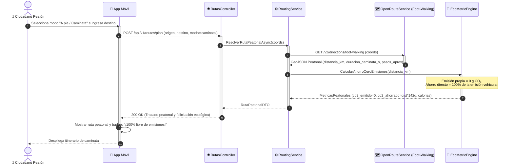

# DS05: Desplazamiento a Pie (Modo Peatonal Cero Emisiones) y Comparativa Ambiental

| Campo | Especificación |
| :--- | :--- |
| **Identificador** | DS05 |
| **Nombre** | DS05: Desplazamiento a Pie (Modo Peatonal Cero Emisiones) y Comparativa Ambiental |
| **Casos de Uso Vinculados** | CU03, CU06, CU16 |
| **Requisitos Funcionales** | RF09, RF10, RF11 |

---

### Descripción del Flujo
Resolución de rutas a pie priorizando andenes y zonas seguras peatonales de Neiva, computando 0 gramos de CO₂ emitidos y calculando el 100% de emisiones evitadas.

---

### Diagrama de Secuencia UML

