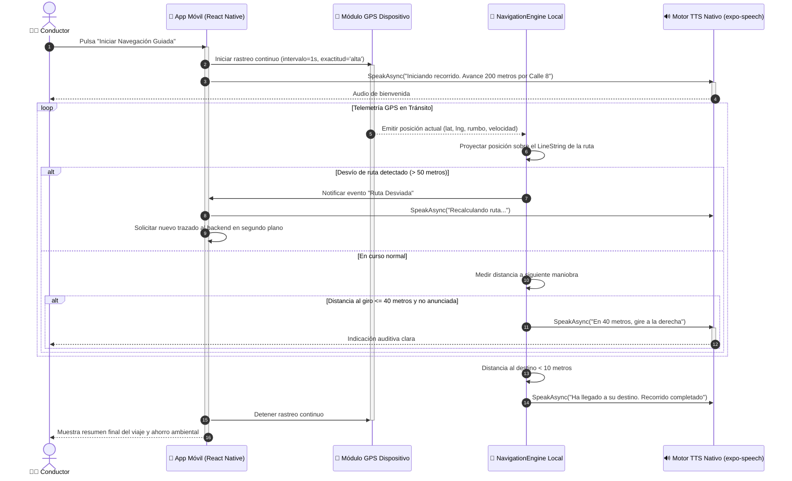

# DS06: Navegación Guiada por GPS con Asistencia Auditiva Text-to-Speech (TTS)

| Campo | Especificación |
| :--- | :--- |
| **Identificador** | DS06 |
| **Nombre** | DS06: Navegación Guiada por GPS con Asistencia Auditiva Text-to-Speech (TTS) |
| **Casos de Uso Vinculados** | CU25 |
| **Requisitos Funcionales** | RF25, RF28 |

---

### Descripción del Flujo
Ciclo continuo de telemetría GPS, seguimiento de la posición en tiempo real, detección de proximidad a maniobras de giro y síntesis auditiva en cabina mediante el motor TTS nativo.

---

### Diagrama de Secuencia UML

