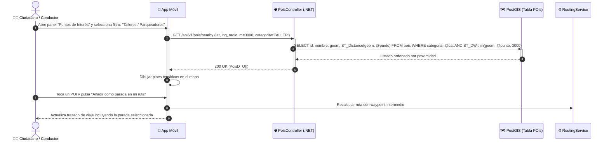

# DS07: Consulta Geoespacial de Puntos de Interés (POIs) e Inserción como Parada

| Campo | Especificación |
| :--- | :--- |
| **Identificador** | DS07 |
| **Nombre** | DS07: Consulta Geoespacial de Puntos de Interés (POIs) e Inserción como Parada |
| **Casos de Uso Vinculados** | CU17 |
| **Requisitos Funcionales** | RF15 |

---

### Descripción del Flujo
Filtrado espacial por categoría y radio de proximidad utilizando funciones ST_DWithin de PostGIS, permitiendo agregar talleres o parqueaderos como paradas intermedias en la ruta.

---

### Diagrama de Secuencia UML

