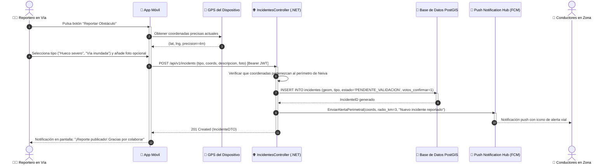

# DS08: Registro de Reporte Ciudadano con Captura Satelital GPS y Notificación Push

| Campo | Especificación |
| :--- | :--- |
| **Identificador** | DS08 |
| **Nombre** | DS08: Registro de Reporte Ciudadano con Captura Satelital GPS y Notificación Push |
| **Casos de Uso Vinculados** | CU07, CU18 |
| **Requisitos Funcionales** | RF17, RF18, RF25 |

---

### Descripción del Flujo
Georreferenciación de obstáculos en vía, validación de polígono urbano, almacenamiento en PostGIS y difusión push inmediata a conductores que transiten a menos de 3 km.

---

### Diagrama de Secuencia UML

