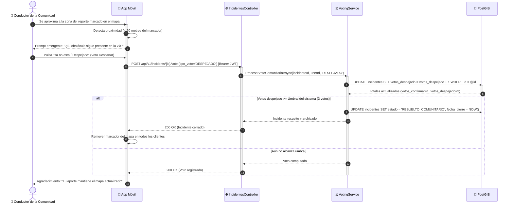

# DS09: Validación Comunitaria de Incidentes por Votación en Tiempo Real y Auto-Cierre

| Campo | Especificación |
| :--- | :--- |
| **Identificador** | DS09 |
| **Nombre** | DS09: Validación Comunitaria de Incidentes por Votación en Tiempo Real y Auto-Cierre |
| **Casos de Uso Vinculados** | CU22 |
| **Requisitos Funcionales** | RF18, RF22 |

---

### Descripción del Flujo
Ciclo colaborativo de votación donde conductores cercanos confirman o descartan reportes, automatizando el archivo o retiro del marcador sin intervención humana.

---

### Diagrama de Secuencia UML

