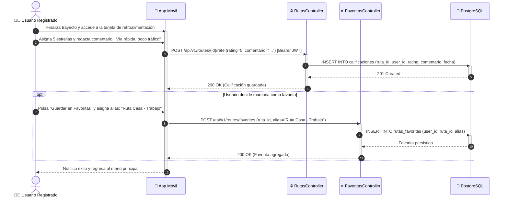

# DS10: Consulta, Calificación y Retroalimentación de Trayecto con Estrellas

| Campo | Especificación |
| :--- | :--- |
| **Identificador** | DS10 |
| **Nombre** | DS10: Consulta, Calificación y Retroalimentación de Trayecto con Estrellas |
| **Casos de Uso Vinculados** | CU09, CU11 |
| **Requisitos Funcionales** | RF14, RF16 |

---

### Descripción del Flujo
Al finalizar un recorrido, el usuario califica el estado de la vía de 1 a 5 estrellas, redacta observaciones de seguridad y opcionalmente guarda el trayecto como favorito con un alias.

---

### Diagrama de Secuencia UML

