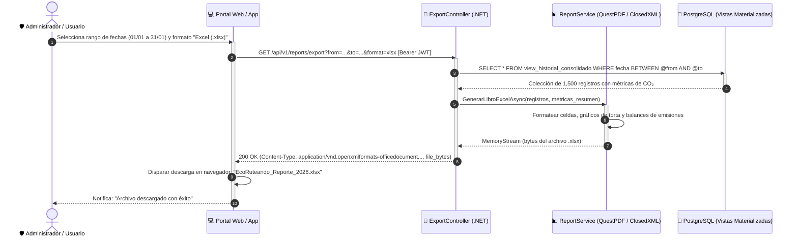

# DS11: Generación y Exportación de Historial y Reportes Estadísticos en PDF y Excel

| Campo | Especificación |
| :--- | :--- |
| **Identificador** | DS11 |
| **Nombre** | DS11: Generación y Exportación de Historial y Reportes Estadísticos en PDF y Excel |
| **Casos de Uso Vinculados** | CU08, CU19 |
| **Requisitos Funcionales** | RF20, RF22, RF29 |

---

### Descripción del Flujo
Procesamiento de consultas complejas de trayectos por rango temporal, agregación de métricas de CO₂ y compilación de archivos descargables en formatos PDF y Excel (.xlsx).

---

### Diagrama de Secuencia UML

