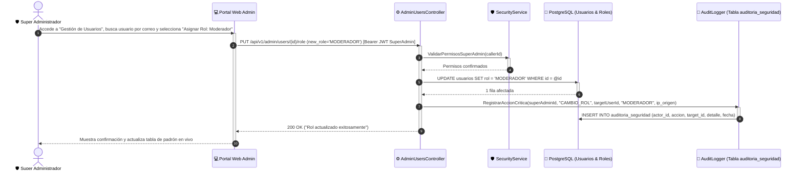

# DS12: Gestión Administrativa de Usuarios, Modificación de Roles y Log de Auditoría

| Campo | Especificación |
| :--- | :--- |
| **Identificador** | DS12 |
| **Nombre** | DS12: Gestión Administrativa de Usuarios, Modificación de Roles y Log de Auditoría |
| **Casos de Uso Vinculados** | CU24, CU28 |
| **Requisitos Funcionales** | RF21, RF23, RF24 |

---

### Descripción del Flujo
Supervisión administrativa de usuarios, revocación o asignación de privilegios de moderador/administrador y registro inmutable en bitácora de auditoría de seguridad.

---

### Diagrama de Secuencia UML

