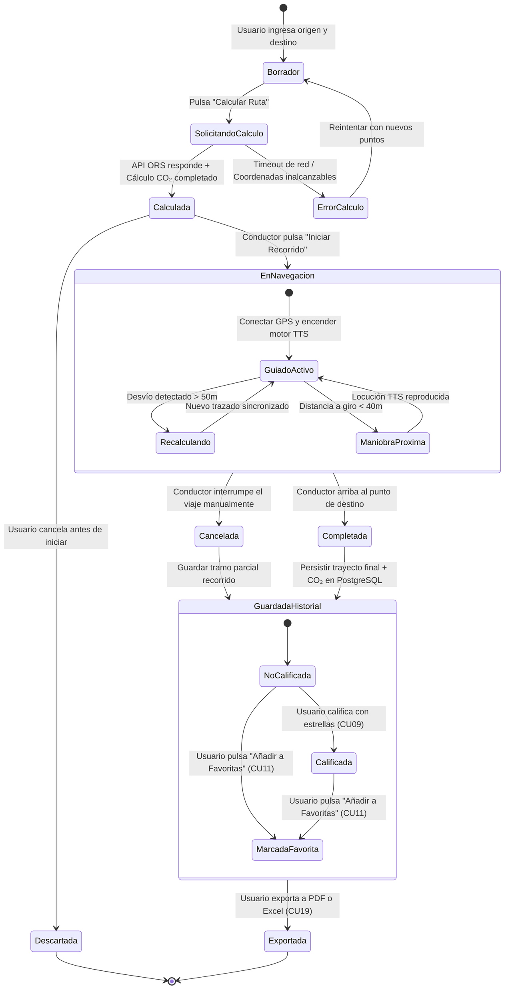

# TE01: Ciclo de Vida de una Ruta / Trayecto en Vehículo Particular

| Campo | Especificación |
| :--- | :--- |
| **Identificador** | TE01 |
| **Nombre** | TE01: Ciclo de Vida de una Ruta / Trayecto en Vehículo Particular |
| **Requisitos Funcionales** | RF09, RF10, RF11, RF12, RF14, RF28 |

---

### Descripción de la Máquina de Estados
Estados formales por los que transita una ruta en automóvil eficiente: desde su formulación inicial hasta su ejecución asistida por voz y almacenamiento histórico para balances ambientales.

---

### Diagrama de Transición de Estados UML (Statechart)

