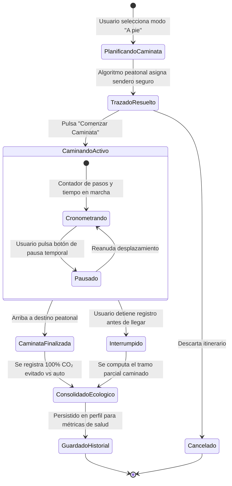

# TE02: Ciclo de Vida del Trayecto Peatonal / Caminata a Pie

| Campo | Especificación |
| :--- | :--- |
| **Identificador** | TE02 |
| **Nombre** | TE02: Ciclo de Vida del Trayecto Peatonal / Caminata a Pie |
| **Requisitos Funcionales** | RF09, RF10, RF11, RF12 |

---

### Descripción de la Máquina de Estados
Ciclo de estados para desplazamientos a pie: cálculo de andenes peatonales, métrica de 0 g CO₂ emitidos, pausa de caminata y consolidación en el podio ecológico.

---

### Diagrama de Transición de Estados UML (Statechart)

