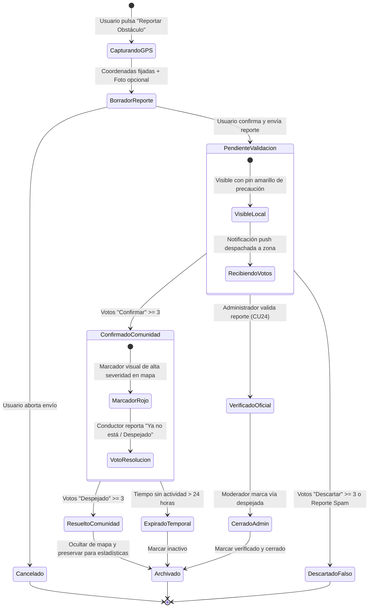

# TE03: Ciclo de Vida del Reporte Ciudadano de Obstáculo / Incidente

| Campo | Especificación |
| :--- | :--- |
| **Identificador** | TE03 |
| **Nombre** | TE03: Ciclo de Vida del Reporte Ciudadano de Obstáculo / Incidente |
| **Requisitos Funcionales** | RF17, RF18, RF24 |

---

### Descripción de la Máquina de Estados
Estados de los reportes viales: desde su creación georreferenciada con GPS, su confirmación por consenso de otros conductores y su retiro o archivado por expiración temporal.

---

### Diagrama de Transición de Estados UML (Statechart)

