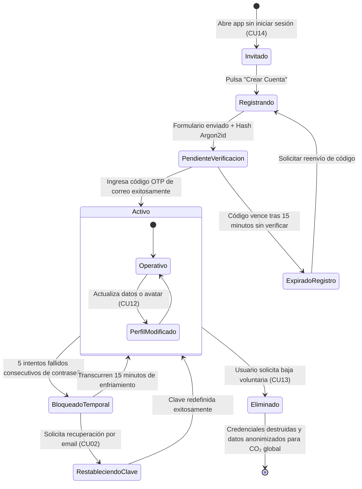

# TE04: Ciclo de Vida de la Cuenta de Usuario

| Campo | Especificación |
| :--- | :--- |
| **Identificador** | TE04 |
| **Nombre** | TE04: Ciclo de Vida de la Cuenta de Usuario |
| **Requisitos Funcionales** | RF01, RF02, RF04, RF06, RF07 |

---

### Descripción de la Máquina de Estados
Ciclo completo de identidad digital: modo invitado local, registro con verificación OTP, sesión activa con token JWT, congelamiento preventivo por ataques de fuerza bruta y baja definitiva.

---

### Diagrama de Transición de Estados UML (Statechart)

