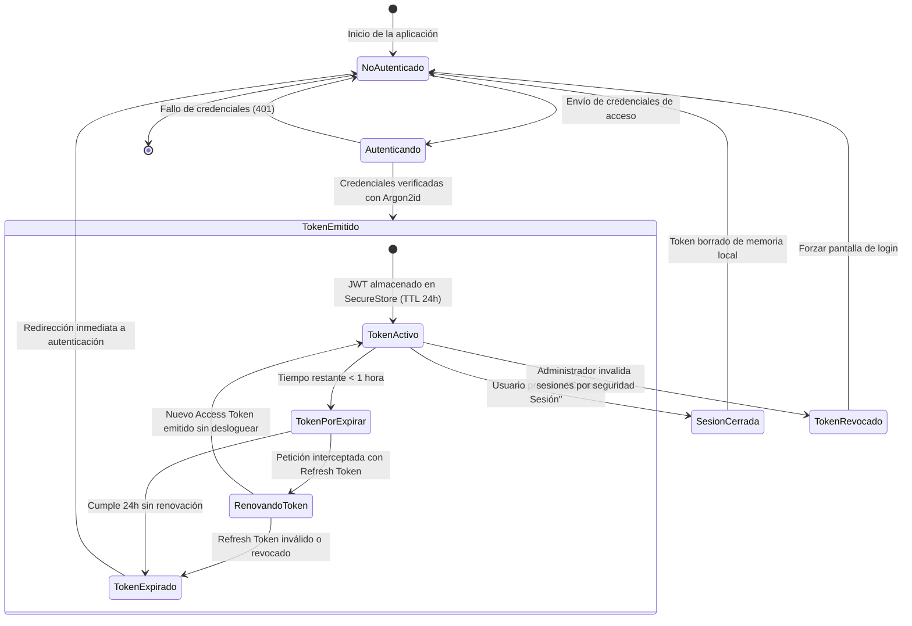

# TE05: Ciclo de Vida de la Sesión y Token de Autenticación (JWT y Refresh Token)

| Campo | Especificación |
| :--- | :--- |
| **Identificador** | TE05 |
| **Nombre** | TE05: Ciclo de Vida de la Sesión y Token de Autenticación (JWT y Refresh Token) |
| **Requisitos Funcionales** | RF02, RF04 |

---

### Descripción de la Máquina de Estados
Estados temporales de tokens de acceso: emisión inicial con claims de rol, estado activo durante 24 horas, renovación en segundo plano con refresh token y expiración o revocación definitiva.

---

### Diagrama de Transición de Estados UML (Statechart)

