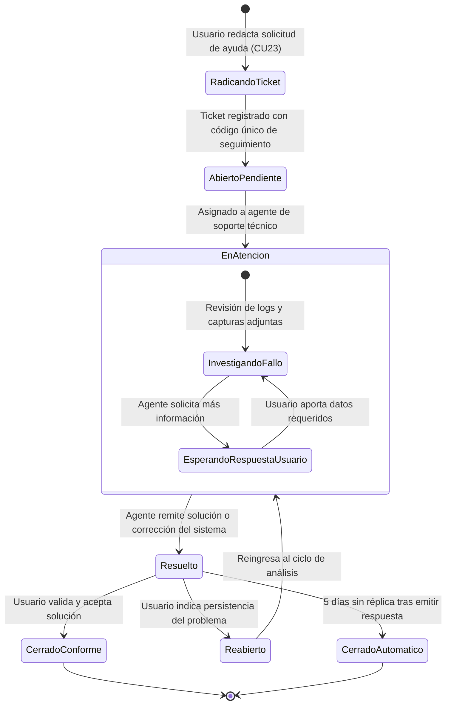

# TE06: Ciclo de Vida de un Ticket de Soporte Técnico y Mesa de Ayuda

| Campo | Especificación |
| :--- | :--- |
| **Identificador** | TE06 |
| **Nombre** | TE06: Ciclo de Vida de un Ticket de Soporte Técnico y Mesa de Ayuda |
| **Requisitos Funcionales** | RF30 |

---

### Descripción de la Máquina de Estados
Gestión formal de incidencias técnicas: radicación ciudadana, asignación al equipo de soporte, fase de investigación, respuesta al usuario y cierre con encuesta de satisfacción.

---

### Diagrama de Transición de Estados UML (Statechart)

