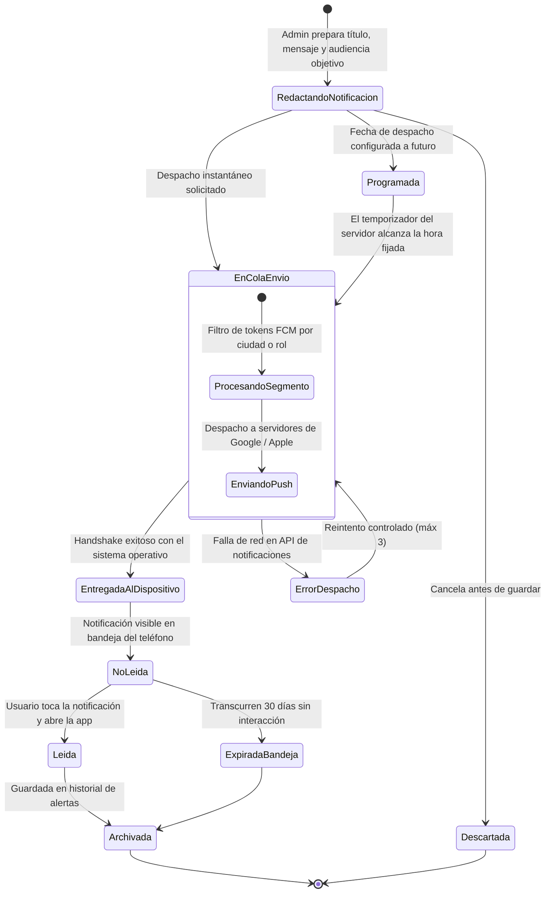

# TE07: Ciclo de Vida de una Notificación del Sistema (Push / In-App)

| Campo | Especificación |
| :--- | :--- |
| **Identificador** | TE07 |
| **Nombre** | TE07: Ciclo de Vida de una Notificación del Sistema (Push / In-App) |
| **Requisitos Funcionales** | RF25 |

---

### Descripción de la Máquina de Estados
Ciclo de comunicaciones del sistema: redacción administrativa, programación horaria, encolado en Firebase Cloud Messaging, entrega al dispositivo móvil y lectura por el destinatario.

---

### Diagrama de Transición de Estados UML (Statechart)

