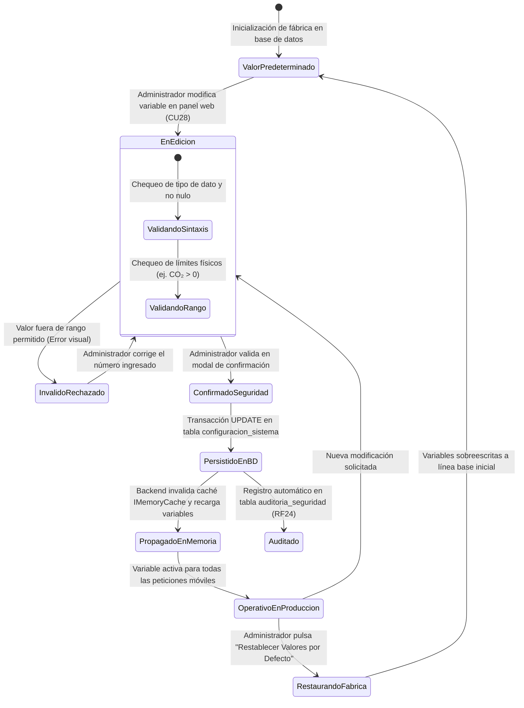

# TE08: Ciclo de Vida de Parámetros Operativos del Sistema

| Campo | Especificación |
| :--- | :--- |
| **Identificador** | TE08 |
| **Nombre** | TE08: Ciclo de Vida de Parámetros Operativos del Sistema |
| **Requisitos Funcionales** | RF23, RF24 |

---

### Descripción de la Máquina de Estados
Manejo de variables globales de entorno: factores de cálculo de CO₂, límites geográficos, valores por defecto de fábrica, validación de rangos numéricos y propagación en caliente en caché.

---

### Diagrama de Transición de Estados UML (Statechart)

