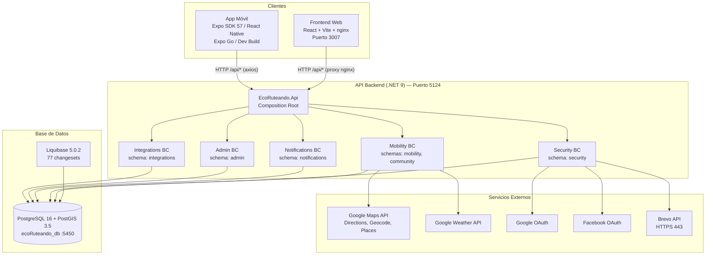
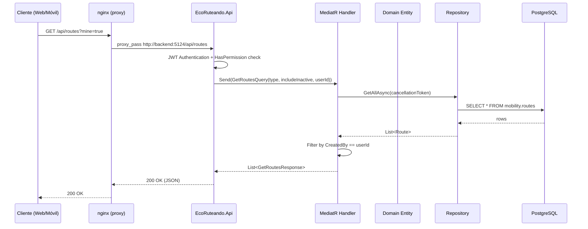

# Manual Técnico — EcoRuteando

| Campo | Valor |
|-------|-------|
| **Proyecto** | EcoRuteando |
| **Versión del documento** | 1.0 |
| **Fecha de actualización** | 13 de octubre de 2026 |
| **Estado** | Vigente |
| **Alcance** | Backend, Frontend Web, Aplicación Móvil, Base de Datos |

---

## Índice

1. [Introducción y propósito](#1-introducción-y-propósito)
2. [Alcance del sistema](#2-alcance-del-sistema)
3. [Descripción general de la solución](#3-descripción-general-de-la-solución)
4. [Arquitectura de software (DDD + Clean Architecture)](#4-arquitectura-de-software)
5. [Tecnologías, herramientas y versiones](#5-tecnologías-herramientas-y-versiones)
6. [Estructura de los repositorios](#6-estructura-de-los-repositorios)
7. [Descripción de módulos y componentes](#7-descripción-de-módulos-y-componentes)
8. [Modelo de datos](#8-modelo-de-datos)
9. [APIs, endpoints, autenticación y autorización](#9-apis-endpoints-autenticación-y-autorización)
10. [Configuración del entorno](#10-configuración-del-entorno)
11. [Instalación y ejecución paso a paso](#11-instalación-y-ejecución-paso-a-paso)
12. [Compilación y construcción](#12-compilación-y-construcción)
13. [Pruebas y validación](#13-pruebas-y-validación)
14. [Despliegue](#14-despliegue)
15. [Mantenimiento, registros y diagnóstico](#15-mantenimiento-registros-y-diagnóstico)
16. [Solución de problemas frecuentes](#16-solución-de-problemas-frecuentes)
17. [Seguridad, permisos y manejo de secretos](#17-seguridad-permisos-y-manejo-de-secretos)
18. [Funcionalidades: estado de implementación](#18-funcionalidades-estado-de-implementación)
19. [Glosario técnico](#19-glosario-técnico)
---

## 1. Introducción y propósito

Este manual técnico describe la arquitectura, configuración, instalación, ejecución y mantenimiento de **EcoRuteando**, una plataforma de movilidad ecológica que permite planificar rutas sostenibles, estimar impacto ambiental, reportar obstáculos y recibir alertas climáticas.

El documento está dirigido a desarrolladores que se incorporen al proyecto y necesiten comprender, instalar, ejecutar, validar y mantener el sistema sin depender de explicaciones verbales del equipo.

### 1.1 Convención de evidencia

A lo largo del manual se distingue entre:

| Etiqueta | Significado |
|----------|-------------|
| **Verificado** | Respaldado directamente por código fuente o configuración revisada |
| **Inferido** | Deducido de evidencias indirectas, no confirmado directamente |
| **Pendiente** | Requiere información adicional o validación manual |

---

## 2. Alcance del sistema

EcoRuteando comprende cuatro componentes distribuidos en cuatro repositorios:

| Componente | Repositorio | Tecnología | Rol |
|-----------|------------|-----------|-----|
| **API Backend** | `EcoRuteandoBackend` | .NET 9 (C#) | API REST — módulos Security, Mobility, Notifications, Admin, Integrations |
| **Frontend Web** | `EcoRuteando/front-end/ecoRuteando-react` | React 18 + Vite 8 | Aplicación web SPA (usuario y administrador) |
| **App Móvil** | `Movil-EcoRuteando` | Expo SDK 57 / React Native 0.86 | Aplicación móvil Android/iOS/Web |
| **Base de Datos** | `EcoRuteandoDb` | PostgreSQL 16 + PostGIS 3.5 + Liquibase | Esquema, migraciones y datos semilla |

El repositorio `EcoRuteando` (raíz) contiene además el `docker-compose.yml` principal que orquesta el stack completo local.

### 2.1 Fuera de alcance

- Infraestructura de monitoreo (APM, alerting)
- Pipeline CI/CD para backend y móvil (no existe)
- Publicación en tiendas de aplicaciones (configuración `submit` vacía en `eas.json`)

---

## 3. Descripción general de la solución

EcoRuteando es una plataforma de movilidad sostenible orientada a la ciudad de **Neiva, Colombia** (coordenadas por defecto: 2.9273, −75.2819). Permite a los usuarios:

- Planificar rutas a pie, en carro, en bicicleta o transporte público usando Google Maps
- Estimar ahorro de CO₂ y calorías quemadas
- Guardar rutas y marcar favoritas
- Calificar rutas y compartirlas
- Reportar obstáculos en el mapa con foto y GPS
- Recibir alertas climáticas basadas en ubicación
- Consultar historial de viajes y estadísticas personales
- Administrar usuarios, reportes, exportes y configuración del sistema (rol Admin)

### 3.1 Actores del sistema

| Actor | Descripción |
|-------|------------|
| **Usuario registrado** | Se autentica con email/contraseña u OAuth (Google), planifica rutas, guarda favoritos, reporta obstáculos |
| **Usuario invitado** | Accede en modo invitado sin autenticación; puede planificar rutas pero no guardar datos |
| **Administrador** | Gestiona usuarios, modera reportes, revisa estadísticas, administra exportes y configuración |
| **Sistema** | Genera notificaciones, ejecuta limpieza de tokens expirados, integra datos meteorológicos |

---

## 4. Arquitectura de software

### 4.1 Fundamentos de DDD (Domain-Driven Design)

EcoRuteando aplica **Domain-Driven Design** con **Clean Architecture** en el backend .NET. Esta sección describe cómo se reflejan los principios de DDD en el código fuente real.

#### 4.1.1 Bounded Contexts (Contextos acotados)

El sistema se divide en **5 bounded contexts** independientes, cada uno con su propio esquema de base de datos, sus entidades, sus repositorios y sus reglas de negocio:

| Bounded Context | Esquema BD | Responsabilidad |
|----------------|-----------|----------------|
| **Security** | `security` | Autenticación, autorización, usuarios, roles, permisos, sesiones, 2FA, OAuth, auditoría |
| **Mobility** | `mobility` + `community` | Rutas, POIs, viajes, favoritos, calificaciones, reportes de obstáculos, estadísticas |
| **Notifications** | `notifications` | Notificaciones in-app, push, plantillas, tokens de dispositivo |
| **Admin** | `admin` | Estadísticas consolidadas, exportes, configuración del sistema, soporte, factores de transporte |
| **Integrations** | `integrations` | Caché de APIs externas, datos meteorológicos, calidad del aire |

**Verificado:** Los módulos **nunca se referencian entre sí**. No existe ningún `using EcoRuteando.Modules.<Otro>` en todo el código fuente. Cada contexto posee su propio `DbContext` de EF Core con tabla de historial de migraciones independiente.

#### 4.1.2 Entidades y raíces de agregado

**Clase base compartida** (`src/Shared/EcoRuteando.Shared/BaseClasses/Entity.cs`):

```csharp
public abstract class Entity<TId>
{
    public TId Id { get; protected set; }
    public DateTime CreatedAt { get; protected set; }
    public DateTime? UpdatedAt { get; protected set; }
    // Igualdad basada en identidad (Id)
}
```

**Raíces de agregado identificadas** (entidades que gestionan sus propios hijos):

| Raíz | Contexto | Colección de hijos | Invariante gestionado |
|------|---------|-------------------|----------------------|
| `User` | Security | `UserRoles`, `RefreshTokens` | Escalación de bloqueo de cuenta (`LockoutEscalationSeconds = {30, 60, 300, 900}`) |
| `Route` | Mobility | `RoutePois` | `AddPoi()` rechaza POIs duplicados |
| `RouteUsage` | Mobility | — | `Complete()` impide finalizar dos veces; `EndedAt >= StartedAt` |
| `SupportTicket` | Admin | `Messages` | `AddMessage()` encapsula la lista `_messages` |
| `ObstacleReport` | Mobility | `ReportVotes` | `Validate()` impide autvalidación |

**Entidades con estado encapsulado** (máquinas de estado en el dominio):

- `RefreshToken`: `Revoke()` / `IsActive`
- `Session`: `Revoke()`
- `TwoFactorAuth`: `Enable()` / `Disable()` / `UpdateSecret()`
- `EmailVerification`: `MarkAsVerified()` / `UpdateToken()`
- `AdminExport`: `Create()` / `Complete()` / `Fail()`

#### 4.1.3 Lo que NO está implementado en DDD

**Verificado** mediante investigación del código fuente:

| Patrón DDD | Estado | Evidencia |
|-----------|--------|-----------|
| Value Objects | **No implementado** | No hay records con igualdad estructural ni clases con `Equals` sobrescrito. Las ubicaciones usan tipos `NetTopologySuite` (Point, LineString) directamente en el dominio. `string Status`, `string PreferredLanguage` son primitivos. |
| Domain Events | **No implementado** | Cero coincidencias de `DomainEvent`, `IDomainEvent`, `RaiseEvent` en todo `src/`. Existe una carpeta `Events/` vacía en `EcoRuteando.Shared.csproj` como placeholder. |
| Specification Pattern | **No implementado** | El filtrado vive en métodos de repositorio (`GetActiveAsync`, `GetForValidationAsync`). |
| Domain Services | **No implementados** | No existen clases `*DomainService`. Toda coordinación está en Application handlers. |
| Event Sourcing | **No implementado** | Sin outbox, sin event store. |

> **Nota para el manual:** La ausencia de Value Objects se manifiesta como *primitive obsession* — campos como `Status = "active"` o `PrimaryColor = "#1ABC9C"` (validado por regex en `User.Update`) son strings en lugar de tipos de valor con invariantes.

#### 4.1.4 Aislamiento entre Bounded Contexts

Los contextos se comunican **únicamente a través de la base de datos y la API**, nunca por referencia directa:

- `User.Id` aparece como `Guid` (sin navegación) en Mobility, Notifications, Admin
- `TransportFactor` está **duplicado** en Admin y Mobility (con enums `TransportType` separados)
- `SystemConfiguration` (Admin) y `SecurityPolicy` (Security) son singletons independientes

Esto constituye una forma de **duplicated-model separation** en lugar de un Anti-Corruption Layer formal.

### 4.2 Aplicación de Clean Architecture

#### 4.2.1 Capas por módulo

Cada bounded context implementa **Clean Architecture** con 4 capas:

```
┌─────────────────────────────────────────────────────────┐
│                    EcoRuteando.Api                       │
│              (Composition Root / Host)                   │
│         Registra Infrastructure + Presentation           │
└──────────────────────┬──────────────────────────────────┘
                       │ referencia
┌──────────────────────▼──────────────────────────────────┐
│                   Presentation                           │
│  Controllers, Request Contracts                          │
│  Referencia: solo Application                            │
└──────────────────────┬──────────────────────────────────┘
                       │ referencia
┌──────────────────────▼──────────────────────────────────┐
│                    Application                           │
│  Commands, Queries, Handlers, Validators                 │
│  Abstractions (interfaces de infraestructura)            │
│  Referencia: Domain + Shared                             │
└──────────────────────┬──────────────────────────────────┘
                       │ referencia
┌──────────────────────▼──────────────────────────────────┐
│                      Domain                              │
│  Entities, Enums, Repository Interfaces                  │
│  Referencia: solo Shared                                 │
└─────────────────────────────────────────────────────────┘

┌─────────────────────────────────────────────────────────┐
│                  Infrastructure                          │
│  EF Core DbContext, Configurations, Repositories         │
│  External Services (Google, SMTP, OAuth)                 │
│  Referencia: Application + Domain + Shared               │
└─────────────────────────────────────────────────────────┘
```

#### 4.2.2 Dirección de las dependencias (verificada en .csproj)

| Capa | Referencia a | NuGet notable |
|------|-------------|---------------|
| **Domain** | Solo `Shared` | Npgsql (para `[PgName]`), NetTopologySuite (Mobility/Integrations) |
| **Application** | Domain + Shared | MediatR 14.1.0, FluentValidation 11.11.0 |
| **Infrastructure** | Application + Domain + Shared | EF Core 9.0, Npgsql EF, BCrypt, MailKit, JWT |
| **Presentation** | Solo Application | FrameworkReference AspNetCore.App |
| **Api** | Infrastructure + Presentation (de todos los módulos) | JWT Bearer, Serilog (referenciado sin usar), Swashbuckle |

**Verificado:** La dirección Presentation → Application → Domain es correcta en los `.csproj`. Presentation nunca referencia Infrastructure directamente.

**Hallazgo:** 7 controllers hacen `using ...Domain.Enums` para parsear enums de query strings — un menor debilitamiento de la frontera.

#### 4.2.3 Shared Kernel (`EcoRuteando.Shared`)

El kernel compartido es mínimo (10 archivos):

| Componente | Contenido |
|-----------|-----------|
| `BaseClasses/Entity.cs` | Clase base genérica de entidades |
| `Abstractions/Persistence/` | `IUnitOfWork`, `ISecurityUnitOfWork`, `IMobilityUnitOfWork` |
| `Exceptions/` | `DomainException`, `NotFoundException`, `ConflictException`, `ForbiddenException`, `UnauthorizedException` |
| `Authorization/` | `HasPermissionAttribute`, `PermissionRequirement`, `PermissionPolicyProvider` |

**No se comparten:** enums, entidades, DTOs, interfaces de repositorio — cada BC los posee exclusivamente.

### 4.3 Implementación de CQRS con MediatR

#### 4.3.1 Patrón de carpetas (Vertical Slice)

```
Application/
├── Routes/                          # Feature
│   ├── Commands/                    # Escrituras
│   │   ├── CreateRoute/
│   │   │   ├── CreateRouteCommand.cs        # record : IRequest<Guid>
│   │   │   ├── CreateRouteCommandHandler.cs # IRequestHandler<...>
│   │   │   └── CreateRouteCommandValidator.cs # AbstractValidator
│   │   ├── UpdateRoute/
│   │   └── DeleteRoute/
│   └── Queries/                     # Lecturas
│       ├── GetRoutes/
│       │   ├── GetRoutesQuery.cs            # record : IRequest<IReadOnlyList<...>>
│       │   ├── GetRoutesQueryHandler.cs
│       │   └── GetRoutesResponse.cs         # DTO
│       └── GetRouteById/
└── ...
```

#### 4.3.2 Inventario CQRS

| Métrica | Cantidad |
|---------|---------|
| Command records | 67 |
| Query records | 47 |
| Response/DTO records | 48 |
| Validators FluentValidation | 24 |

#### 4.3.3 Pipeline Behaviors

`ValidationBehavior<TRequest, TResponse>` está registrado en los módulos **Security** y **Mobility**. Los módulos **Admin, Notifications e Integrations** registran MediatR pero **no** el pipeline de validación — sus handlers hacen validaciones manuales con `ArgumentException`.

### 4.4 Unit of Work

Patrón **DbContext-as-UoW**:

```csharp
// Security: SecurityDbContext implementa ISecurityUnitOfWork
services.AddScoped<ISecurityUnitOfWork>(sp => sp.GetRequiredService<SecurityDbContext>());
```

**Implementado en:** Security, Mobility
**NO implementado en:** Admin, Notifications, Integrations — sus `DbContext` son clases `: DbContext` planas sin `IUnitOfWork`.

No existe gestión transaccional (`BeginTransaction`) en ningún módulo.

### 4.5 Diagrama de arquitectura general



### 4.6 Flujo de solicitud



### 4.7 Integración con PostgreSQL, PostGIS y Liquibase

- **Una sola BD** `ecoRuteando_db` con **6 esquemas** PostgreSQL
- **PostGIS** habilitado para columnas `GEOGRAPHY(POINT/LINESTRING, 4326)`
- **Liquibase** gestiona el esquema completo: **77 changesets** en `changelog/db.changelog-master.yaml`
- **EF Core Migrations** existe solo para Security (`InitialCreate`) — el esquema real es gestionado por Liquibase
- Cada módulo tiene su propia tabla `__EFMigrationsHistory` en su esquema

### 4.8 Comunicación entre componentes

| Origen | Destino | Protocolo | Mecanismo |
|--------|---------|-----------|-----------|
| Frontend Web | Backend | HTTP/REST | nginx proxy `/api/` → `backend:5124` |
| App Móvil | Backend | HTTP/REST | axios con `baseURL = EXPO_PUBLIC_API_URL` |
| Backend | PostgreSQL | TCP 5432 | Npgsql / EF Core |
| Liquibase | PostgreSQL | TCP 5432 | JDBC (contenedor one-shot) |
| Backend | Google Maps/Weather | HTTPS | HttpClient con API key |
| Backend | Brevo API | HTTPS 443 | HttpClient (api-key) |

**No existe comunicación directa entre Frontend y App Móvil.** No hay WebSockets, gRPC ni message broker.
---

## 5. Tecnologías, herramientas y versiones

> **Verificado** en `*.csproj`, `package.json` y `docker-compose.yml` (13 oct 2026).

### 5.1 Backend (.NET)

| Tecnología | Versión | Uso |
|-----------|---------|-----|
| .NET | 9.0 (`net9.0`) | Runtime y SDK del proyecto |
| ASP.NET Core | 9.0 | Framework web (API REST) |
| Entity Framework Core | 9.0 | ORM |
| Npgsql / Npgsql.EntityFrameworkCore.PostgreSQL | 9.0 | Proveedor PostgreSQL + PostGIS |
| NetTopologySuite | 11.x (via Npgsql) | Tipos espaciales (Point, LineString) |
| MediatR | 14.1.0 | Desacoplamiento CQRS |
| FluentValidation | 11.11.0 | Validación de commands/queries |
| BCrypt.Net-Next | 4.x | Hash de contraseñas |
| Brevo API | REST/HTTPS | Envío de correos transaccionales vía HTTPS 443 |
| Microsoft.AspNetCore.Authentication.JwtBearer | 9.0.0 | Autenticación JWT |
| Swashbuckle | 6.x | Swagger/OpenAPI |
| Serilog.AspNetCore | 8.0.3 | Logging (**referenciado, sin configurar**) |
| Microsoft.VisualStudio.Azure.Containers.Tools.Targets | 1.22.1 | Integración Docker en IDE |

> **Nota:** El SDK instalado en la máquina es .NET 10.0.112 (mayor compatibilidad hacia atrás con `net9.0`).

### 5.2 Frontend Web

| Tecnología | Versión | Uso |
|-----------|---------|-----|
| Node.js | v22.22.1 | Runtime JS |
| React | ^18.2.0 | UI library |
| Vite | ^8.0.1 | Bundler / dev server |
| Tailwind CSS | ^3.4.19 | Estilos utilitarios |
| react-router-dom | ^7.x | Enrutamiento SPA |
| axios | ^1.x | Cliente HTTP |
| nginx | alpine | Servidor estático + proxy reverso (producción) |

### 5.3 App Móvil

| Tecnología | Versión | Uso |
|-----------|---------|-----|
| Expo SDK | 57.0.24 | Framework React Native |
| React Native | 0.86.3 | Runtime móvil |
| expo-router | ~6.x | Navegación por archivos |
| @react-native-async-storage/async-storage | 2.x | Persistencia local |
| expo-secure-store | 14.x | Almacenamiento seguro (tokens) |
| expo-image-picker | 17.x | Selección de fotos de perfil |
| expo-file-system | 19.x | Lectura de archivos (base64) |
| @expo/vector-icons | ^15.x | Iconos |
| nativewind | 4.x | **Instalado pero no utilizado** |

### 5.4 Base de Datos

| Tecnología | Versión | Uso |
|-----------|---------|-----|
| PostgreSQL | 16 (`postgis/postgis:16-3.5`) | Motor de datos |
| PostGIS | 3.5 | Extensión geoespacial |
| Liquibase | 5.0.2 | Gestión de migraciones (fuente de verdad) |
| pgcrypto | integrada | Contraseñas y tokens |
| unaccent / pg_trgm / citext | integradas | Búsqueda y normalización |

### 5.5 Herramientas de orquestación y cliente móvil

| Herramienta | Versión | Uso |
|------------|---------|-----|
| Docker | 29.7.2 | Contenedores |
| Docker Compose | v2 | Orquestación del stack |
| EAS CLI | (config en `eas.json`) | Builds de Expo |

---

## 6. Estructura de los repositorios

### 6.1 EcoRuteandoBackend

```
EcoRuteandoBackend/
├── EcoRuteando.sln                       # Solución .NET (23 proyectos)
├── Dockerfile                            # Multi-stage build
├── src/
│   ├── Api/
│   │   └── EcoRuteando.Api/              # Composition Root (Program.cs, appsettings)
│   ├── Modules/
│   │   ├── Security/
│   │   │   ├── EcoRuteando.Modules.Security.Domain/
│   │   │   ├── EcoRuteando.Modules.Security.Application/
│   │   │   ├── EcoRuteando.Modules.Security.Infrastructure/
│   │   │   └── EcoRuteando.Modules.Security.Presentation/
│   │   ├── Mobility/                     # (misma estructura 4 capas)
│   │   ├── Notifications/                # (misma estructura 4 capas)
│   │   ├── Admin/                        # (misma estructura 4 capas)
│   │   └── Integrations/                 # (misma estructura 4 capas)
│   └── Shared/
│       └── EcoRuteando.Shared/           # Shared Kernel mínimo
└── (sin carpeta de tests)
```

> **Hallazgo:** Existe un proyecto `EcoRuteando.Modules.Security` huérfano `net8.0` que no forma parte de la solución moderna.

### 6.2 EcoRuteando (raíz — contiene docker-compose y frontend)

```
EcoRuteando/
├── docker-compose.yml                    # Stack completo (postgres, backend, frontend, liquibase)
├── docs/adr/                             # Decisiones de arquitectura (ADR)
├── documents/                            # Documentación del proyecto (este manual vive aquí)
│   ├── manual-tecnico/                   # ← ESTE DOCUMENTO
│   ├── auditoria-manual-tecnico.md
│   ├── documento-arquitectura.md
│   └── ...
└── front-end/
    └── ecoRuteando-react/                # Aplicación React
        ├── src/
        │   ├── features/                 # Feature-based: auth, home, routes, admin...
        │   ├── shared/                   # Componentes, hooks, i18n, services
        │   └── App.jsx / main.jsx
        ├── vercel.json                   # Rewrites Vercel → Render
        └── package.json
```

### 6.3 Movil-EcoRuteando

```
Movil-EcoRuteando/
├── app/                                  # expo-router (rutas por archivos)
│   ├── (tabs)/                           # index, routes, profile, notifications
│   └── _layout.tsx
├── src/
│   ├── shared/
│   │   ├── services/apiClient.ts         # axios + interceptor JWT
│   │   ├── store/AuthContext.tsx         # Auth + SecureStore
│   │   └── i18n/                         # Traducciones
│   └── features/
├── app.json / app.config.ts
├── eas.json                              # Builds EAS (development/preview/production)
└── package.json
```

### 6.4 EcoRuteandoDb

```
EcoRuteandoDb/
├── changelog/
│   └── db.changelog-master.yaml          # Master changelog (77 changesets)
├── 01_ddl/
│   ├── 01_extensions/                    # postgis, pgcrypto, unaccent...
│   ├── 02_schemas/                       # security, mobility, admin, community, integrations, notifications
│   ├── 03_tables/                        # 006_security_module/, mobility/, admin/...
│   └── 04_indexes_constraints/
├── 02_dml/
│   └── seeds/                            # Roles, permisos, policy, factores de transporte
└── docker/liquibase/Dockerfile
```

---

## 7. Descripción de módulos y componentes

### 7.1 Módulo Security (Bounded Context: identidad y acceso)

**Responsabilidad:** Registro, login, JWT, refresh tokens, sesiones, roles, permisos, 2FA TOTP, OAuth (Google/Facebook), verificación de email, recuperación de contraseñas, auditoría, políticas de seguridad.

| Subdominio | Entidades | Tablas (esquema `security`) |
|-----------|-----------|----------------------------|
| Identidad | `User` | `users` |
| Autorización | `Role`, `Permission`, `RolePermission`, `UserRole` | `roles`, `permissions`, `role_permissions`, `user_roles` |
| Sesión | `RefreshToken`, `Session` | `refresh_tokens`, `sessions` |
| 2FA | `TwoFactorAuth` | `two_factor_auth` |
| Verificación | `EmailVerification` | `email_verifications` |
| OAuth | `UserOAuthAccount` | `user_oauth_accounts` |
| Auditoría | `SecurityAudit` | `security_audit` |
| Política | `SecurityPolicy` | `security_policies` |

**Roles sembrados:** `User`, `Admin`, `SuperAdmin` (el último existe en código pero **no está sembrado** por Liquibase).

**Permisos (22):** `routes.read`, `routes.write`, `routes.delete`, `pois.read`, `pois.write`, `stats.read`, `reports.read`, `reports.create`, `reports.vote`, `reports.validate`, `roles.read`, `roles.create`, `roles.update`, `roles.delete`, `permissions.read`, `permissions.create`, `permissions.update`, `permissions.delete`, `rolepermissions.read`, `rolepermissions.assign`, `rolenotifications.remove`, `systemconfig.read`.

### 7.2 Módulo Mobility (Bounded Context: movilidad sostenible)

**Responsabilidad:** Planificación de rutas con Google Maps, estimación CO₂/calorías, POIs, favoritos, calificaciones, compartir rutas, reportes de obstáculos, historial de viajes, estadísticas, clima por ruta.

| Subdominio | Entidades | Tablas principales |
|-----------|-----------|-------------------|
| Rutas | `Route`, `RoutePoi` | `mobility.routes`, `mobility.route_pois` |
| POIs | `Poi` | `mobility.pois` |
| Favoritos | `FavoriteRoute` | `mobility.favorite_routes` |
| Calificaciones | `RouteRating` | `mobility.route_ratings` |
| Compartir | `SharedRoute` | `mobility.shared_routes` |
| Reportes | `ObstacleReport`, `ReportVote` | `community.obstacle_reports`, `community.report_votes` |
| Viajes | `TripHistory` | `mobility.trip_history` |
| Factores | `TransportFactor` | `mobility.transport_factors` |

**Tipos de ruta soportados:** `walking`, `driving`, `bicycling`, `transit` (enum `RouteType`).
**Métodos de estimación:** `distance`, `duration`, `calories`, `co2` (enum `EstimationMethod`).

### 7.3 Módulo Notifications

**Responsabilidad:** Notificaciones in-app, push (device tokens), plantillas, envío programado.

| Subdominio | Tablas (esquema `notifications`) |
|-----------|--------------------------------|
| Notificaciones | `notifications` |
| Plantillas | `notification_templates` |
| Tokens push | `device_tokens` |

### 7.4 Módulo Admin

**Responsabilidad:** Estadísticas consolidadas, exportes CSV/Excel, configuración del sistema, factores de transporte, tickets de soporte.

| Subdominio | Tablas (esquema `admin`) |
|-----------|-------------------------|
| Estadísticas | `daily_statistics` |
| Exportes | `exports` |
| Configuración | `system_configuration` |
| Factores | `transport_factors` |
| Soporte | `support_tickets`, `support_messages` |

### 7.5 Módulo Integrations

**Responsabilidad:** Caché de APIs externas, ingesta de datos meteorológicos y calidad del aire.

| Subdominio | Tablas (esquema `integrations`) |
|-----------|--------------------------------|
| Caché | `api_cache` |
| Clima | `weather_data` |
| Aire | `air_quality_data` |
---

## 8. Modelo de datos

### 8.1 Esquemas de base de datos

| Esquema | Propósito | Tablas |
|---------|-----------|--------|
| `security` | Identidad, autorización, sesiones, auditoría | 14 |
| `mobility` | Rutas, POIs, favoritos, ratings, viajes | 10 |
| `community` | Reportes de obstáculos, alertas | 5 |
| `admin` | Estadísticas, exportes, configuración, soporte | 6 |
| `integrations` | Caché APIs externas, clima, calidad del aire | 3 |
| `notifications` | Notificaciones, plantillas, device tokens | 3 |
| **Total** | | **36 tablas + 17 ENUMs** |

### 8.2 Extensiones PostgreSQL habilitadas

| Extensión | Esquema | Propósito |
|-----------|---------|-----------|
| `postgis` | public | Tipos geoespaciales (`GEOGRAPHY`, `GEOMETRY`) |
| `pgcrypto` | public | `gen_random_uuid()` para IDs |
| `unaccent` | public | Normalización de texto (búsqueda) |
| `pg_trgm` | public | Búsqueda por similitud (trigram) |
| `citext` | public | Columnas de email case-insensitive |

### 8.3 Tablas principales por esquema

#### `security` (14 tablas)

| Tabla | Propósito | Campos clave |
|-------|-----------|-------------|
| `users` | Usuarios del sistema | `id UUID PK`, `email CITEXT UNIQUE`, `password_hash`, `full_name`, `primary_role_id`, `email_verified`, `profile_photo_url TEXT`, `created_at` |
| `roles` | Roles del sistema | `id SERIAL PK`, `name`, `description` |
| `permissions` | Permisos granulares | `id SERIAL PK`, `name`, `description` |
| `role_permissions` | Asignación rol→permiso | `role_id`, `permission_id` |
| `user_roles` | Asignación usuario→rol | `user_id`, `role_id` |
| `refresh_tokens` | Tokens de refresh (rotación) | `id UUID PK`, `user_id`, `token_hash`, `expires_at`, `revoked_at` |
| `sessions` | Sesiones activas | `id UUID PK`, `user_id`, `ip_address`, `user_agent`, `revoked_at` |
| `two_factor_auth` | Configuración 2FA TOTP | `user_id PK`, `secret_encrypted` (AES-256-GCM), `enabled`, `backup_codes` |
| `email_verifications` | Tokens de verificación de email | `user_id PK`, `token_hash`, `expires_at`, `verified_at` |
| `password_recovery` | Tokens de recuperación | `user_id`, `token_hash`, `expires_at`, `used_at` |
| `oauth_accounts` | Cuentas OAuth vinculadas | `user_id`, `provider`, `provider_user_id` |
| `audit_logs` | Auditoría de seguridad | `id UUID PK`, `event_type`, `user_id`, `ip_address`, `details JSONB` |
| `error_logs` | Errores de seguridad | `id UUID PK`, `message`, `stack_trace`, `created_at` |
| `security_policies` | Política de seguridad global | `id PK`, `password_min_length`, `require_2fa`, `lockout_max_attempts`, `lockout_duration_minutes` |

#### `mobility` (10 tablas)

| Tabla | Propósito | Campos clave |
|-------|-----------|-------------|
| `routes` | Rutas planificadas | `id UUID PK`, `user_id`, `name`, `route_type` (ENUM), `origin GEOGRAPHY(POINT)`, `destination GEOGRAPHY(POINT)`, `geometry GEOGRAPHY(LINESTRING)`, `distance_meters`, `duration_seconds`, `co2_grams`, `calories`, `status` (ENUM), `is_public`, `created_at` |
| `route_poi` | POIs asociados a una ruta | `route_id`, `poi_id`, `order_index` |
| `points_of_interest` | Puntos de interés | `id UUID PK`, `name`, `category`, `location GEOGRAPHY(POINT)`, `rating` |
| `favorite_routes` | Favoritos del usuario | `user_id`, `route_id`, `created_at` |
| `ratings` | Calificaciones de rutas | `id UUID PK`, `route_id`, `user_id`, `score` (1-5), `comment` |
| `rating_votes` | Votos sobre calificaciones | `rating_id`, `user_id`, `is_helpful` |
| `shared_routes` | Rutas compartidas | `id UUID PK`, `route_id`, `shared_by`, `share_token`, `expires_at` |
| `trip_history` | Historial de viajes | `id UUID PK`, `user_id`, `route_id`, `started_at`, `ended_at`, `status` (ENUM), `distance_meters`, `co2_saved_grams` |
| `route_usage` | Registro de uso de rutas | `id UUID PK`, `route_id`, `user_id`, `started_at`, `ended_at`, `completed` |
| `route_usage_default` | Configuración por defecto de uso | `id PK`, `default_transport_type` |

#### `community` (5 tablas)

| Tabla | Propósito |
|-------|-----------|
| `obstacle_reports` | Reportes de obstáculos con foto y GPS |
| `report_votes` | Votos de la comunidad sobre reportes |
| `alerts` | Alertas climáticas/notificaciones |
| `alert_route` | Asociación alerta→ruta |
| `route_reports` | Reportes generales de rutas |

#### `admin` (6 tablas)

| Tabla | Propósito |
|-------|-----------|
| `daily_statistics` | Estadísticas diarias consolidadas |
| `exports` | Exportes CSV/Excel solicitados |
| `system_configuration` | Configuración global del sistema |
| `transport_factors` | Factores de emisión/calorías por tipo de transporte |
| `support_tickets` | Tickets de soporte |
| `support_messages` | Mensajes de tickets |

#### `integrations` (3 tablas)

| Tabla | Propósito |
|-------|-----------|
| `api_cache` | Caché de respuestas de APIs externas (TTL) |
| `weather_data` | Datos meteorológicos cacheados |
| `air_quality_data` | Datos de calidad del aire cacheados |

#### `notifications` (3 tablas)

| Tabla | Propósito |
|-------|-----------|
| `notifications` | Notificaciones in-app por usuario |
| `notification_templates` | Plantillas de notificación |
| `device_tokens` | Tokens de dispositivos push |

### 8.4 ENUMs (17)

| Esquema | ENUM | Valores |
|---------|------|---------|
| `security` | `user_status` | `active`, `inactive`, `suspended`, `locked` |
| `security` | `oauth_provider` | `google`, `facebook` |
| `security` | `audit_event_type` | `login_success`, `login_failed`, `logout`, `token_refresh`, `password_change`, `2fa_enable`, `2fa_disable` |
| `mobility` | `route_type` | `walking`, `driving`, `bicycling`, `transit` |
| `mobility` | `route_status` | `planned`, `in_progress`, `completed`, `cancelled`, `interrupted` |
| `mobility` | `estimation_method` | `distance`, `duration`, `calories`, `co2` |
| `mobility` | `transport_type` | `walking`, `cycling`, `driving`, `public_transport` |
| `mobility` | `poi_category` | `park`, `restaurant`, `shop`, `school`, `hospital`, `other` |
| `mobility` | `trip_status` | `active`, `completed`, `interrupted` |
| `community` | `report_status` | `pending`, `validated`, `rejected`, `resolved` |
| `community` | `report_category` | `road_damage`, `traffic`, `obstacle`, `other` |
| `community` | `alert_type` | `weather`, `air_quality`, `route_change` |
| `admin` | `export_status` | `pending`, `processing`, `completed`, `failed` |
| `admin` | `export_format` | `csv`, `excel` |
| `admin` | `ticket_status` | `open`, `in_progress`, `resolved`, `closed` |
| `admin` | `ticket_priority` | `low`, `medium`, `high`, `critical` |
| `notifications` | `notification_type` | `info`, `warning`, `success`, `error`, `weather`, `social` |

### 8.5 Procedimientos almacenados

| Procedamiento | Esquema | Propósito |
|--------------|---------|-----------|
| `sp_get_user_stats` | `mobility` | Estadísticas de un usuario (rutas, viajes, CO₂ ahorrado) |
| `sp_get_system_stats` | `admin` | Estadísticas consolidadas del sistema |
| `sp_cleanup_expired_tokens` | `security` | Limpieza de tokens expirados |
| `sp_cleanup_old_audit_logs` | `security` | Purga de logs de auditoría antiguos |

> **Nota:** La numeración de tablas y ENUMs proviene del conteo de `CREATE TABLE` / `CREATE TYPE` en los cambiosets Liquibase. El total de 36 tablas y 17 ENUMs se verificó mediante `grep` sobre `01_ddl/03_tables/`.
---

## 9. APIs, endpoints, autenticación y autorización

### 9.1 Autenticación

**Esquema:** JWT Bearer (access token) + Refresh Token (rotación).

| Elemento | Detalle |
|----------|---------|
| Access Token | JWT firmado con `Jwt:Key`, expiración configurable |
| Refresh Token | Token opaco hasheado con BCrypt, rotación en cada uso |
| Header | `Authorization: Bearer <access_token>` |
| Almacenamiento móvil | `expo-secure-store` (clave `auth_token`, `refresh_token`) |
| Almacenamiento web | `localStorage` |

**Flujo de refresh:** El interceptor de axios en el móvil detecta 401, llama a `POST /api/auth/refresh` con el refresh token, reintenta la petición original. Si el refresh falla, cierra sesión y limpia `profileAvatarUri` (clave legacy).

### 9.2 Autorización

**Dos mecanismos superpuestos:**

1. **`[Authorize]`** — Autenticación requerida (JWT válido)
2. **`[HasPermission("permiso.nombre")]`** — Permiso granular verificado contra `role_permissions` del usuario

El `PermissionPolicyProvider` (Shared Kernel) resuelve políticas dinámicas `Permission:{name}`.

### 9.3 Endpoints por módulo

> **Verificado** mediante inspección de `[Route]`, `[Http*]`, `[Authorize]`, `[AllowAnonymous]`, `[HasPermission]` en los controllers.

---

#### 9.3.1 Security (8 controllers)

##### AuthController — `api/auth`

| Método | Ruta | Auth | Permiso | Descripción |
|--------|------|------|---------|-------------|
| POST | `/register` | Anónimo | — | Registro con email/contraseña |
| POST | `/login` | Anónimo | — | Login, retorna access + refresh token |
| POST | `/refresh` | Anónimo | — | Rotación de refresh token |
| POST | `/logout` | Anónimo | — | Revoca refresh token |
| GET | `/me` | JWT | — | Usuario autenticado actual |
| POST | `/sensitive/forgot-password` | Anónimo | — | Solicitud de recuperación |
| POST | `/sensitive/reset-password` | Anónimo | — | Reset con token |
| POST | `/sensitive/change-password` | JWT | — | Cambio autenticado |
| POST | `/sensitive/send-verification` | Anónimo | — | Envía email de verificación (no forma parte del flujo de registro actual) |
| POST | `/sensitive/verify-email` | Anónimo | — | Verifica token de email (no forma parte del flujo de registro actual) |
| POST | `/oauth/login` | Anónimo | — | Login OAuth (Google/Facebook) |
| GET | `/sessions` | JWT | — | Lista sesiones activas |
| DELETE | `/sessions/{sessionId}` | JWT | — | Revoca sesión específica |
| DELETE | `/sessions` | JWT | — | Revoca todas las sesiones |
| POST | `/2fa/enable` | JWT | — | Habilita 2FA ( retorna QR/secret) |
| POST | `/2fa/verify` | JWT | — | Verifica código TOTP |
| POST | `/2fa/disable` | JWT | — | Deshabilita 2FA |

##### UsersController — `api/users`

| Método | Ruta | Auth | Permiso | Descripción |
|--------|------|------|---------|-------------|
| GET | `/` | JWT | `users.read`* | Lista usuarios (paginado) |
| GET | `/{id}` | JWT | `users.read`* | Detalle de usuario |
| PUT | `/me` | JWT | — | Actualiza perfil propio |
| PUT | `/me/photo` | JWT | — | Sube foto de perfil (base64) |
| PUT | `/{id}` | JWT | `users.update`* | Actualiza usuario |
| DELETE | `/{id}` | JWT | `users.delete`* | Elimina usuario |

> \* Los controllers de usuarios usan `[Authorize]` + verificación inline; revisar `UsersController` para detalles exactos.

##### RolesController — `api/roles`

| Método | Ruta | Permiso |
|--------|------|---------|
| GET | `/` | `roles.read` |
| GET | `/{id:int}` | `roles.read` |
| POST | `/` | `roles.create` |
| PUT | `/{id:int}` | `roles.update` |
| DELETE | `/{id:int}` | `roles.delete` |

##### PermissionsController — `api/permissions`

| Método | Ruta | Permiso |
|--------|------|---------|
| GET | `/` | `permissions.read` |
| GET | `/{id:int}` | `permissions.read` |
| POST | `/` | `permissions.create` |
| PUT | `/{id:int}` | `permissions.update` |
| DELETE | `/{id:int}` | `permissions.delete` |

##### RolePermissionsController — `api/rolepermissions`

| Método | Ruta | Permiso |
|--------|------|---------|
| GET | `/{roleId:Guid}` | `rolepermissions.read` |
| POST | `/` | `rolepermissions.assign` |
| DELETE | `/{roleId:Guid}/{permissionId:Guid}` | `rolepermissions.remove` |

##### UserRolesController — `api/userroles`

| Método | Ruta | Permiso |
|--------|------|---------|
| GET | `/{userId:guid}` | `roles.read` |
| DELETE | `/{userId:guid}/{roleId:int}` | `roles.update` |

##### SecurityPoliciesController — `api/security-policies`

| Método | Ruta | Auth | Descripción |
|--------|------|------|-------------|
| GET | `/` | JWT | Consulta política vigente |
| PUT | `/` | JWT | Actualiza política (solo Admin) |

##### TestController — `api/test` *(solo para diagnóstico)*

| Método | Ruta | Auth | Descripción |
|--------|------|------|-------------|
| GET | `/public` | Anónimo | Prueba de conectividad |
| GET | `/private` | JWT | Prueba de autenticación |

---

#### 9.3.2 Mobility (11 controllers)

##### RoutesController — `api/routes`

| Método | Ruta | Permiso | Descripción |
|--------|------|---------|-------------|
| GET | `/` | `routes.read` | Lista rutas (filtros: `type`, `includeInactive`, `mine`) |
| GET | `/{id:guid}` | `routes.read` | Detalle de ruta |
| POST | `/` | `routes.write` | Crea ruta (usa Google Maps Directions) |
| PUT | `/{id:guid}` | `routes.write` | Actualiza ruta |
| DELETE | `/{id:guid}` | `routes.delete` | Elimina ruta |
| POST | `/{id:guid}/pois/{poiId:guid}` | `routes.write` | Asocia POI a ruta |
| DELETE | `/{id:guid}/pois/{poiId:guid}` | `routes.write` | Remueve POI de ruta |

##### PoisController — `api/pois`

| Método | Ruta | Permiso | Descripción |
|--------|------|---------|-------------|
| GET | `/` | — | Lista POIs |
| GET | `/{id:guid}` | — | Detalle POI |
| POST | `/` | `routes.write` | Crea POI |
| PUT | `/{id:guid}` | `routes.write` | Actualiza POI |
| DELETE | `/{id:guid}` | `routes.write` | Elimina POI |

##### FavoritesController — `api/favorites`

| Método | Ruta | Permiso | Descripción |
|--------|------|---------|-------------|
| GET | `/` | `routes.read` | Rutas favoritas del usuario |
| POST | `/` | `routes.write` | Agrega a favoritos |
| DELETE | `/{routeId:guid}` | `routes.write` | Remueve de favoritos |

##### RatingsController — `api/ratings`

| Método | Ruta | Permiso | Descripción |
|--------|------|---------|-------------|
| POST | `/` | `routes.write` | Califica ruta |
| GET | `/route/{routeId:guid}` | `routes.read` | Ratings de una ruta |
| GET | `/route/{routeId:guid}/mine` | `routes.read` | Rating del usuario actual |

##### SharedRoutesController — `api/shared-routes`

| Método | Ruta | Permiso | Descripción |
|--------|------|---------|-------------|
| POST | `/` | `routes.write` | Comparte ruta (genera token) |
| GET | `/` | `routes.read` | Lista rutas compartidas |

##### TripHistoryController — `api/trips`

| Método | Ruta | Permiso | Descripción |
|--------|------|---------|-------------|
| GET | `/` | `routes.read` | Historial de viajes |
| GET | `/{id:guid}` | `routes.read` | Detalle de viaje |
| POST | `/` | `routes.write` | Inicia viaje |
| POST | `/{id:guid}/complete` | `routes.write` | Finaliza viaje |
| POST | `/{id:guid}/interrupt` | `routes.write` | Interrumpe viaje |

##### ObstacleReportsController — `api/obstacle-reports`

| Método | Ruta | Auth | Permiso | Descripción |
|--------|------|------|---------|-------------|
| GET | `/active` | Anónimo | — | Reportes activos (público) |
| POST | `/` | JWT | `reports.create` | Crea reporte (con foto y GPS) |
| GET | `/mine` | JWT | `reports.read` | Reportes del usuario |
| GET | `/` | JWT | `reports.read` | Todos los reportes (admin) |
| POST | `/{reportId:guid}/vote` | JWT | `reports.vote` | Vota reporte |
| PATCH | `/{reportId:guid}/status` | JWT | `reports.validate` | Valida/rechaza reporte |

##### StatisticsController — `api/admin/stats` *(en Mobility)*

| Método | Ruta | Permiso | Descripción |
|--------|------|---------|-------------|
| GET | `/` | `stats.read` | Estadísticas de movilidad |

##### SustainabilityController — `api/sustainability`

| Método | Ruta | Permiso | Descripción |
|--------|------|---------|-------------|
| GET | `/estimate` | `routes.read` | Estimación CO₂/calorías |

##### WeatherController — `api/weather` *(en Mobility)*

| Método | Ruta | Permiso | Descripción |
|--------|------|---------|-------------|
| GET | `/route` | `routes.read` | Clima a lo largo de una ruta |
| GET | `/current` | `routes.read` | Clima actual en ubicación |

##### GoogleMapsController — `api/maps`

| Método | Ruta | Auth | Descripción |
|--------|------|------|-------------|
| GET | `/directions` | — | Direcciones Google Maps |
| GET | `/geocode` | — | Geocodificación |
| GET | `/reverse-geocode` | — | Geocodificación inversa |
| GET | `/places` | — | Búsqueda de lugares |

##### ExportsController — `api/exports` *(en Mobility)*

| Método | Ruta | Permiso | Descripción |
|--------|------|---------|-------------|
| GET | `/trips` | `routes.read` | Exporta viajes |
| GET | `/stats` | `stats.read` | Exporta estadísticas |

---

#### 9.3.3 Notifications (2 controllers)

##### NotificationsController — `api/notifications`

| Método | Ruta | Auth | Descripción |
|--------|------|------|-------------|
| GET | `/` | JWT | Lista notificaciones |
| GET | `/unread-count` | JWT | Conteo de no leídas |
| PATCH | `/{id:guid}/read` | JWT | Marca como leída |
| PATCH | `/read-all` | JWT | Marca todas como leídas |
| POST | `/device-token` | JWT | Registra token push |
| POST | `/send` | JWT | Envía notificación (admin) |

##### NotificationTemplatesController — `api/notification-templates`

| Método | Ruta | Auth | Descripción |
|--------|------|------|-------------|
| GET | `/` | JWT | Lista plantillas |
| POST | `/` | JWT | Crea plantilla |

---

#### 9.3.4 Admin (5 controllers)

##### StatisticsController — `api/admin/statistics`

| Método | Ruta | Auth | Descripción |
|--------|------|------|-------------|
| GET | `/daily` | JWT | Estadísticas diarias |
| GET | `/summary` | JWT | Resumen consolidado |
| POST | `/daily` | JWT | Genera estadísticas del día |

##### ExportsController — `api/admin/exports`

| Método | Ruta | Auth | Descripción |
|--------|------|------|-------------|
| GET | `/` | JWT | Lista exportes |
| POST | `/` | JWT | Crea exporte |
| GET | `/{id:guid}` | JWT | Descarga exporte |
| PATCH | `/{id:guid}/status` | JWT | Actualiza estado |

##### SystemConfigurationController — `api/admin/system-configuration`

| Método | Ruta | Auth | Descripción |
|--------|------|------|-------------|
| GET | `/` | Anónimo | Configuración pública |
| PUT | `/` | JWT | Actualiza configuración (Admin) |

##### TransportFactorsController — `api/admin/transport-factors`

| Método | Ruta | Auth | Descripción |
|--------|------|------|-------------|
| GET | `/` | JWT | Lista factores |
| GET | `/active` | Anónimo | Factores activos |
| POST | `/` | JWT | Crea factor |
| PUT | `/{id:guid}` | JWT | Actualiza factor |

##### SupportTicketsController — `api/support/tickets`

| Método | Ruta | Auth | Descripción |
|--------|------|------|-------------|
| POST | `/` | JWT | Crea ticket |
| GET | `/mine` | JWT | Tickets del usuario |
| GET | `/` | JWT | Todos los tickets (admin) |
| GET | `/{id:guid}` | JWT | Detalle de ticket |
| POST | `/{id:guid}/messages` | JWT | Agrega mensaje |
| PATCH | `/{id:guid}/status` | JWT | Cambia estado |

---

#### 9.3.5 Integrations (3 controllers)

##### WeatherController — `api/integrations/weather`

| Método | Ruta | Auth | Descripción |
|--------|------|------|-------------|
| GET | `/` | Anónimo | Consulta clima (cacheado) |
| POST | `/ingest` | JWT | Ingesta manual de datos |

##### AirQualityController — `api/integrations/air-quality`

| Método | Ruta | Auth | Descripción |
|--------|------|------|-------------|
| GET | `/` | Anónimo | Consulta calidad del aire |
| POST | `/ingest` | JWT | Ingesta manual |

##### ApiCacheController — `api/integrations/cache`

| Método | Ruta | Auth | Descripción |
|--------|------|------|-------------|
| GET | `/` | JWT | Consulta caché |
| POST | `/set` | JWT | Inserta en caché |
| POST | `/invalidate` | JWT | Invalida entrada |
| POST | `/purge-expired` | JWT | Purga expirados |

---

### 9.4 Resumen de cobertura

| Módulo | Controllers | Endpoints | Anónimos | Con Permiso |
|--------|------------|-----------|----------|-------------|
| Security | 8 | ~40 | 8 | ~15 |
| Mobility | 11 | ~35 | 6 | ~25 |
| Notifications | 2 | 8 | 0 | 0 |
| Admin | 5 | ~18 | 2 | 0 |
| Integrations | 3 | 9 | 2 | 0 |
| **Total** | **29** | **~110** | **18** | **~40** |

> **Nota:** Los totales son aproximados basados en el conteo de atributos `[Http*]` en los controllers. Algunos endpoints usan verificación inline en lugar de `[HasPermission]`.
---

## 10. Configuración del entorno

### 10.1 Variables de entorno requeridas

#### Backend (`EcoRuteandoBackend/.env`)

> Plantilla oficial: `EcoRuteandoBackend/.env.example`

| Variable | Descripción | Ejemplo / Nota |
|----------|-------------|----------------|
| `ConnectionStrings__DefaultConnection` | Cadena de conexión PostgreSQL | `Host=postgres;Port=5432;Database=ecoRuteando_db;Username=postgres;Password=postgres` |
| `Jwt__SecretKey` | Clave secreta JWT (mínimo 32 bytes) | Generar con `openssl rand -base64 64` |
| `Jwt__Issuer` | Emisor del token | `EcoRuteando` |
| `Jwt__Audience` | Audiencia del token | `EcoRuteandoUsers` |
| `Jwt__ExpirationMinutes` | Minutos de expiración access token | `60` |
| `EmailSettings__ApiKey` | Clave API de Brevo (pestaña SMTP & API → API Keys) | `xkeysib-...` (NO la contraseña SMTP) |
| `EmailSettings__FromName` | Nombre del remitente | `EcoRuteando` |
| `EmailSettings__FromEmail` | Email del remitente (debe estar verificado como remitente en Brevo) | Gmail personal verificado o dominio propio |
| `Google__ClientId` | Client ID OAuth Google | Console Cloud |
| `Google__ClientSecret` | Client Secret OAuth Google | Console Cloud |
| `Facebook__AppId` | App ID OAuth Facebook | Meta Developers |
| `Facebook__AppSecret` | App Secret OAuth Facebook | Meta Developers |
| `GoogleMaps__ApiKey` | API key Google Maps (servidor) | Console Cloud |
| `Admin__Email` | Email del admin seed | `admin@ecoruteando.com` |
| `Admin__Password` | Contraseña del admin seed | Definida en Liquibase |

> **Nota:** Las claves de Google Maps para el **frontend** (`VITE_GOOGLE_MAPS_API_KEY`) y para el **backend** (`GoogleMaps__ApiKey`) son independientes — cada una debe habilitar las APIs correspondientes en Google Cloud Console.

#### Frontend (`front-end/ecoRuteando-react/.env`)

| Variable | Descripción |
|----------|-------------|
| `VITE_GOOGLE_MAPS_API_KEY` | Clave JavaScript API para renderizado de mapas |
| `VITE_GOOGLE_CLIENT_ID` | Client ID OAuth Google (para login desde web) |
| `VITE_FACEBOOK_APP_ID` | App ID OAuth Facebook |

#### Móvil (`Movil-EcoRuteando/.env`)

| Variable | Descripción |
|----------|-------------|
| `EXPO_PUBLIC_API_URL` | URL base del backend (`http://localhost:5124` en dev; `https://ecoruteando-backend.onrender.com` en prod) |
| `EXPO_PUBLIC_GOOGLE_MAPS_KEY` | Clave Maps para React Native |
| `EXPO_PUBLIC_GOOGLE_CLIENT_ID` | Client ID OAuth Google |

### 10.2 Política de secretos

- **NUNCA** commitear secretos. Los archivos `.env` van en `.gitignore`.
- Los `docker-compose.yml` están trackeadados: **NO** poner secretos ahí; usar `env_file` o variables del host.
- El backend cifra secretos TOTP con AES-256-GCM (`IEncryptionService`) — mantener este patrón.
- El `.env.example` es la plantilla oficial para nuevos desarrolladores.

### 10.3 Puertos del stack

| Servicio | Puerto host | Puerto contenedor | Protocolo |
|----------|------------|-------------------|-----------|
| PostgreSQL | 5450 | 5432 | TCP |
| Backend API | 5124 | 5124 | HTTP |
| Frontend (nginx) | 3007 | 80 | HTTP |
| Liquibase | — | — | one-shot |

---

## 11. Instalación y ejecución paso a paso

### 11.1 Requisitos previos

| Herramienta | Versión mínima | Propósito |
|------------|---------------|-----------|
| Docker + Docker Compose | 29.x / v2 | Stack completo |
| .NET SDK | 9.0 (o superior) | Backend |
| Node.js | 22.x | Frontend y móvil |
| npm | 10.x | Paquetes JS |
| Expo CLI | ~57 | App móvil |
| Git | 2.x | Control de versiones |

### 11.2 Clonar los repositorios

```bash
# Backend
git clone <repo-backend> ~/Escritorio/EcoRuteandoBackend

# Frontend + docker-compose
git clone <repo-frontend> ~/Escritorio/EcoRuteando

# Base de datos
git clone <repo-db> ~/Escritorio/EcoRuteandoDb

# Móvil
git clone <repo-movil> ~/Escritorio/Movil-EcoRuteando
```

### 11.3 Ejecutar el stack completo (Docker)

```bash
cd ~/Escritorio/EcoRuteando

# 1. Copiar y completar variables de entorno
cp ../EcoRuteandoBackend/.env.example ../EcoRuteandoBackend/.env
# Editar .env con valores reales

# 2. Levantar todo (postgres + liquibase + backend + frontend)
docker compose up -d

# 3. Verificar contenedores
docker compose ps

# 4. Ver logs del backend
docker compose logs -f backend
```

**Orden de arranque automático:**
1. `postgres` (healthcheck con `pg_isready`)
2. `liquibase` (one-shot: aplica 77 changesets)
3. `backend` (espera a liquibase)
4. `frontend` (espera a backend)

### 11.4 Ejecutar backend sin Docker (desarrollo)

```bash
cd ~/Escritorio/EcoRuteandoBackend

# Asegurar que PostgreSQL esté corriendo (puede ser el de Docker)
docker compose up -d postgres

# Restaurar y ejecutar
dotnet restore
dotnet build
dotnet run --project src/Api/EcoRuteando.Api
```

Backend disponible en `http://localhost:5124`.

### 11.5 Ejecutar frontend sin Docker (desarrollo)

```bash
cd ~/Escritorio/EcoRuteando/front-end/ecoRuteando-react

# Instalar dependencias
npm install

# Copiar variables de entorno
cp .env.example .env
# Editar .env

# Dev server
npm run dev
```

Frontend disponible en `http://localhost:3007` (o el puerto Vite asigne).

### 11.6 Ejecutar app móvil

```bash
cd ~/Escritorio/Movil-EcoRuteando

# Instalar dependencias
npm install

# Variables de entorno
cp .env.example .env
# Editar .env (EXPO_PUBLIC_API_URL=http://localhost:5124)

# Para desarrollo con Expo Go
npx expo start
```

**Para conectar con el backend local desde un dispositivo/emulador:**

```bash
# USB (emulador Android):
adb reverse tcp:5124 tcp:5124
adb reverse tcp:8081 tcp:8081

# O usar la IP local en EXPO_PUBLIC_API_URL
```

### 11.7 Reconstruir imágenes Docker

```bash
# Si hay cambios en backend o frontend
cd ~/Escritorio/EcoRuteando
docker compose build --no-cache backend
docker compose build --no-cache frontend
docker compose up -d
```

> **Nota:** Siempre usar `--no-cache` para frontend — los builds cacheados pueden quedar con versiones stale del bundle.

---

## 12. Compilación y construcción

### 12.1 Backend

```bash
dotnet build EcoRuteando.sln          # Compila los 23 proyectos
dotnet publish src/Api/EcoRuteando.Api -c Release -o ./publish
```

**Docker multi-stage:**
```bash
docker build -t ecoruteando-backend .
```

### 12.2 Frontend

```bash
npm run build                          # Genera dist/
```

**Docker (nginx):**
```bash
docker build -t ecoruteando-frontend .
```

### 12.3 Móvil (EAS Build)

```bash
# Requiere Expo CLI autenticado
eas build --profile development --platform android
eas build --profile preview --platform android
eas build --profile production --platform all
```

**Perfiles en `eas.json`:**

| Profile | Uso | EXPO_PUBLIC_API_URL |
|---------|-----|-------------------|
| `development` | Desarrollo local | `http://localhost:5124` |
| `preview` | Build de prueba | URL de Render |
| `production` | Producción | URL de Render |

---

## 13. Pruebas y validación

### 13.1 Estado actual de pruebas

| Tipo | Estado | Detalle |
|------|--------|---------|
| **Unit tests (backend)** | ❌ **No existen** | No hay proyectos `*.Tests` en la solución |
| **Integration tests (backend)** | ❌ **No existen** | Sin `WebApplicationFactory` ni `Testcontainers` |
| **E2E tests** | ❌ **No existen** | Sin Cypress/Playwright |
| **Frontend tests** | ❌ **No existen** | Sin archivos `*.test.*` o `*.spec.*` |
| **Móvil tests** | ❌ **No existen** | Sin Jest ni Detox configurados |

> **Hallazgo importante:** El proyecto **no tiene ninguna suite de pruebas automatizadas**. Toda validación es manual.

### 13.2 Validación manual disponible

| Herramienta | Propósito |
|------------|-----------|
| Swagger UI | Explorar y probar endpoints (`/swagger`) |
| TestController | Endpoints de diagnóstico (`/api/test/public`, `/api/test/private`) |
| `docker compose logs` | Verificar arranque y errores |
| `psql` | Verificar datos en PostgreSQL |

### 13.3 Checklist de validación manual post-cambio

```bash
# 1. Compilar backend
dotnet build

# 2. Verificar liquibase
docker compose up liquibase   # Debe aplicar cambiosets sin errores

# 3. Probar endpoint de salud
curl http://localhost:5124/api/test/public

# 4. Login manual
curl -X POST http://localhost:5124/api/auth/login \
  -H "Content-Type: application/json" \
  -d '{"email":"admin@ecoruteando.com","password":"EcoAdmin!2026"}'

# 5. Verificar flujo completo en web y móvil
```

### 13.4 Recomendación para futuros tests

Prioridad sugerida:
1. **Unit tests de handlers CQRS** (Application layer) — mayor ROI
2. **Integration tests de repositorios** (con Testcontainers PostgreSQL)
3. **Tests de autorización** (permisos por rol)
4. **E2E de flujos críticos** (login → planificar ruta → guardar)
---

## 14. Despliegue

### 14.1 Infraestructura actual (verificada)

| Componente | Plataforma | URL / Detalle | Estado |
|-----------|-----------|--------------|--------|
| Frontend Web | **Vercel** | Proyecto `ecoRuteando-react` | ✅ Verificado (`vercel.json`) |
| Backend API | **Render** | `https://ecoruteando-backend.onrender.com` | ⚠️ Inferido (config referenciada, dashboard no inspeccionado) |
| Base de Datos | **Render PostgreSQL** | URL en variable de entorno del backend | ⚠️ Inferido |
| Móvil | **EAS Build (Expo)** | `eas.json` con perfiles development/preview/production | ✅ Verificado |

### 14.2 Configuración Vercel (frontend)

**Archivo:** `front-end/ecoRuteando-react/vercel.json`

```json
{
  "rewrites": [
    { "source": "/api/:match*", "destination": "https://ecoruteando-backend.onrender.com/api/:match*" },
    { "source": "/((?!api/).*)", "destination": "/index.html" }
  ]
}
```

- Las llamadas a `/api/*` se reescriben al backend en Render
- El resto es SPA catch-all (react-router)

### 14.3 Configuración Render (backend)

> **No existe `render.yaml`** en el repositorio — la configuración es dashboard-side y no fue inspeccionada.

**Configuración inferida de `eas.json` y `vercel.json`:**

| Parámetro | Valor |
|-----------|-------|
| Build Command | `dotnet publish src/Api/EcoRuteando.Api -c Release -o ./output` |
| Start Command | `./output/EcoRuteando.Api` |
| Puerto | `5124` |
| Variables de entorno | Todas las de la sección 10.1 |

### 14.4 Configuración EAS (móvil)

**Archivo:** `Movil-EcoRuteando/eas.json`

```json
{
  "build": {
    "development": {
      "env": { "EXPO_PUBLIC_API_URL": "http://localhost:5124" },
      "developmentClient": true
    },
    "preview": {
      "env": { "EXPO_PUBLIC_API_URL": "https://ecoruteando-backend.onrender.com" },
      "distribution": "internal"
    },
    "production": {
      "env": { "EXPO_PUBLIC_API_URL": "https://ecoruteando-backend.onrender.com" }
    }
  },
  "submit": {
    "production": {}
  }
}
```

- **`submit` está vacío** → no hay configuración de publicación en Play Store/App Store
- Los builds `preview` generan APK internos instalables

### 14.5 CI/CD

| Repositorio | Pipeline | Estado |
|------------|----------|--------|
| EcoRuteandoBackend | GitHub Actions u otro | ❌ No encontrado |
| EcoRuteando | GitHub Actions u otro | ❌ No encontrado |
| Movil-EcoRuteando | GitHub Actions u otro | ❌ No encontrado |
| EcoRuteandoDb | GitHub Actions u otro | ❌ No encontrado |

> **Hallazgo:** No existe integración continua automatizada. Los despliegues son manuales.

### 14.6 Flujo de despliegue manual recomendado

```
1. Merge a develop (vía PR)
2. Merge develop → qa (vía PR) + DB-XX-qa → qa
3. Validar en ambiente QA
4. Merge qa → main (vía PR)
5. Vercel despliega automáticamente (si está conectado a main)
6. Render: redeploy manual o auto-deploy desde main
7. EAS: eas build --profile production
```

### 14.7 Checklist pre-despliegue

- [ ] `git status` limpio en los 4 repos
- [ ] Rama correcta (`main` para producción)
- [ ] Sin secretos en los commits (`git diff` revisado)
- [ ] Migraciones Liquibase verificadas en staging
- [ ] Variables de entorno actualizadas en Render/Vercel/EAS
- [ ] `.env.example` actualizado si se agregaron variables nuevas
- [ ] Smoke test manual: login → ruta → guardar → favorito
---

## 15. Mantenimiento, registros y diagnóstico

### 15.1 Registros (Logs)

| Componente | Mecanismo | Ubicación |
|-----------|-----------|-----------|
| Backend | `ILogger<T>` + Serilog (**referenciado, sin configurar en Program.cs**) | Consola / stdout del contenedor |
| Frontend | `console.*` del navegador | DevTools |
| Móvil | `console.*` | Expo Go / Metro bundler |
| PostgreSQL | Logs del contenedor | `docker compose logs postgres` |
| Liquibase | Salida del contenedor one-shot | `docker compose logs liquibase` |

> **Hallazgo:** Serilog está instalado (`Serilog.AspNetCore` 8.0.3) pero **no está configurado** en `Program.cs` — los logs usan el provider por defecto de ASP.NET Core.

### 15.2 Comandos de diagnóstico

```bash
# Estado de contenedores
docker compose ps

# Logs del backend (tiempo real)
docker compose logs -f backend

# Logs de postgres
docker compose logs -f postgres

# Conectar a PostgreSQL
docker compose exec postgres psql -U postgres -d ecoRuteando_db

# Ver esquemas
docker compose exec postgres psql -U postgres -d ecoRuteando_db -c "\dn"

# Ver tablas de un esquema
docker compose exec postgres psql -U postgres -d ecoRuteando_db -c "\dt security.*"

# Ver cambiosets Liquibase aplicados
docker compose exec postgres psql -U postgres -d ecoRuteando_db -c "SELECT id, author, filename FROM databasechangelog ORDER BY orderexecuted DESC LIMIT 10;"

# Health check del backend
curl http://localhost:5124/api/test/public
```

### 15.3 Tareas de mantenimiento programadas

| Tarea | Mecanismo | Intervalo |
|-------|-----------|-----------|
| Limpieza de refresh tokens expirados | `BackgroundJobs:ExpiredTokensCleanup` | 60 min |
| Purga de API cache expirada | `POST /api/integrations/cache/purge-expired` | Manual / job |
| Purga de audit logs antiguos | `sp_cleanup_old_audit_logs` | Manual |

### 15.4 Backup de base de datos

```bash
# Backup completo
docker compose exec postgres pg_dump -U postgres ecoRuteando_db > backup_$(date +%Y%m%d).sql

# Restaurar
docker compose exec -T postgres psql -U postgres ecoRuteando_db < backup_20261013.sql
```

> **Recomendación:** Configurar backups automáticos en Render PostgreSQL (feature disponible en planes de pago).

---

## 16. Solución de problemas frecuentes

### 16.1 Backend no arranca

| Síntoma | Causa probable | Solución |
|---------|---------------|----------|
| `Connection refused` a PostgreSQL | postgres aún arrancando | Esperar healthcheck; `docker compose up -d postgres` y reintentar |
| `password authentication failed` | Credenciales incorrectas en `.env` | Verificar `ConnectionStrings__DefaultConnection` |
| `relation does not exist` | Liquibase no corrió | `docker compose up liquibase` y verificar logs |
| Puerto 5124 en uso | Otro proceso | Cambiar puerto o terminar proceso |

### 16.2 Frontend no carga datos

| Síntoma | Causa | Solución |
|---------|-------|----------|
| Página en blanco | Error de JS en consola | Abrir DevTools, revisar `console` |
| `Failed to fetch` | Backend caído o CORS | Verificar backend; revisar nginx proxy |
| Mapa no renderiza | API key inválida | Verificar `VITE_GOOGLE_MAPS_API_KEY` |
| Datos stale tras rebuild | Cache de Docker | `docker compose build --no-cache frontend` |

### 16.3 Móvil no conecta

| Síntoma | Causa | Solución |
|---------|-------|----------|
| `Network request failed` | URL incorrecta | Verificar `EXPO_PUBLIC_API_URL` |
| No funciona en dispositivo físico | Backend en localhost | `adb reverse tcp:5124 tcp:5124` o usar IP local |
| Avatar no persiste | SecureStore por usuario | Verificar que `userId` esté en SecureStore antes de montar AvatarContext |

### 16.4 Correos (Brevo API)

| Síntoma | Causa | Solución |
|---------|-------|----------|
| `Brevo devolvió 401` / `Key not found` | Se pegó la contraseña SMTP (`xsmtpsib-`) en vez de la API key | Generar API key en Brevo → SMTP & API → pestaña **API Keys** (empieza con `xkeysib-` o `v3-`) |
| `Brevo devolvió 403` | Remitente no verificado en Brevo | Verificar el correo del remitente en Brevo → Senders |
| Correo no llega al destino | Caído en spam o restricción de IP | Revisar spam; NO activar "Authorized IPs" en Brevo (Render no tiene IP fija en plan free) |
| Registro no pide código de verificación | **Desactivado intencionalmente** | Los usuarios se crean ya verificados (`user.VerifyEmail()` en registro); pendiente reactivar cuando se defina proveedor definitivo |

### 16.5 Errores de autenticación

| Síntoma | Causa | Solución |
|---------|-------|----------|
| `401 Unauthorized` | Token expirado | Refrescar con `/api/auth/refresh` |
| `403 Forbidden` | Permiso faltante | Verificar `role_permissions` del usuario |
| Rol incorrecto | `primary_role_id` no coincide | Actualizar en `security.users` Y `security.user_roles` |

### 16.6 Errores de base de datos

| Síntoma | Causa | Solución |
|---------|-------|----------|
| `column does not exist` | Cambio no migrado | Aplicar cambioset Liquibase nuevo |
| `type does not exist` | ENUM no creado | Verificar `CREATE TYPE` en cambiosets |
| `extension postgis does not exist` | PostGIS no habilitado | Verificar `CREATE EXTENSION IF NOT EXISTS postgis` |
| Liquibase falla con "already exists" | Cambios manuales previos | Reset completo: `docker compose down -v && docker compose up -d` |
---

## 17. Seguridad, permisos y manejo de secretos

### 17.1 Superficie de autenticación

| Mecanismo | Implementación | Estado |
|-----------|---------------|--------|
| Email + contraseña | BCrypt (`BCrypt.Net-Next`) | ✅ Implementado |
| JWT access token | `JwtBearer` 9.0, expiración 60 min | ✅ Implementado |
| Refresh token | Rotación opaca, hasheado con BCrypt | ✅ Implementado |
| OAuth Google | `Google__ClientId` / `Google__ClientSecret` | ✅ Implementado |
| OAuth Facebook | `Facebook__AppId` / `Facebook__AppSecret` | ✅ Implementado |
| 2FA TOTP | Secretos cifrados con AES-256-GCM | ✅ Implementado |
| Verificación de email | Tokens hasheados con expiración | ⏸️ Desactivada temporalmente (usuarios se crean verificados; infra Brevo lista para reactivar) |
| Recuperación de contraseña | Tokens hasheados con expiración | ✅ Implementado |

### 17.2 Autorización (RBAC + permisos)

**Dos niveles:**

1. **Rol** (`User`, `Admin`, `SuperAdmin`) — asignado en `user_roles`
2. **Permisos granulares** (22 permisos) — asignados a roles vía `role_permissions`

**Permisos disponibles:**

| Categoría | Permisos |
|-----------|----------|
| Rutas | `routes.read`, `routes.write`, `routes.delete` |
| POIs | `pois.read`, `pois.write` |
| Estadísticas | `stats.read` |
| Reportes | `reports.read`, `reports.create`, `reports.vote`, `reports.validate` |
| Roles | `roles.read`, `roles.create`, `roles.update`, `roles.delete` |
| Permisos | `permissions.read`, `permissions.create`, `permissions.update`, `permissions.delete` |
| Asignación | `rolepermissions.read`, `rolepermissions.assign`, `rolepermissions.remove` |
| Sistema | `systemconfig.read` |

### 17.3 Protección de datos sensibles

| Medida | Implementación |
|--------|---------------|
| Contraseñas | BCrypt hash (no reversible) |
| Secretos TOTP | AES-256-GCM (`IEncryptionService`) |
| Refresh tokens | Hash BCrypt (el token real viaja por HTTP, solo se almacena el hash) |
| Tokens de email/reset | Hash almacenado, token real enviado por email |
| Datos de sesión | IP + User Agent en `sessions` |

### 17.4 Hallazgos de seguridad

| # | Hallazgo | Severidad | Descripción |
|---|---------|-----------|-------------|
| 1 | **API keys hardcodeadas en `.env` commiteado** | 🔴 Alta | Claves reales de Google Maps y OAuth presentes en `.env` que fue commiteado al repositorio. **Acción inmediata:** rotar claves, remover del historial de git, `.env` en `.gitignore`. |
| 2 | ~~SMTP roto~~ migrado a Brevo API | ✅ Resuelto | Envío vía Brevo API (HTTPS 443). La verificación de correo quedó desactivada intencionalmente hasta definir proveedor definitivo. |
| 3 | **`SuperAdmin` no sembrado** | 🟡 Baja | El rol existe en código pero no está en los seeds de Liquibase. |
| 4 | **Sin rate limiting** | 🟡 Baja | No hay `[EnableRateLimiting]` en endpoints de login/refresh. |
| 5 | **Serilog sin configurar** | 🟡 Baja | Logging estructurado no activo — dificulta auditoría forense. |
| 6 | **`TestController` expuesto** | 🟡 Baja | Endpoints `/api/test/*` deberían deshabilitarse en producción. |

### 17.5 Buenas prácticas activas (mantener)

- ✅ Secretos solo en `.env` (untracked)
- ✅ `docker-compose.yml` sin secretos (usa `env_file`)
- ✅ Cifrado AES-256-GCM para secretos TOTP
- ✅ BCrypt para contraseñas (no MD5/SHA)
- ✅ Refresh token rotation
- ✅ Permisos granulares por recurso
- ✅ Auditoría de eventos de seguridad (`security_audit`)

---

## 18. Funcionalidades: estado de implementación

### 18.1 Security

| Funcionalidad | Estado | Detalle |
|--------------|--------|---------|
| Registro / Login | ✅ Completo | Email+password, OAuth Google/Facebook |
| JWT + Refresh | ✅ Completo | Rotación de tokens |
| Gestión de usuarios | ✅ Completo | CRUD con permisos |
| Roles y permisos | ✅ Completo | RBAC + permisos granulares |
| 2FA TOTP | ✅ Completo | Habilitar/verificar/deshabilitar |
| Verificación de email | ⏸️ Desactivada | Código completo; desactivada en flujo de registro/login (Brevo API disponible para reactivar) |
| Recuperación de contraseña | ✅ Operativa | Envío de código vía Brevo API (HTTPS 443) |
| Sesiones (listar/revocar) | ✅ Completo | IP + User Agent |
| Auditoría de seguridad | ✅ Completo | Eventos en `security_audit` |
| Política de seguridad | ✅ Completo | Configurable por admin |

### 18.2 Mobility

| Funcionalidad | Estado | Detalle |
|--------------|--------|---------|
| Planificar ruta (Google Maps) | ✅ Completo | Walking, driving, bicycling, transit |
| Estimación CO₂ / calorías | ✅ Completo | Factores configurables |
| Guardar rutas | ✅ Completo | Con POIs asociados |
| Favoritos | ✅ Completo | Agregar/remover |
| Calificar rutas | ✅ Completo | Score 1-5 + comentario + votos |
| Compartir rutas | ✅ Completo | Token de compartir |
| Reportar obstáculos | ✅ Completo | Foto + GPS + votos + validación |
| Historial de viajes | ✅ Completo | Iniciar/completar/interrumpir |
| Estadísticas personales | ✅ Completo | Vía stored procedure |
| Clima por ruta | ✅ Completo | Google Weather API |
| Búsqueda de POIs | ✅ Completo | Con categorías |

### 18.3 Notifications

| Funcionalidad | Estado | Detalle |
|--------------|--------|---------|
| Notificaciones in-app | ✅ Completo | CRUD + mark as read |
| Conteo de no leídas | ✅ Completo | Badge en UI |
| Registro de device tokens | ✅ Completo | Para push futuro |
| Plantillas | ✅ Completo | CRUD básico |
| Push notifications (envío real) | ⚠️ Parcial | Registro de tokens implementado, envío FCM/APNs pendiente |
| Notificaciones automáticas (clima, social) | ⚠️ Parcial | Lógica parcial en backend |

### 18.4 Admin

| Funcionalidad | Estado | Detalle |
|--------------|--------|---------|
| Dashboard de estadísticas | ✅ Completo | Resumen + diarias |
| Gestión de usuarios (admin) | ✅ Completo | Listar, ver, editar, eliminar |
| Moderación de reportes | ✅ Completo | Validar/rechazar obstáculos |
| Exportes CSV/Excel | ✅ Completo | Viajes + estadísticas |
| Configuración del sistema | ✅ Completo | Singleton editable |
| Factores de transporte | ✅ Completo | CRUD |
| Tickets de soporte | ✅ Completo | Crear, responder, cambiar estado |
| Gestión de notificaciones (envío) | ✅ Completo | Endpoint `/send` |

### 18.5 Integrations

| Funcionalidad | Estado | Detalle |
|--------------|--------|---------|
| Caché de APIs externas | ✅ Completo | TTL configurable |
| Datos meteorológicos | ✅ Completo | Consulta + ingesta |
| Calidad del aire | ✅ Completo | Consulta + ingesta |
| Google Maps (proxy) | ✅ Completo | Directions, geocode, places |

### 18.6 Frontend Web

| Funcionalidad | Estado | Detalle |
|--------------|--------|---------|
| Login / Registro | ✅ Completo | Con OAuth |
| Planificador de rutas | ✅ Completo | Mapa interactivo |
| Gestión de rutas | ✅ Completo | CRUD, favoritos, compartir |
| Panel de administración | ✅ Completo | Usuarios, reportes, stats, exportes |
| Notificaciones | ✅ Completo | Lista + badge |
| Perfil de usuario | ✅ Completo | Editar datos, cambiar contraseña |
| Multi-idioma | ✅ Completo | i18n (ES/EN) |
| Responsive | ✅ Completo | Tailwind CSS |

### 18.7 App Móvil

| Funcionalidad | Estado | Detalle |
|--------------|--------|---------|
| Login / Registro | ✅ Completo | Con OAuth |
| Planificador de rutas | ✅ Completo | Google Maps |
| Rutas guardadas | ✅ Completo | Lista + detalle |
| Favoritos | ✅ Completo | |
| Perfil con foto | ✅ Completo | Upload base64 a backend |
| Notificaciones | ✅ Completo | Lista in-app |
| Avatar por cuenta | ✅ Completo | SecureStore por userId |
| Modo invitado | ✅ Completo | Sin autenticación |
| Push notifications | ⚠️ Pendiente | Device tokens registrados, envío no implementado |
| Offline mode | ⚠️ Pendiente | Sin caché offline de rutas |

### 18.8 Resumen global

| Categoría | Completado | Parcial | Pendiente |
|-----------|-----------|---------|-----------|
| Security | 8/10 | 2/10 | 0/10 |
| Mobility | 11/11 | 0/11 | 0/11 |
| Notifications | 3/5 | 2/5 | 0/5 |
| Admin | 7/8 | 1/8 | 0/8 |
| Integrations | 4/4 | 0/4 | 0/4 |
| Frontend | 8/8 | 0/8 | 0/8 |
| Móvil | 8/10 | 1/10 | 1/10 |
| **Total** | **49/56 (87%)** | **6/56 (11%)** | **1/56 (2%)** |

**Funcionalidades principales completamente operativas:** autenticación, autorización, planificación de rutas, gestión de rutas/POIs, favoritos, calificaciones, reportes de obstáculos, historial de viajes, estadísticas, exportes, configuración, soporte, notificaciones in-app, panel admin, app móvil.

**Principales gaps:** reactivación de verificación de correo (desactivada temporalmente), push notifications (envío real), suite de pruebas automatizadas, CI/CD, Serilog.
---

## 19. Glosario técnico

| Término | Definición |
|---------|-----------|
| **API** | Application Programming Interface — contrato de comunicación entre sistemas |
| **API Key** | Clave identificadora para acceder a un servicio externo (Google Maps) |
| **ASP.NET Core** | Framework web de Microsoft para construir APIs y aplicaciones web |
| **Bounded Context** | Límite explícito dentro del cual un modelo de dominio es consistente (DDD) |
| **BCrypt** | Algoritmo de hash lento diseñado para contraseñas |
| **CDN** | Content Delivery Network |
| **Clean Architecture** | Arquitectura que separa dependencias por capas con reglas de dependencia estrictas |
| **Command** | Operación de escritura en CQRS |
| **CQRS** | Command Query Responsibility Segregation — separa lecturas y escrituras |
| **CORS** | Cross-Origin Resource Sharing |
| **CSV** | Comma-Separated Values (formato de exportación) |
| **DDD** | Domain-Driven Design — diseño centrado en el modelo de negocio |
| **Docker** | Plataforma de contenedores |
| **EAS** | Expo Application Services — servicio de builds para Expo/React Native |
| **EF Core** | Entity Framework Core — ORM de .NET |
| **ENUM** | Tipo de dato de PostgreSQL con valores predefinidos |
| **FIFO** | First In, First Out |
| **GeoJSON** | Formato JSON para datos geoespaciales |
| **GEOGRAPHY** | Tipo PostGIS para coordenadas geográficas (lat/lon) |
| **Google Maps API** | Servicios de mapas, direcciones, geocodificación de Google |
| **Healthcheck** | Verificación periódica de que un servicio está operativo |
| **JWT** | JSON Web Token — token firmado para autenticación stateless |
| **LINQ** | Language Integrated Query — consultas en C# |
| **Liquibase** | Herramienta de migración de base de datos basada en changelogs |
| **MediatR** | Librería .NET para patrón mediator (desacoplamiento CQRS) |
| **Migration** | Cambio versionado en el esquema de BD |
| **nginx** | Servidor web de alto rendimiento (proxy reverso + estáticos) |
| **Npgsql** | Proveedor ADO.NET para PostgreSQL |
| **NuGet** | Gestor de paquetes .NET |
| **OAuth** | Protocolo de autorización delegada (Google, Facebook) |
| **ORM** | Object-Relational Mapping |
| **POI** | Point of Interest — punto de interés |
| **PostGIS** | Extensión geoespacial para PostgreSQL |
| **PostgreSQL** | Sistema de gestión de bases de datos relacional |
| **Query** | Operación de lectura en CQRS |
| **React Native** | Framework para apps móviles con JavaScript/TypeScript |
| **React** | Biblioteca de UI de Facebook |
| **RBAC** | Role-Based Access Control |
| **Repositorio** | Abstracción de acceso a datos (patrón DDD) |
| **Sandbox** | Entorno aislado para pruebas |
| **SecureStore** | Almacenamiento seguro nativo de Expo (iOS Keychain / Android Keystore) |
| **Serilog** | Biblioteca de logging estructurado para .NET |
| **SPA** | Single Page Application |
| **SQL** | Structured Query Language |
| **StartTLS** | Extensión de SMTP para cifrar la conexión |
| **Stored Procedure** | Procedimiento almacenado en la BD |
| **Swagger/OpenAPI** | Especificación y UI para documentar APIs |
| **Tailwind CSS** | Framework CSS utilitario |
| **TOTP** | Time-based One-Time Password (2FA) |
| **TTL** | Time To Live (expiración de caché) |
| **TypeScript** | Lenguaje JS con tipos estáticos |
| **Unit of Work** | Patrón que agrupa operaciones de BD en una transacción |
| **UX** | User Experience |
| **UUID** | Universally Unique Identifier |
| **Vite** | Bundler y dev server para frontend moderno |

---

## Apéndice A: Comandos útiles rápidos

```bash
# === DOCKER ===
docker compose up -d                    # Levantar todo
docker compose down -v                  # Bajar todo + borrar volúmenes
docker compose build --no-cache frontend # Rebuild frontend
docker compose logs -f backend          # Logs backend

# === BASE DE DATOS ===
docker compose exec postgres psql -U postgres -d ecoRuteando_db
docker compose exec postgres psql -U postgres -d ecoRuteando_db -c "\dn"  # Esquemas
docker compose exec postgres psql -U postgres -d ecoRuteando_db -c "\dt security.*"

# === BACKEND ===
dotnet build                           # Compilar
dotnet run --project src/Api/EcoRuteando.Api  # Ejecutar

# === FRONTEND ===
npm install
npm run dev
npm run build

# === MÓVIL ===
npm install
npx expo start
adb reverse tcp:5124 tcp:5124          # Conectar a backend local
adb reverse tcp:8081 tcp:8081          # Conectar a Metro bundler

# === GIT ===
git status
git log --oneline -10
git diff --stat
```

---

## Apéndice B: Credenciales seed (solo desarrollo)

> ⚠️ **Estas credenciales son SOLO para desarrollo local.** Nunca usar en producción.

| Usuario | Contraseña | Rol |
|---------|-----------|-----|
| `admin@ecoruteando.com` | `EcoAdmin!2026` | Admin |

**Para promover un usuario a Admin manualmente:**

```sql
-- Obtener el id del rol Admin
SELECT id FROM security.roles WHERE name = 'Admin';

-- Obtener el id del usuario
SELECT id FROM security.users WHERE email = 'usuario@ejemplo.com';

-- Insertar en user_roles
INSERT INTO security.user_roles (user_id, role_id) VALUES ('<user_id>', '<admin_role_id>');

-- Actualizar primary_role_id (para que el JWT refleje Admin)
UPDATE security.users SET primary_role_id = <admin_role_id> WHERE id = '<user_id>';
```

---

*Fin del Manual Técnico de EcoRuteando — v1.0 — 13 de octubre de 2026*
