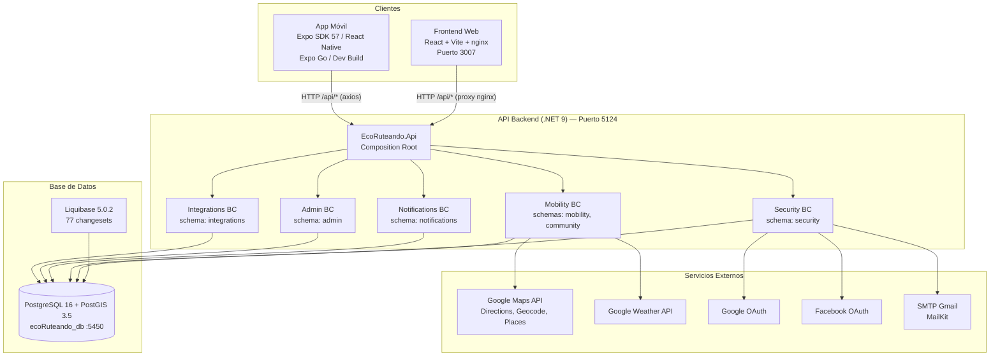
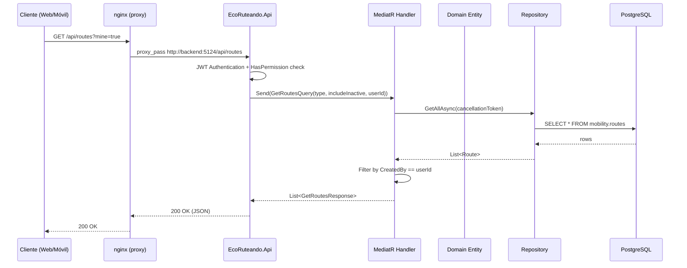

---

## 1. Introducción y propósito

Este manual técnico describe la arquitectura, configuración, instalación, ejecución y mantenimiento de **EcoRuteando**, una plataforma de movilidad ecológica que permite planificar rutas sostenibles, estimar impacto ambiental, reportar obstáculos y recibir alertas climáticas.

El documento está dirigido a desarrolladores que se incorporen al proyecto y necesiten comprender, instalar, ejecutar, validar y mantener el sistema sin depender de explicaciones verbales del equipo.

### 1.1 Convención de evidencia

A lo largo del manual se distingue entre:

| Etiqueta | Significado |
|----------|-------------|
| **Verificado** | Respaldado directamente por código fuente o configuración revisada |
| **Inferido** | Deducido de evidencias indirectas, no confirmado directamente |
| **Pendiente** | Requiere información adicional o validación manual |

---

## 2. Alcance del sistema

EcoRuteando comprende cuatro componentes distribuidos en cuatro repositorios:

| Componente | Repositorio | Tecnología | Rol |
|-----------|------------|-----------|-----|
| **API Backend** | `EcoRuteandoBackend` | .NET 9 (C#) | API REST — módulos Security, Mobility, Notifications, Admin, Integrations |
| **Frontend Web** | `EcoRuteando/front-end/ecoRuteando-react` | React 18 + Vite 8 | Aplicación web SPA (usuario y administrador) |
| **App Móvil** | `Movil-EcoRuteando` | Expo SDK 57 / React Native 0.86 | Aplicación móvil Android/iOS/Web |
| **Base de Datos** | `EcoRuteandoDb` | PostgreSQL 16 + PostGIS 3.5 + Liquibase | Esquema, migraciones y datos semilla |

El repositorio `EcoRuteando` (raíz) contiene además el `docker-compose.yml` principal que orquesta el stack completo local.

### 2.1 Fuera de alcance

- Infraestructura de monitoreo (APM, alerting)
- Pipeline CI/CD para backend y móvil (no existe)
- Publicación en tiendas de aplicaciones (configuración `submit` vacía en `eas.json`)

---

## 3. Descripción general de la solución

EcoRuteando es una plataforma de movilidad sostenible orientada a la ciudad de **Neiva, Colombia** (coordenadas por defecto: 2.9273, −75.2819). Permite a los usuarios:

- Planificar rutas a pie, en carro, en bicicleta o transporte público usando Google Maps
- Estimar ahorro de CO₂ y calorías quemadas
- Guardar rutas y marcar favoritas
- Calificar rutas y compartirlas
- Reportar obstáculos en el mapa con foto y GPS
- Recibir alertas climáticas basadas en ubicación
- Consultar historial de viajes y estadísticas personales
- Administrar usuarios, reportes, exportes y configuración del sistema (rol Admin)

### 3.1 Actores del sistema

| Actor | Descripción |
|-------|------------|
| **Usuario registrado** | Se autentica con email/contraseña u OAuth (Google), planifica rutas, guarda favoritos, reporta obstáculos |
| **Usuario invitado** | Accede en modo invitado sin autenticación; puede planificar rutas pero no guardar datos |
| **Administrador** | Gestiona usuarios, modera reportes, revisa estadísticas, administra exportes y configuración |
| **Sistema** | Genera notificaciones, ejecuta limpieza de tokens expirados, integra datos meteorológicos |

---

## 4. Arquitectura de software

### 4.1 Fundamentos de DDD (Domain-Driven Design)

EcoRuteando aplica **Domain-Driven Design** con **Clean Architecture** en el backend .NET. Esta sección describe cómo se reflejan los principios de DDD en el código fuente real.

#### 4.1.1 Bounded Contexts (Contextos acotados)

El sistema se divide en **5 bounded contexts** independientes, cada uno con su propio esquema de base de datos, sus entidades, sus repositorios y sus reglas de negocio:

| Bounded Context | Esquema BD | Responsabilidad |
|----------------|-----------|----------------|
| **Security** | `security` | Autenticación, autorización, usuarios, roles, permisos, sesiones, 2FA, OAuth, auditoría |
| **Mobility** | `mobility` + `community` | Rutas, POIs, viajes, favoritos, calificaciones, reportes de obstáculos, estadísticas |
| **Notifications** | `notifications` | Notificaciones in-app, push, plantillas, tokens de dispositivo |
| **Admin** | `admin` | Estadísticas consolidadas, exportes, configuración del sistema, soporte, factores de transporte |
| **Integrations** | `integrations` | Caché de APIs externas, datos meteorológicos, calidad del aire |

**Verificado:** Los módulos **nunca se referencian entre sí**. No existe ningún `using EcoRuteando.Modules.<Otro>` en todo el código fuente. Cada contexto posee su propio `DbContext` de EF Core con tabla de historial de migraciones independiente.

#### 4.1.2 Entidades y raíces de agregado

**Clase base compartida** (`src/Shared/EcoRuteando.Shared/BaseClasses/Entity.cs`):

```csharp
public abstract class Entity<TId>
{
    public TId Id { get; protected set; }
    public DateTime CreatedAt { get; protected set; }
    public DateTime? UpdatedAt { get; protected set; }
    // Igualdad basada en identidad (Id)
}
```

**Raíces de agregado identificadas** (entidades que gestionan sus propios hijos):

| Raíz | Contexto | Colección de hijos | Invariante gestionado |
|------|---------|-------------------|----------------------|
| `User` | Security | `UserRoles`, `RefreshTokens` | Escalación de bloqueo de cuenta (`LockoutEscalationSeconds = {30, 60, 300, 900}`) |
| `Route` | Mobility | `RoutePois` | `AddPoi()` rechaza POIs duplicados |
| `RouteUsage` | Mobility | — | `Complete()` impide finalizar dos veces; `EndedAt >= StartedAt` |
| `SupportTicket` | Admin | `Messages` | `AddMessage()` encapsula la lista `_messages` |
| `ObstacleReport` | Mobility | `ReportVotes` | `Validate()` impide autvalidación |

**Entidades con estado encapsulado** (máquinas de estado en el dominio):

- `RefreshToken`: `Revoke()` / `IsActive`
- `Session`: `Revoke()`
- `TwoFactorAuth`: `Enable()` / `Disable()` / `UpdateSecret()`
- `EmailVerification`: `MarkAsVerified()` / `UpdateToken()`
- `AdminExport`: `Create()` / `Complete()` / `Fail()`

#### 4.1.3 Lo que NO está implementado en DDD

**Verificado** mediante investigación del código fuente:

| Patrón DDD | Estado | Evidencia |
|-----------|--------|-----------|
| Value Objects | **No implementado** | No hay records con igualdad estructural ni clases con `Equals` sobrescrito. Las ubicaciones usan tipos `NetTopologySuite` (Point, LineString) directamente en el dominio. `string Status`, `string PreferredLanguage` son primitivos. |
| Domain Events | **No implementado** | Cero coincidencias de `DomainEvent`, `IDomainEvent`, `RaiseEvent` en todo `src/`. Existe una carpeta `Events/` vacía en `EcoRuteando.Shared.csproj` como placeholder. |
| Specification Pattern | **No implementado** | El filtrado vive en métodos de repositorio (`GetActiveAsync`, `GetForValidationAsync`). |
| Domain Services | **No implementados** | No existen clases `*DomainService`. Toda coordinación está en Application handlers. |
| Event Sourcing | **No implementado** | Sin outbox, sin event store. |

> **Nota para el manual:** La ausencia de Value Objects se manifiesta como *primitive obsession* — campos como `Status = "active"` o `PrimaryColor = "#1ABC9C"` (validado por regex en `User.Update`) son strings en lugar de tipos de valor con invariantes.

#### 4.1.4 Aislamiento entre Bounded Contexts

Los contextos se comunican **únicamente a través de la base de datos y la API**, nunca por referencia directa:

- `User.Id` aparece como `Guid` (sin navegación) en Mobility, Notifications, Admin
- `TransportFactor` está **duplicado** en Admin y Mobility (con enums `TransportType` separados)
- `SystemConfiguration` (Admin) y `SecurityPolicy` (Security) son singletons independientes

Esto constituye una forma de **duplicated-model separation** en lugar de un Anti-Corruption Layer formal.

### 4.2 Aplicación de Clean Architecture

#### 4.2.1 Capas por módulo

Cada bounded context implementa **Clean Architecture** con 4 capas:

```
┌─────────────────────────────────────────────────────────┐
│                    EcoRuteando.Api                       │
│              (Composition Root / Host)                   │
│         Registra Infrastructure + Presentation           │
└──────────────────────┬──────────────────────────────────┘
                       │ referencia
┌──────────────────────▼──────────────────────────────────┐
│                   Presentation                           │
│  Controllers, Request Contracts                          │
│  Referencia: solo Application                            │
└──────────────────────┬──────────────────────────────────┘
                       │ referencia
┌──────────────────────▼──────────────────────────────────┐
│                    Application                           │
│  Commands, Queries, Handlers, Validators                 │
│  Abstractions (interfaces de infraestructura)            │
│  Referencia: Domain + Shared                             │
└──────────────────────┬──────────────────────────────────┘
                       │ referencia
┌──────────────────────▼──────────────────────────────────┐
│                      Domain                              │
│  Entities, Enums, Repository Interfaces                  │
│  Referencia: solo Shared                                 │
└─────────────────────────────────────────────────────────┘

┌─────────────────────────────────────────────────────────┐
│                  Infrastructure                          │
│  EF Core DbContext, Configurations, Repositories         │
│  External Services (Google, SMTP, OAuth)                 │
│  Referencia: Application + Domain + Shared               │
└─────────────────────────────────────────────────────────┘
```

#### 4.2.2 Dirección de las dependencias (verificada en .csproj)

| Capa | Referencia a | NuGet notable |
|------|-------------|---------------|
| **Domain** | Solo `Shared` | Npgsql (para `[PgName]`), NetTopologySuite (Mobility/Integrations) |
| **Application** | Domain + Shared | MediatR 14.1.0, FluentValidation 11.11.0 |
| **Infrastructure** | Application + Domain + Shared | EF Core 9.0, Npgsql EF, BCrypt, MailKit, JWT |
| **Presentation** | Solo Application | FrameworkReference AspNetCore.App |
| **Api** | Infrastructure + Presentation (de todos los módulos) | JWT Bearer, Serilog (referenciado sin usar), Swashbuckle |

**Verificado:** La dirección Presentation → Application → Domain es correcta en los `.csproj`. Presentation nunca referencia Infrastructure directamente.

**Hallazgo:** 7 controllers hacen `using ...Domain.Enums` para parsear enums de query strings — un menor debilitamiento de la frontera.

#### 4.2.3 Shared Kernel (`EcoRuteando.Shared`)

El kernel compartido es mínimo (10 archivos):

| Componente | Contenido |
|-----------|-----------|
| `BaseClasses/Entity.cs` | Clase base genérica de entidades |
| `Abstractions/Persistence/` | `IUnitOfWork`, `ISecurityUnitOfWork`, `IMobilityUnitOfWork` |
| `Exceptions/` | `DomainException`, `NotFoundException`, `ConflictException`, `ForbiddenException`, `UnauthorizedException` |
| `Authorization/` | `HasPermissionAttribute`, `PermissionRequirement`, `PermissionPolicyProvider` |

**No se comparten:** enums, entidades, DTOs, interfaces de repositorio — cada BC los posee exclusivamente.

### 4.3 Implementación de CQRS con MediatR

#### 4.3.1 Patrón de carpetas (Vertical Slice)

```
Application/
├── Routes/                          # Feature
│   ├── Commands/                    # Escrituras
│   │   ├── CreateRoute/
│   │   │   ├── CreateRouteCommand.cs        # record : IRequest<Guid>
│   │   │   ├── CreateRouteCommandHandler.cs # IRequestHandler<...>
│   │   │   └── CreateRouteCommandValidator.cs # AbstractValidator
│   │   ├── UpdateRoute/
│   │   └── DeleteRoute/
│   └── Queries/                     # Lecturas
│       ├── GetRoutes/
│       │   ├── GetRoutesQuery.cs            # record : IRequest<IReadOnlyList<...>>
│       │   ├── GetRoutesQueryHandler.cs
│       │   └── GetRoutesResponse.cs         # DTO
│       └── GetRouteById/
└── ...
```

#### 4.3.2 Inventario CQRS

| Métrica | Cantidad |
|---------|---------|
| Command records | 67 |
| Query records | 47 |
| Response/DTO records | 48 |
| Validators FluentValidation | 24 |

#### 4.3.3 Pipeline Behaviors

`ValidationBehavior<TRequest, TResponse>` está registrado en los módulos **Security** y **Mobility**. Los módulos **Admin, Notifications e Integrations** registran MediatR pero **no** el pipeline de validación — sus handlers hacen validaciones manuales con `ArgumentException`.

### 4.4 Unit of Work

Patrón **DbContext-as-UoW**:

```csharp
// Security: SecurityDbContext implementa ISecurityUnitOfWork
services.AddScoped<ISecurityUnitOfWork>(sp => sp.GetRequiredService<SecurityDbContext>());
```

**Implementado en:** Security, Mobility
**NO implementado en:** Admin, Notifications, Integrations — sus `DbContext` son clases `: DbContext` planas sin `IUnitOfWork`.

No existe gestión transaccional (`BeginTransaction`) en ningún módulo.

### 4.5 Diagrama de arquitectura general



### 4.6 Flujo de solicitud



### 4.7 Integración con PostgreSQL, PostGIS y Liquibase

- **Una sola BD** `ecoRuteando_db` con **6 esquemas** PostgreSQL
- **PostGIS** habilitado para columnas `GEOGRAPHY(POINT/LINESTRING, 4326)`
- **Liquibase** gestiona el esquema completo: **77 changesets** en `changelog/db.changelog-master.yaml`
- **EF Core Migrations** existe solo para Security (`InitialCreate`) — el esquema real es gestionado por Liquibase
- Cada módulo tiene su propia tabla `__EFMigrationsHistory` en su esquema

### 4.8 Comunicación entre componentes

| Origen | Destino | Protocolo | Mecanismo |
|--------|---------|-----------|-----------|
| Frontend Web | Backend | HTTP/REST | nginx proxy `/api/` → `backend:5124` |
| App Móvil | Backend | HTTP/REST | axios con `baseURL = EXPO_PUBLIC_API_URL` |
| Backend | PostgreSQL | TCP 5432 | Npgsql / EF Core |
| Liquibase | PostgreSQL | TCP 5432 | JDBC (contenedor one-shot) |
| Backend | Google Maps/Weather | HTTPS | HttpClient con API key |
| Backend | SMTP Gmail | TCP 587 | MailKit (StartTLS) |

**No existe comunicación directa entre Frontend y App Móvil.** No hay WebSockets, gRPC ni message broker.
